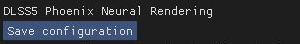
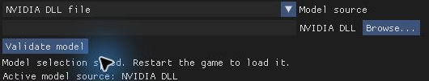
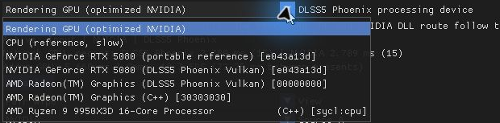
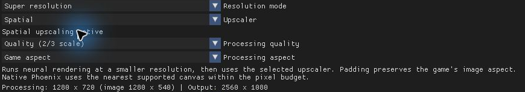
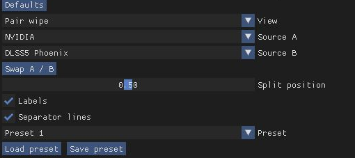
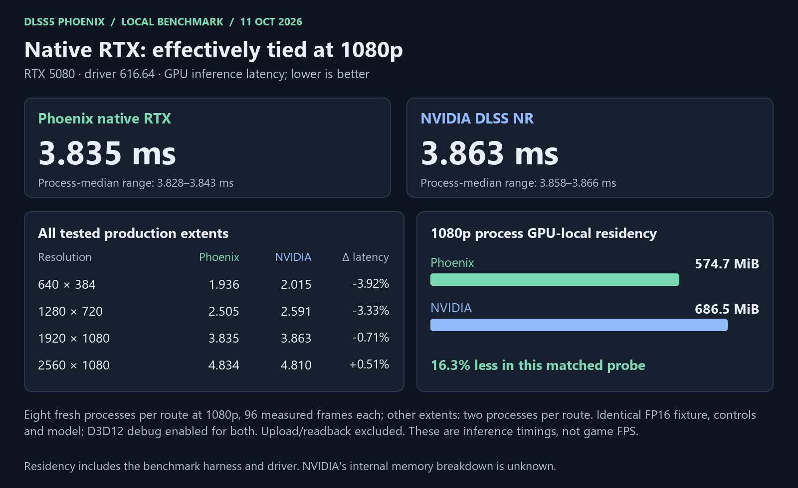
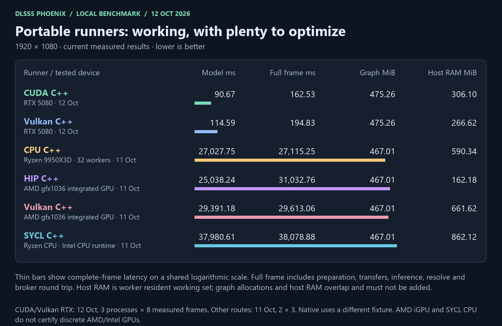
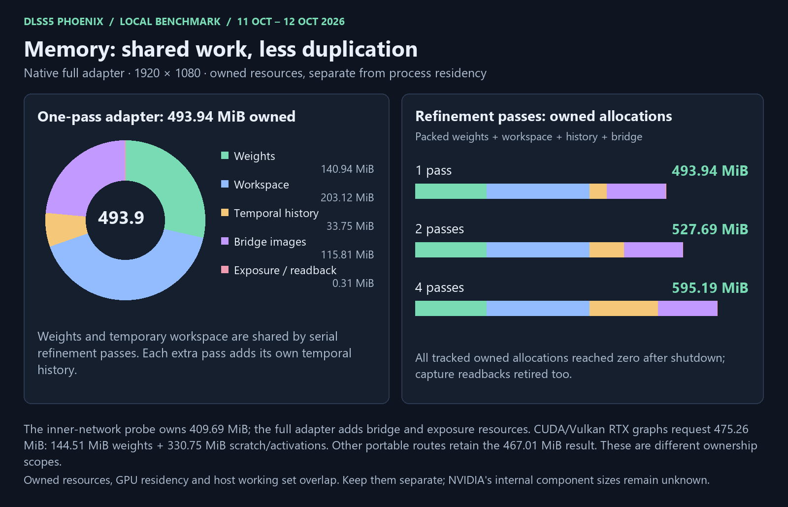
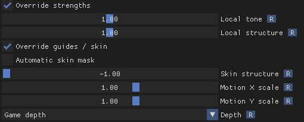
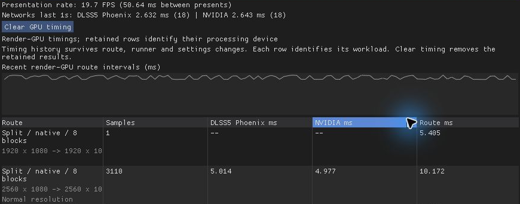

# DLSS5 Phoenix

My attempt at a cross-backend runner for NVIDIA DLSS 5 neural rendering,
packaged as a ReShade addon.

I dislike how much of the software we add to our games is closed source. We
rush for the best experience, often giving code access to our systems without
being able to inspect what it does—or what that means for our privacy. I'd
rather let you look under the hood. Better pixels shouldn't require blind trust.

## A quick look

- **Pick your runner and GPU:** native RTX, CUDA, Vulkan, HIP, CPU or SYCL.
- **Bring a compatible model:** browse to a DLL or model folder and validate it.
- **Choose resolution and upscaling:** Normal or Super resolution, aspect controls,
  spatial reconstruction, NVIDIA DLSS SR or Intel XeSS.
- **Let the network adapt:** automatically reduce or restore Phoenix transformer
  blocks to target game FPS or a GPU-time budget (experimental).
- **Make it your own:** tone, structure, skin controls and adjustable neural work.
- **Compare as you go:** split/difference views and timing history across backends.
- **Keep it practical:** CPU thread limits, presets and Save configuration at the top.

Runner and upscaler availability depends on your hardware and installed runtimes.
The current performance results and limitations are below.

**Save without the scroll.** Configuration stays one button away.



**Your model, your runner.** Browse and validate a compatible model; choose an
available processing device.





**Control the pixels.** Choose the processing resolution, upscaler and aspect.



**See the difference.** Pick two sources, move the split and save a preset.



These are cropped screenshots of the addon running in Resident Evil Requiem.
Available devices vary by machine; the screenshots illustrate controls, not
benchmark results.

[Appearance and timing controls](#what-you-can-play-with) ·
[Measured performance](#benchmarks-the-good-the-slow-and-the-vram) ·
[Build instructions](#build-from-source)

## Why I'm making this

- **Credit where it's due:** NVIDIA built something impressive. Their model,
  Tensor Cores and native execution set a very high bar; optimized RTX is easily
  this project's strongest path today. The goal is to explore that technology
  across more runners and expose useful controls.
- **Why bother?** I know DLSS 5 hasn't exactly won a popularity contest. I'm
  optimistic about [NVIDIA's approach to neural rendering](https://www.nvidia.com/en-us/geforce/news/dlss-5-3d-guided-neural-rendering/):
  my bet is that convincing real-time realism needs more than endlessly larger
  meshes, textures and rendering budgets. Asking every ordinary studio to build
  movie-quality assets and lighting consistently is a formidable bill.
  Artist-directed neural rendering looks like a promising way forward.
- **More artistic choice would be lovely.** I'd like people to train compatible
  models for their own looks: cartoons, painterly worlds, or something less
  interested in counting pores. Phoenix already supports selecting a compatible
  model from disk. There is **no trainer or alternative trained model included**;
  replacement weights must fit the supported architecture and layout.
- **A very personal hardware opinion:** after the GPU price hikes, the RTX 5080
  is the only card I'd currently consider reasonably priced for the high-end
  gaming I want. “Reasonable” is doing heroic work in that sentence.

## Benchmarks: the good, the slow, and the VRAM



- **Native RTX is doing well:** at 1920×1080, Phoenix measured **3.835 ms** versus
  **3.863 ms** for NVIDIA DLSS NR. That's effectively parity, with a 0.71% lower
  median latency in this test—not a promised game-FPS gain. NVIDIA was slightly
  faster at 2560×1080; Phoenix was faster at the two smaller tested extents.
- **Memory is encouraging:** the matched 1080p probe measured **574.7 MiB** of
  process GPU-local residency for Phoenix versus **686.5 MiB** for NVIDIA,
  about **16.3% less**. This includes harness/driver resources; NVIDIA's internal
  allocation breakdown is unknown. Saving VRAM matters when apparently even
  spare megabytes need a financing plan.
- **Portable speed still needs work:** on the RTX 5080, CUDA measures **90.67 ms**
  for the model and **162.53 ms** for the complete frame; Vulkan measures
  **114.59 ms** and **194.83 ms**. Both graphs allocate **475.26 MiB**, with
  worker resident RAM of **306.10 MiB** and **266.62 MiB**, respectively.
  CPU, SYCL CPU and AMD iGPU routes still take tens of seconds. These are
  development/reference paths today. Native and portable fixtures and timing
  boundaries differ, so a direct speedup ratio would be misleading.





- **Test machine:** RTX 5080, NVIDIA driver 616.64; Ryzen 9 9950X3D, 16 cores /
  32 threads; 96 GiB installed RAM; AMD Radeon gfx1036 integrated graphics.
- **Coverage:** native/NVIDIA and unchanged portable timings are dated
  **11 October 2026**. CUDA/Vulkan RTX timings are dated **12 October**:
  three fresh processes per route, ten frames each, discarding the first two;
  fractional-motion history, eight global blocks and one pass. Results are
  medians of process medians. The native 1080p comparison uses eight fresh
  processes per route. All six current routes passed **42 saved regression
  frames**; the new GPU paths also matched **120 temporal frame hashes**.
  These are standalone inference/broker measurements, not in-game FPS.
- [Measurement definitions, results and reproduction notes](docs/benchmarks/2026-10-12/README.md)
  · [Memory ownership details](MEMORY_USAGE.md)

## What you can play with

**Tune the look.** Tone, structure, skin and guide controls, without leaving the game.



**Keep your comparisons.** Timing rows survive backend and settings changes.



The values above are from the screenshot session, not the controlled benchmark.

- **Choose the runner:** native RTX, CUDA, Vulkan, HIP, CPU or SYCL, subject to
  the installed provider and device capabilities. Compiled runners need no
  Python or Torch at runtime. The native bundle currently targets **`sm_120`**;
  this is not a claim of support for every RTX generation.
- **Choose the processing device:** use the game GPU or select another available
  device for a portable runner. In principle, one GPU can render the game while
  another runs neural rendering—the same division of work used in
  [NVIDIA's early two-GPU showcase](https://allthings.how/dlss-5-requires-just-one-rtx-gpu-the-dual-5090-demo-was-a-tech-showcase/).
  Phoenix has an experimental offload path; real dual-discrete-GPU performance
  is unverified, and transfer cost/result age matter. The NVIDIA DLL route stays
  on the game's rendering GPU.
- **Choose the model source:** browse to a supported NVIDIA DLL or compatible
  model folder, then validate loading and a small inference run. Models and the
  NVIDIA DLL are supplied separately.
- **Choose resolution and upscaling:** Normal or reduced-resolution neural
  rendering with processing quality and aspect controls. Upscaling choices are
  built-in spatial reconstruction, NVIDIA DLSS Super Resolution and Intel XeSS,
  for both Phoenix and NVIDIA NR output. Temporal upscalers run on the game GPU
  and require valid depth/motion guides and separately supplied vendor runtimes.
  Unsupported configurations show a spatial fallback. Gameplay quality is
  still unverified; XeSS has been exercised on NVIDIA, not Intel hardware.
- **Tune the look:** local tone and structure, skin masking, motion/depth guides,
  and route-specific NVIDIA intensity/style/exposure controls.
- **Scale neural work dynamically:** enable **Enable approximate network** and
  **Adaptive blocks**, then choose **DLSS5 Phoenix GPU time** or **Desired game
  FPS**. Phoenix reduces the number of executed transformer blocks under load
  and restores them as performance allows, within your minimum and maximum.
  Time-budget mode uses measured inference GPU time; FPS mode uses the game's
  presentation rate. Reduced depth trades image quality for speed and is an
  experimental approximation. A target is not a contract with physics.
- **Tune the workload manually:** experiment with transformer-block repetitions
  and refinement passes to explore the quality/performance tradeoff.
- **Compare before committing:** split-screen and difference views, swappable
  sources, presets, history resets and timing diagnostics.
- **Keep the practical bits practical:** automatic CPU worker count or a manual
  limit, visible model-loading errors, and a Save configuration button at the top.
- **Keep installation compact:** runner libraries and kernels can be embedded
  in one addon; they unpack to a private runtime cache as needed. The NVIDIA
  model DLL stays separate.

## Help wanted

- Sorry, discrete Radeon and Intel GPU owners: I don't have those cards to test.
  AMD HIP/Vulkan passed on the integrated Radeon, and SYCL was tested on the
  Ryzen CPU through Intel's CPU runtime. **Neither establishes discrete AMD or
  Intel GPU compatibility or performance.** The portable paths are intended to
  work on devices with the required capabilities; hardware testing is welcome.
- Contributions are welcome: faster portable kernels, AMD/Intel hardware
  results, dual-GPU testing, compatible model experiments, bug reports and docs.
  Please include hardware, driver, resolution, settings and reproducible results.
- This is an independent experimental project, unaffiliated with NVIDIA.
  NVIDIA deserves the credit for DLSS and its models.

## Build from source

The commands below build and validate the addon. For optional routes, use the
[dependency guide](third_party/EXTERNAL_DEPENDENCIES.md) and [detailed build notes](BUILDING.md).

### Requirements

Run the commands below in PowerShell from the repository root. Replace the
example SDK and model paths with your local paths.

| Requirement | Used for |
| --- | --- |
| Windows x64 | Building and running the Windows targets |
| [Python 3.11+](https://www.python.org/downloads/windows/) | Build scripts and automated tests |
| [Visual Studio C++ x64 Build Tools](https://visualstudio.microsoft.com/downloads/) and [Windows SDK](https://developer.microsoft.com/en-us/windows/downloads/windows-sdk/) 10.0.26100 or newer | C++ compilation, linking, GPU upload declarations and Windows resource compilation |
| [NVIDIA NGX / DLSS SDK headers](https://github.com/NVIDIA/DLSS), supplied separately | Addon and native validation tools; `--ngx-sdk` must contain `nvsdk_ngx.h`, `nvsdk_ngx_defs.h` and `nvsdk_ngx_params.h` |
| [CUDA Toolkit 13.1](https://developer.nvidia.com/cuda-toolkit-archive), as tested locally | Native RTX kernels and the optional portable CUDA target |
| Python 3.12+ and [NumPy 2.5.2](https://pypi.org/project/numpy/2.5.2/) | Offline synthetic fixture generation for release validation |
| Pinned model DLL, supplied separately | Saved inference regression checks require the exact digest shown below |

Install the **Desktop development with C++** workload, including the x64 compiler
and Windows SDK. The build scripts locate Visual Studio through `vswhere` and
initialize its compiler environment automatically.

Native kernels currently target **`sm_120`**. Running the native validation steps
requires compatible NVIDIA hardware; the tested GPU is an RTX 5080. Compiling
the addon and its CPU/WARP tests does not require a model or physical NVIDIA GPU.

HIP, SYCL and Vulkan have additional optional dependencies. See
[external dependencies and tested versions](third_party/EXTERNAL_DEPENDENCIES.md)
for installation links, SDK layouts and matching runtime libraries. Third-party
source notices are listed in [THIRD_PARTY.md](THIRD_PARTY.md).

- Optional GPU tools: [ROCm / HIP](https://github.com/ROCm/TheRock/blob/main/RELEASES.md),
  [Intel LLVM / DPC++](https://github.com/intel/llvm/blob/sycl/sycl/doc/Releases.md),
  [Vulkan SDK](https://vulkan.lunarg.com/sdk/home).
- Running in a game: [ReShade with addon support](https://reshade.me/) and the
  [Microsoft Visual C++ x64 runtime](https://learn.microsoft.com/en-us/cpp/windows/latest-supported-vc-redist).

Python and NumPy are development tools; the compiled addon and runners do not
require Python, NumPy or Torch at runtime.

Measured memory ownership, process-memory definitions and the refinement/capture
regression scope are documented in [MEMORY_USAGE.md](MEMORY_USAGE.md).

### Compile the addon

```powershell
python tools/build_addon.py addon_release --ngx-sdk C:\SDK\NGX\include --production-only
```

Output: **`build/addon_release/phoenix.addon64`**.

The builder runs 11 C++ test suites and two software D3D12 WARP suites before
compiling the addon. `--production-only` explicitly selects the release target.
The default also selects only that target when diagnostic addon source is absent.

This command builds the addon without embedding a runtime package. For a complete
embedded build, continue through the following sections.

### Build the kernels and runners

Build the selected native kernels with an explicit CUDA compiler path:

```powershell
python tools/production_build_native_kernels.py native_release --compiler "C:\Program Files\NVIDIA GPU Computing Toolkit\CUDA\v13.1\bin\nvcc.exe" --jobs 4
```

Output: **`build/native_release/`**, containing 41 compiled kernels, their graph
and build manifest. PTX, cubins and other generated files stay under `build/`.
No pre-existing compiled kernels or extracted model files are required to compile.

Build the core runtime, CPU runner and validation helpers:

```powershell
python tools/build_portable_cpp.py runners_release --only cpu runtime broker runner device_query d3d12_transport runtime_contracts client_contracts
& ./build/runners_release/phoenix_cpp_runtime_contracts.exe
python tools/build_validation_tools.py validation_tools --ngx-sdk C:\SDK\NGX\include
```

Outputs are under **`build/runners_release/`** and **`build/validation_tools/`**.
This example includes the portable CPU route. Add other routes before packaging
if they are required in the final addon:

| Additional target in `--only` | Additional arguments / requirements |
| --- | --- |
| `cuda` | `--cuda-compiler PATH_TO_NVCC --cuda-arch sm_120` |
| `hip` | `--hip-sdk SDK_CORE_DIRECTORY --hip-arch TARGET_ARCHITECTURE` |
| `sycl` | `--sycl-compiler PATH_TO_CLANG_PLUS_PLUS` |
| `opencl_cpu_proxy` | Also needed when packaging the private Intel OpenCL CPU runtime |
| `vulkan_adapter vulkan_shaders` | `--vulkan-deps DIRECTORY_WITH_HEADERS_AND_GLSLANG` |

Keep the core targets in `--only` when adding optional targets. The final package
contains only the targets you built and the dependencies you explicitly supply.

### Validate and package

Compilation and inference validation are separate steps. Embedding requires a
validated portable runtime package and a validated native kernel bundle.

Install the offline fixture dependency using Python 3.12 or newer:

```powershell
python -m pip install numpy==2.5.2
```

Create **`build/weight_source.json`** with an absolute path to your separately
obtained model DLL. The checked-in regression data uses this exact DLL digest:

```json
{
  "kind": "nvidia_dll",
  "path": "C:/Models/nvngx_dlssnr.dll",
  "sha256": "e16bcf15e16e13f527491cdf7845b2fe6521a738d8f7c9c721866a8496e1fc8e"
}
```

The saved regression checks require the matching DLL; changing the digest alone
does not make a different model compatible with those reference outputs.
Check your DLL before creating the configuration; a newer game's DLL may differ:

```powershell
$modelPath = 'C:\Models\nvngx_dlssnr.dll'
$expectedDigest = 'e16bcf15e16e13f527491cdf7845b2fe6521a738d8f7c9c721866a8496e1fc8e'
if ((Get-FileHash -LiteralPath $modelPath -Algorithm SHA256).Hash.ToLowerInvariant() -ne $expectedDigest) {
    throw 'The DLL does not match the saved regression model.'
}
```

For the CPU runtime package built above:

```powershell
python native_runtime/package_build.py runners_release runners_package
& ./build/runners_release/phoenix_cpp_client_contracts.exe ./build/runners_package ./build/weight_source.json ./build/client_contracts.json
python tools/prepare_validation_fixtures.py ./build/runner_inputs --runtime ./build/runners_package --weight-source ./build/weight_source.json --routes ./tests/fixtures/cpu_routes.example.json
python tools/validate_runners.py --runtime ./build/runners_package --runner ./build/runners_release/phoenix_cpp_runner.exe --jobs ./build/runner_inputs/jobs --output ./build/runner_validation
python tools/validate_native.py --bundle ./build/native_release --probe ./build/validation_tools/native_inference_probe.exe --weight-source ./build/weight_source.json --output ./build/native_validation
```

Each command must succeed before proceeding. The tools generate synthetic inputs
locally and compare outputs with saved Phoenix regression hashes. Native validation
covers all four production extents, including 1920×1080.

For optional backends, provide their vendor libraries using the package builder's
repeatable `--dependency PATH_TO_DLL` option. For SYCL CPU, also supply
`--opencl-cpu PRIVATE_ICD_DIRECTORY` and build `opencl_cpu_proxy`. Discover IDs with:

```powershell
& ./build/runners_release/phoenix_cpp_devices.exe ./build/runners_package
```

Add `private-cpu` only when that package contains the private Intel CPU ICD and
OpenCL proxy. Missing optional providers are expected when their targets were
not built. Supply the returned IDs in a local route mapping to `--routes`.
See [BUILDING.md](BUILDING.md) for route names and validation details.
Compiling an optional provider alone does not enable it in the validated package.

### Build the embedded addon

After both validations pass:

```powershell
python tools/build_addon.py addon_embedded --ngx-sdk C:\SDK\NGX\include --production-only --embed-runtime ./build/runners_package --embed-native ./build/native_release
& ./build/validation_tools/embedded_runtime_tests.exe ./build/addon_embedded/phoenix.addon64 ./build/resource_cache ./build/resource_test.json
```

Final output: **`build/addon_embedded/phoenix.addon64`**.

The runner libraries and GPU kernels are embedded in this file. The NVIDIA model
DLL remains separate. A game installation also needs compatible ReShade with
addon support and a local `Phoenix.json` configuration; see [BUILDING.md](BUILDING.md).

### Tests and source checks

```powershell
python -m unittest discover -s tests -p 'test_*.py'
python -m unittest discover -s tests -p '*tests.py'
python tools/audit_release.py --git-visible
```

For a source archive without a `.git` directory, omit `--git-visible`.

Use a **fresh output name** for each build or validation run. Builders deliberately
refuse to overwrite existing output directories. Compiler logs, test reports and
validation manifests are written alongside their generated outputs under `build/`.
The addon build report records compilation, contract tests and final artifact
verification separately. A successful linker exit alone does not complete a build.
If the output is missing or locked, inspect `report.json`, the build logs and
your security product's history. Packaging is complete only after the builder
and embedded-resource check both succeed.

## License

Original project code is licensed under [Apache 2.0](LICENSE).
Third-party components and adaptations retain their upstream terms; see
[THIRD_PARTY.md](THIRD_PARTY.md) and [NOTICE](NOTICE).
The project license does not grant rights to separately supplied NVIDIA
model DLLs, model data or vendor SDKs/runtimes.
