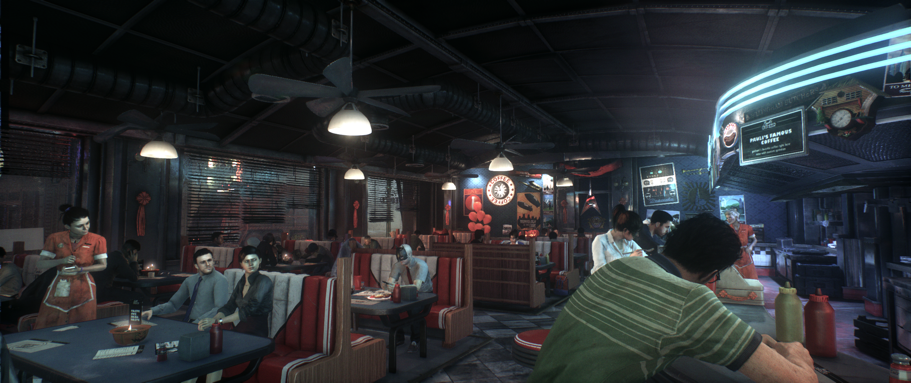
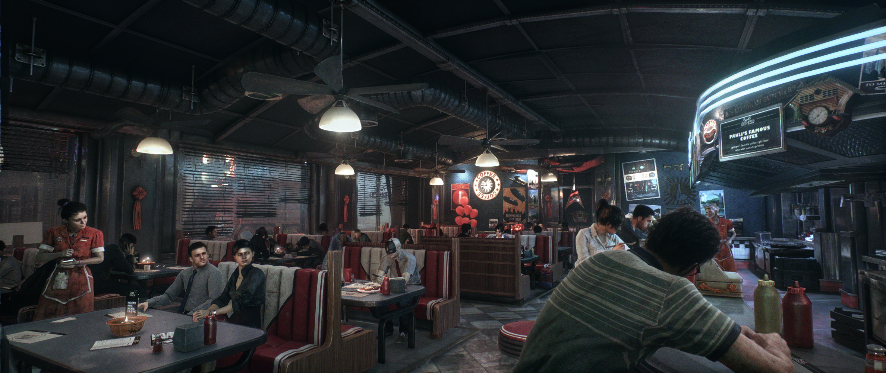
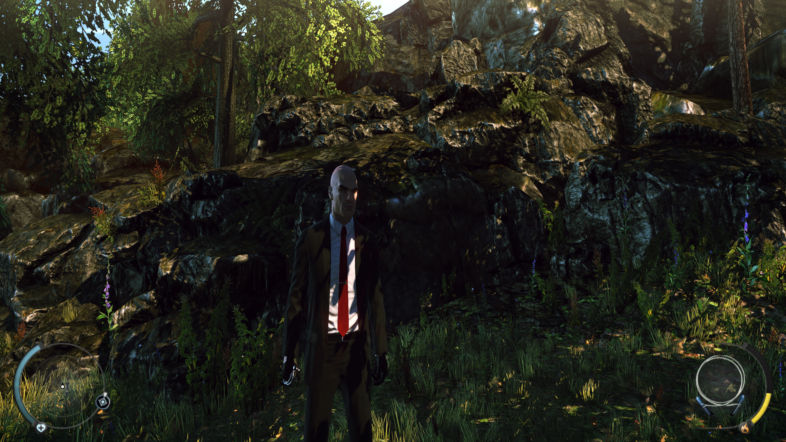
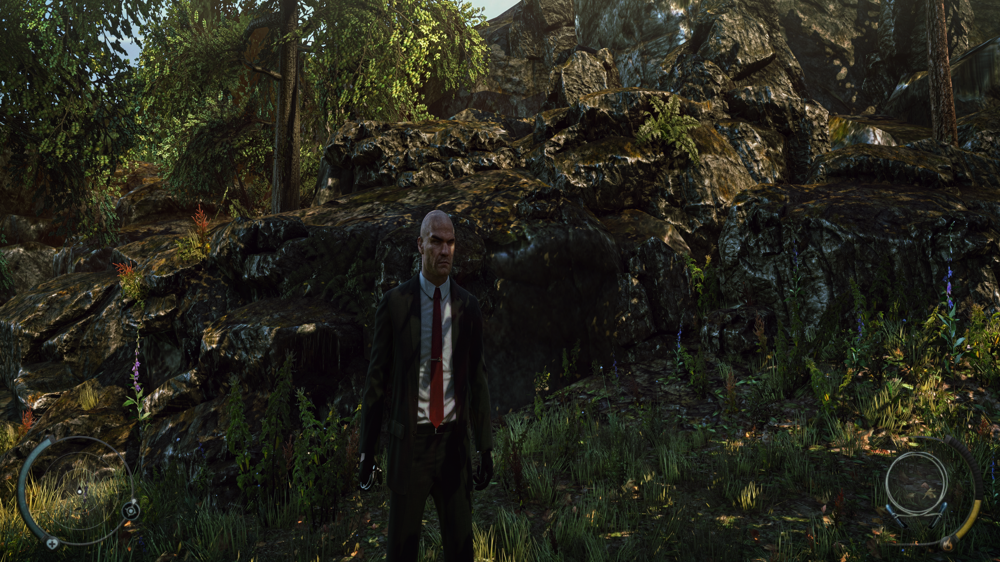
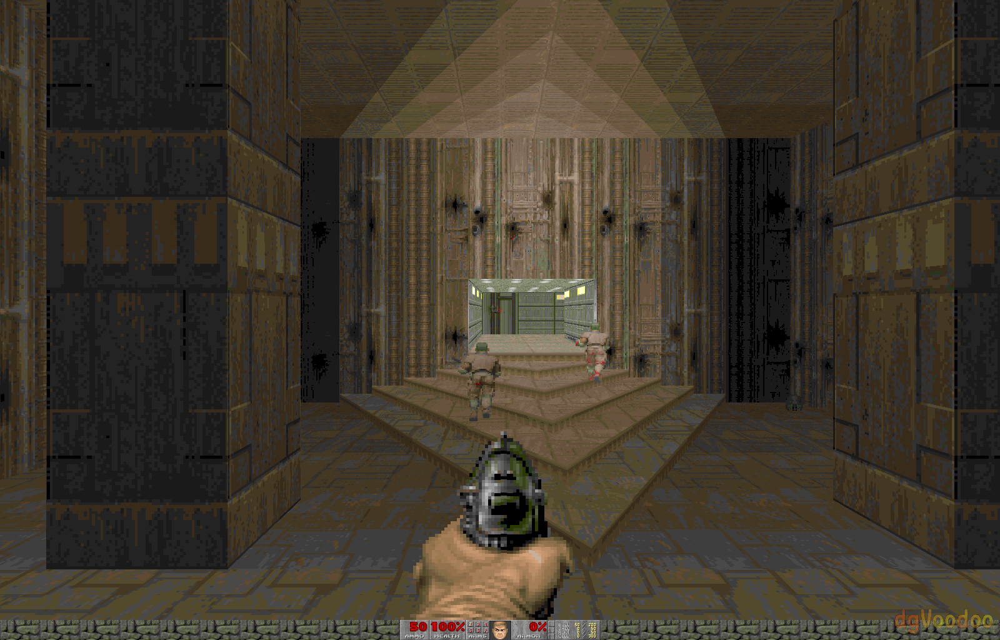
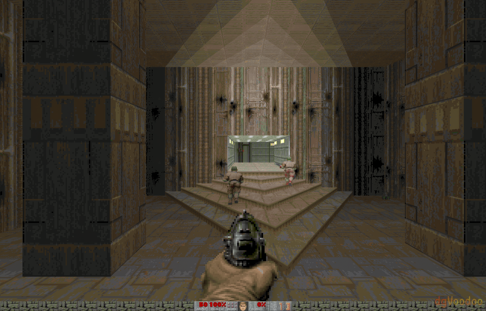

# Phoenix DLSS5

My attempt at an open-source runner for NVIDIA DLSS5 neural rendering,
packaged as a ReShade addon. **Native RTX is the main event:** fast neural
rendering, useful controls, and the freedom to look under the hood.

Tune the look, compare it with NVIDIA DLSS5, bring a compatible model, and see
what actually changes. Better pixels shouldn't require blind trust. The
alternate backends are our slightly obsessive portability side quest. Yes,
we may have taken the side quest too far.

[Download beta](https://github.com/RazvanManolache/dlss5-phoenix-addon/releases/tag/1.0-beta) ·
[Installation](docs/INSTALLATION.md) · [User guide](docs/USER_GUIDE.md) · [All documentation](docs/README.md)

<!-- current-two-model-benchmark -->
## Native RTX: the main event

**Performance on par with NVIDIA DLSS5 at 1080p on the tested RTX 5080.** Both Original and Lightweight have comparable isolated inference latency; this is not end-to-end game FPS or portable-backend performance.

| Model at 1080p | Phoenix DLSS5 GPU ms | NVIDIA DLSS5 GPU ms |
| --- | ---: | ---: |
| Original | 3.841 | 3.848 |
| Lightweight FP8 | 2.250 | 2.248 |

Measured 2026-10-30; full graphs, one pass. Small margins vary between runs; higher-resolution differences, including Original at 4K, are covered in the full report.

[Performance guide](docs/PERFORMANCE.md) · [Measurements and methodology](docs/benchmarks/current/README.md) · [1080p scaling investigation](docs/NATIVE_SCALING_PROFILE.md)
<!-- /current-two-model-benchmark -->

## See it in games

From DOOM II to Gotham: give familiar worlds another look. These are matching input/output captures from reviewed gameplay replays; click an image for the full-resolution view.

**Batman: Arkham Knight**

| Original input | Phoenix DLSS5 |
| --- | --- |
|  |  |

**Hitman: Absolution**

| Original input | Phoenix DLSS5 |
| --- | --- |
|  |  |

**DOOM II**

| Original input | Phoenix DLSS5 |
| --- | --- |
|  |  |

[Seven-game comparison gallery, routes and capture details](docs/GAME_GALLERY.md). These earlier captures illustrate the effect; they are not fresh 1.0 Beta game tests.

## Features

- **Pick the look:** Phoenix DLSS5, NVIDIA DLSS5, split views and difference views.
- **Two model sizes:** Original and Lightweight FP8, plus compatible external model sources and a shared model library.
- **Tune live:** tone, structure, skin, masks, intensity and appearance styles.
- **32-bit and 64-bit games:** automatic execution choices with an x64 helper when needed.
- **Broad capture integration:** D3D9/10/11/12, OpenGL and Vulkan, with route-specific requirements.
- **Build a processing chain:** scaling, color, optional multiscale fusion and motion estimation where supported.
- **Keep comparisons honest:** matching original/modified screenshots, timing history and execution diagnostics.
- **Use it beyond ReShade:** a native SDK and file/framed-stream interfaces.

[Full feature catalog](docs/FEATURES.md) · [Controls and screenshots](docs/USER_GUIDE.md)

**Older RTX kernels exist; older-card validation is still needed.** RTX 20/30/40 paths
are experimental. My NVIDIA hardware testing is on an RTX 5080. Portable CUDA,
Vulkan, HIP, CPU, SYCL and Metal routes have separate limits and performance.
[Compatibility and tested hardware](docs/COMPATIBILITY.md).

## Get started

1. [Choose and install the package](docs/INSTALLATION.md) with full-addon-support ReShade.
2. Select a separately supplied compatible model in Setup.
3. Start with Automatic execution, compare the result, then [tune the look](docs/USER_GUIDE.md).

## Read more

| What you need | Guide |
| --- | --- |
| Installation, package choice and updates | [Installation](docs/INSTALLATION.md) |
| Game screenshots and processing routes | [Gameplay comparison gallery](docs/GAME_GALLERY.md) |
| Features, controls and overlay screenshots | [Feature catalog](docs/FEATURES.md) · [User guide](docs/USER_GUIDE.md) |
| x86, GPU generations, graphics APIs and execution routes | [Compatibility](docs/COMPATIBILITY.md) · [Support matrix](docs/SUPPORT.md) |
| Performance, memory, scaling and historical studies | [Performance guide](docs/PERFORMANCE.md) |
| Build, package or integrate Phoenix DLSS5 | [Developer recipes](docs/DEVELOPMENT.md) · [Native SDK](docs/LIBRARY.md) |
| Motivation, contributions and upstream thanks | [About the project](docs/PROJECT.md) · [Credit ledger](docs/UPSTREAM_CREDITS.md) |

## License

Original project code is [Apache 2.0](LICENSE). Third-party components retain their
own terms: [THIRD_PARTY.md](THIRD_PARTY.md) · [NOTICE](NOTICE). Separately supplied
NVIDIA models and runtimes retain their own licenses.
