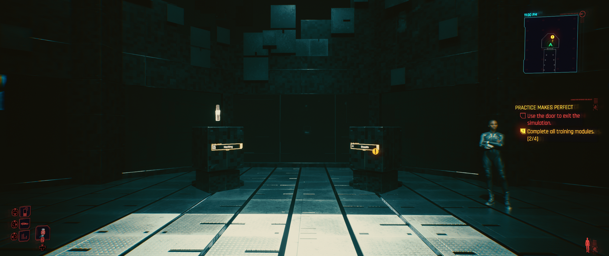
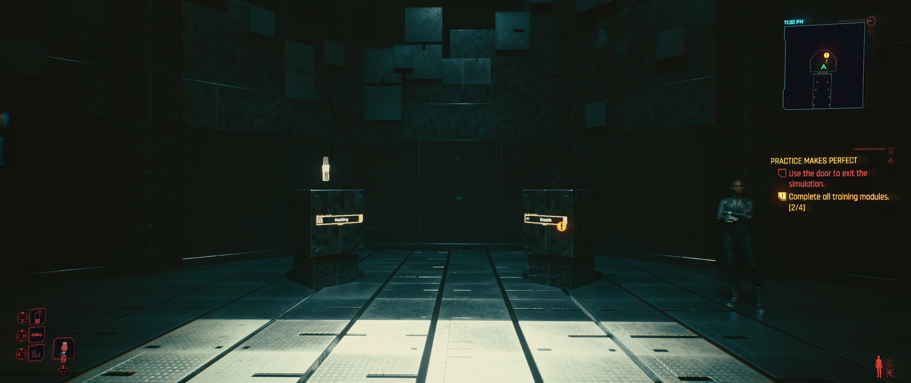
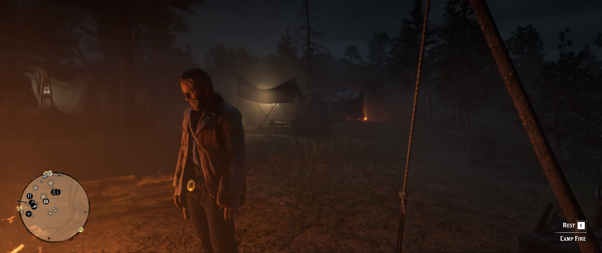
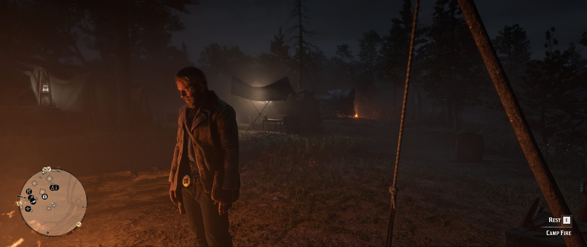
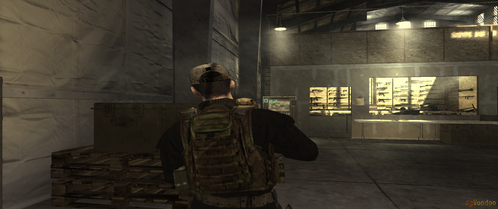
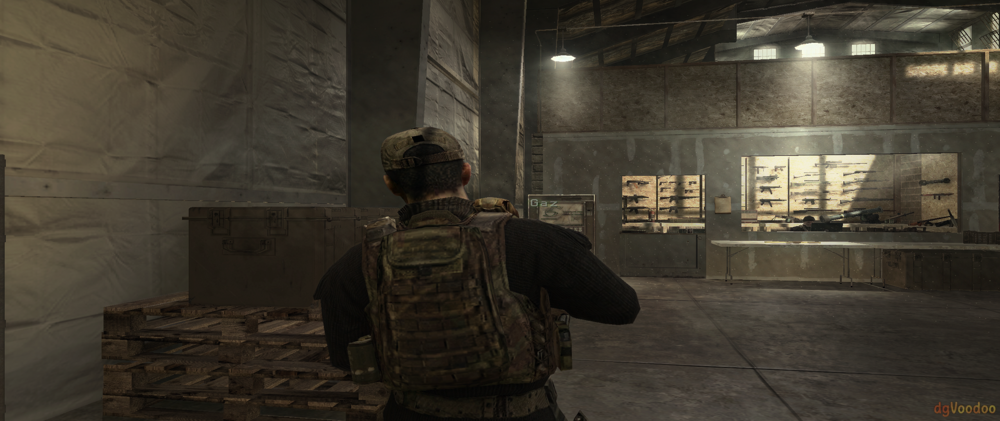
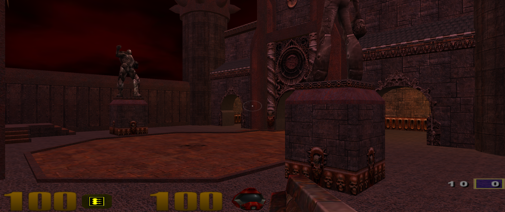
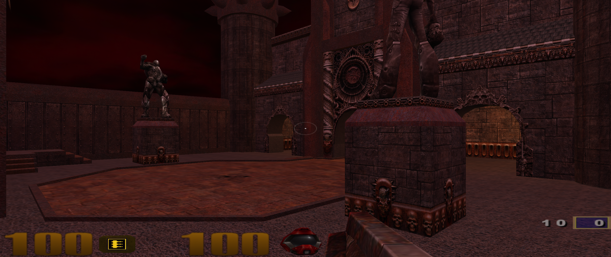

# Phoenix DLSS5 in games

[Project overview](../README.md) · [Documentation index](README.md) · [Compatibility](COMPATIBILITY.md)

From DOS corridors and arena shooters to open worlds and Gotham: the same toolkit can give very different games a fresh look. These examples show Phoenix DLSS5 output beside the image it actually processed.

## Reading the comparisons

- **Left: original processing input. Right: Phoenix DLSS5 output from the same evaluation.** This is the processing input/output pair, not a separately timed stock-game screenshot. Later game/ReShade effects and the overlay are outside these captures.
- Images retain their original resolution and RGB pixels, stored as lossless WebP with metadata removed. Click either image to inspect it full-size. Each pair is stored once and reused by the front page.
- All seven pairs were selected from reviewed, accepted coverage evidence; their source and acceptance hashes and same-frame receipts were checked before import. No games were launched for this documentation update.
- These are earlier coverage captures, not new tests of the 1.0 Beta packages. A successful captured scene does not establish every scene, mode or GPU configuration. Still images show the captured look; they do not measure temporal stability or game FPS.
- The capture API below is what ReShade observed. Legacy games may reach it through a wrapper or DOSBox; it is not necessarily the game's original renderer.

## At a glance

| Game | Observed capture API | Execution in this capture | Model |
| --- | --- | --- | --- |
| Batman: Arkham Knight | Direct3D 11 | external x64 helper | Original |
| Cyberpunk 2077 | Direct3D 12 | in-process | Original |
| Red Dead Redemption 2 | Vulkan | external x64 helper | Original |
| Call of Duty 4: Modern Warfare | Direct3D 11 | external x64 helper | Original |
| Hitman: Absolution | Direct3D 11 | external x64 helper | Original |
| Quake III Arena | OpenGL | external x64 helper | Lightweight FP8 |
| DOOM II | Direct3D 11 | external x64 helper | Original |

## Batman: Arkham Knight

Diner prologue: faces, booths and lighting.

Direct3D 11 capture · external x64 helper · Original model · 2377 × 1003 · matching frame 13127.

| Original input | Phoenix DLSS5 |
| --- | --- |
|  |  |

## Cyberpunk 2077

Practice Makes Perfect training room.

Direct3D 12 capture · in-process · Original model · 2560 × 1080 · matching frame 5552.

| Original input | Phoenix DLSS5 |
| --- | --- |
|  |  |

## Red Dead Redemption 2

Arthur beside the Horseshoe Overlook campfire.

Vulkan capture · external x64 helper · Original model · 2560 × 1080 · matching frame 21509.

| Original input | Phoenix DLSS5 |
| --- | --- |
|  |  |

## Call of Duty 4: Modern Warfare

Training armory with Gaz, equipment and gun racks.

Direct3D 11 capture · external x64 helper · Original model · 2560 × 1080 · matching frame 38044.

| Original input | Phoenix DLSS5 |
| --- | --- |
|  |  |

## Hitman: Absolution

Agent 47 facing the camera in the coastal prologue, with rocks and foliage behind him.

Direct3D 11 capture · external x64 helper · Original model · 3840 × 2160 · matching frame 7434.

| Original input | Phoenix DLSS5 |
| --- | --- |
|  |  |

## Quake III Arena

Playable q3dm1 courtyard.

OpenGL capture · external x64 helper · Lightweight FP8 model · 2560 × 1080 · matching frame 3907.

| Original input | Phoenix DLSS5 |
| --- | --- |
|  |  |

## DOOM II

Playable corridor with pistol, enemies and HUD.

Direct3D 11 capture · external x64 helper · Original model · 1600 × 1024 · matching frame 466.

| Original input | Phoenix DLSS5 |
| --- | --- |
|  |  |

## Capture provenance

[Image inventory and checksums](games/manifest.json) records the source-file hashes, published-image hashes, model, matching frame, dimensions and observed route. It deliberately omits game installation paths, user identifiers, local session details and diagnostic logs.

[How paired screenshots work](PAIRED_SCREENSHOTS.md) · [Performance and memory evidence](PERFORMANCE.md) · [Execution choices](COMPATIBILITY.md)

The gallery contains game imagery for comparison; the project's source-code license does not relicense that imagery.
