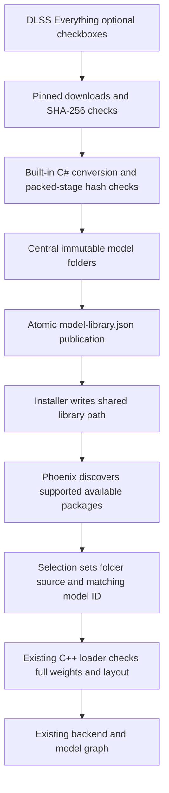

# Phoenix agent handoff: shared native model library

Verified against the local source, installed test packages and retained receipts
on 20 October 2026. This handoff explains the optional Hugging Face exports and
their integration with DLSS Everything. For the Original/Lightweight network
implementations themselves, see [HANDOFF_MULTI_MODEL.md](HANDOFF_MULTI_MODEL.md),
[SMALL_FP8.md](SMALL_FP8.md) and the current [support matrix](SUPPORT.md).

## What is supported

The optional downloads currently provide **two alternative weight packages for
the existing two networks**. They do not introduce additional trained networks.

| Download/package ID | Phoenix model ID | Architecture | Upstream folder |
| --- | --- | --- | --- |
| `canonical-original` | `original` | `phoenix-network37/1` | `weight_ht` |
| `canonical-lightweight` | `small-fp8` | `phoenix-cc-small-fp8/1` | `weight_cc` |

Both come from `bdsqlsz/DLSSNR3.19.16.0`, pinned to revision
`c305bfc0db1bb94bcc8e25b074904b5158d7cbd8`. They reproduce the corresponding
310.9.16 DLL payloads exactly. Phoenix loads them through its existing native
model-folder loader and runs its existing C++ engines. There is no Python,
PyTorch, ONNX runtime or wrapper process in this download/runtime path.

The user explicitly rejected fixed-resolution inference and tiled workarounds.
The fixed-256 ONNX Reference, FP16 and INT8 variants are therefore excluded.
These supported exports retain Phoenix's normal frame-size support and backend
limits. Duplicate mirrors and NVIDIA DLL wrappers are not extra models. This
integration does not port SD.Next's different arithmetic, an OpenDLSS engine or
AMD asynchronous frame reuse.

The selected architecture retains its existing block controls, repeats, passes,
target-FPS adaptation and time budgets on routes that support those features.
The shared library is a weight-source feature; it does not make unsupported
backends, hardware or transport controls available. Metal/HIP/SYCL support must
still be described using the platform matrix and their actual validation status.

## Model library layout

DLSS Everything publishes to `<selected component/payload directory>\Models`.
The validation fixture uses the same layout; testing it does not claim that any
installed game has been updated. All repository paths below are relative.

```text
Models\
  model-library.json
  models\canonical-original-c305bfc0db1b\
    model.json
    weights.bin
  models\canonical-lightweight-c305bfc0db1b\
    model.json
    weights.bin
```

| Package | Packed `weights.bin` bytes | SHA-256 recorded in `model.json` |
| --- | ---: | --- |
| Original | 147,692,350 | `87907cc109e960d0b2280febf2c6d58b7c403ecbc5472f5e01c9d1a590186a4c` |
| Lightweight | 113,891,803 | `65643afd08666ccc6d95490cd90d01f0a9cb9e5dae6fde03438dd8db01429f19` |

Do not point Phoenix at downloaded safetensors folders. Use the converted folders
containing `model.json` and `weights.bin`.

The authenticated reference DLL remains external to both repositories:

```text
nvngx_dlssnr.310.9.16.dll (supplied separately)
SHA-256: 2bc19bc09a7b89dd44f73e2ac0108fcc586e2154bdd0830f242f4f040e28789f
```

Existing games need a matching addon and the actual configured library
path; the integration validation did not update installed games.

## How the integration works



1. **Download UI:** Components → Model source has two optional checkboxes and
   **Download selected native models**. Normal component updates also process
   checked packages. Choices default off and persist. Opening the panel does not
   download; unchecking does not delete installed packages.
2. **Conversion:** the downloader fetches `model.safetensors`,
   `model_config.json` and `source_manifest.json`, verifies pinned sizes/hashes,
   then converts them entirely in C#. Every reconstructed stage must reproduce
   its published packed hash. Temporary source downloads are removed after
   publication. The download sizes are approximately 148 MB and 114 MB.
3. **Publication:** an exclusive file lock serializes writers. A staged package
   becomes an immutable versioned folder, then the index changes atomically.
   Repair uses a new folder when necessary so an active mapping is not overwritten.
   Cancellation/failure preserves existing working packages. Game uninstall
   leaves the central library intact.
4. **Installer:** writes the absolute central root even when the initial source
   is a DLL. With no explicit source and no requested NVIDIA execution/comparison,
   it prefers an installed export matching the selected model ID. NVIDIA
   execution/comparison continues to require the actual NVIDIA DLL.
5. **Phoenix:** polls small metadata with a two-second cache. It validates index
   schema, supported architecture, manifest digest, contained paths and resource
   existence/size. The existing loader performs full resource authentication and
   record-layout validation when opening the selected model. Large weight files
   are not hashed on every overlay frame.
6. **Picker:** `Shared native models` appears in Phoenix's own-model details when
   discoverable packages exist. Selecting one sets `model_source = model_folder`,
   `model_folder = <package folder>` and the matching `model_id` together. Existing
   reload/restart rules apply. The fixed native/x86 driver-host route filters out
   Lightweight. A missing entry does not silently replace the active source.

## Configuration and index contract

Phoenix.json uses `model_library_directory`; the saved settings key is
`Phoenix.ModelLibraryDirectory` (key `ModelLibraryDirectory` in the Phoenix INI
section). Saved controls take precedence where the compatibility controller
already applies that policy. Keep the shared root separate from the selected
package folder.

Example **configuration fragment** for the current Lightweight test package:

```json
{
  "model_library_directory": "C:/Models/Phoenix",
  "weight_source": {
    "kind": "model_folder",
    "path": "C:/Models/Phoenix/models/canonical-lightweight-c305bfc0db1b",
    "model": "small-fp8"
  }
}
```

The root's `model-library.json` uses schema `phoenix-model-library/1` and a
`models` array. Each entry has `id`, `label`, `model`, relative `manifest`, and
`manifest_sha256`. A package's `model.json` uses `dlss5-phoenix-model/1`, identifies
its architecture and provides `resource.path`, `resource.sha256` and
`resource.bytes`. Metadata is bounded to 64 KiB and the index to 32 entries.
Malformed/missing entries are skipped individually. Do not advertise a folder
merely because its directory exists.

## Source map for the next agent

Paths in this table are relative to the indicated repository root above.

| Repository | Files | Responsibility |
| --- | --- | --- |
| Everything | `app/Dlss5CompatApp/OptionalModelLibrary.cs` | Curated packages, pinned revision/hashes, downloads, validation, publication/index |
| Everything | `app/Dlss5CompatApp/CanonicalModelImporter.cs` | Native C# inverse conversion and stage verification |
| Everything | `app/Dlss5CompatApp/MainForm.OptionalModels.cs`, `MainForm.Shell.cs`, `MainForm.cs`, `LibraryState.cs` | Checkboxes, explicit download, update flow and persisted choices |
| Everything | `app/Dlss5CompatApp/PhoenixConfiguration.cs`, `InstallerEngine.cs` | Central root, selected package, JSON/INI propagation and installer preference |
| Everything | `app/Dlss5CompatApp/Models.cs`, `ComponentInspection.cs`, `MainForm.Ux.cs` | Export-only readiness and verification against package hashes |
| Phoenix | `src/native/model/model_library.h` | Bounded discovery and metadata cache |
| Phoenix | `src/native/model/weight_source.h`, `resource_identity.h` | Existing folder authentication, compatible resources and native packing |
| Phoenix | `src/native/support/routing.h` | Settings field and serialization |
| Phoenix | `src/integration/reshade/shared_panel.h` | Shared picker and atomic source/model selection |
| Phoenix | `src/integration/reshade/addon.cpp`, `src/integration/compatibility/controller.h` | Configuration, saved-control precedence and live-state preservation |

Importer maintenance pitfalls: attention-prior token order must be restored;
slices sharing a packed record/offset need the group's matrix extents; the full
canonical QKV matrix uses its actual generic FP8 packing. Preserve verified
behavior rather than replacing it with an assumed Q/K/V split. The regenerated
resource envelope has different metadata, so its whole-file hash differs from
the DLL resource hash. Compare record payloads and native packed allocations;
all of those bytes were verified equal. Original has 153 records and Lightweight
77. Do not relax these checks to accept an unported graph or different precision.

## Evidence and current delivery limits

The downloader/conversion integration receipt is
`docs/current-model-library/validation.json` in DLSS Everything.
It records 216 targeted app regressions, 34 final library/UI/install/inspection
checks, and independent equality checks for all 230 real payload records.
The production downloader/converter was exercised using pinned real files
through an in-process HTTP fixture handler; a separate live HTTPS metadata fetch
matched its pinned hash. This does not claim a full large-file internet download
test. The UI captures and detailed workflow are in Everything's
`docs/current-model-library` and `docs/optional-model-library.md`.

Phoenix's `artifacts/current/model-library-compile-tests.json` records passing
x86/x64 discovery, authenticated packing of both real imports, actual shared
picker interaction tests, and production addon translation-unit compilation.
Those integration checks used CPU only and modified no installed games.

**Later inference validation is separate:** the
[20 October benchmark refresh](benchmarks/current/README.md#dll-weights-versus-shared-model-exports), with
machine-readable `docs/benchmarks/current/measurements.json`, contains 24
model/route/extent combinations, each in two fresh processes: 48 export inference
cases. Native RTX covers 320×180, 1080p and 4K; CPU 32-thread, CUDA and NVIDIA/AMD
Vulkan cover 320×180 and 1080p; CPU single-thread covers 320×180. Every entry in
`model_source_parity` reports exact reset/history equality to its DLL-source
baseline. Matched 1080p network-buffer allocations are unchanged. Small timing
differences are subject to run variation; exports do not change the network.
These fixtures do not establish moving-scene quality, game FPS or game deployment.
No games, VR compositors or x86 transport routes were benchmarked in that refresh.

The Phoenix integration and benchmark follow-up sources ship with 0.9.
The companion application's development state is separate: this handoff does
not publish DLSS Everything or update an installed game. Package-specific checks
are recorded separately in the release's `VALIDATION.json`.

## Continuing from here

1. Read both repositories' current instructions and this source map; preserve
   existing extractions, model libraries and other tasks' edits.
2. Use the indexed converted library above for current development. For normal
   installations, use the actual selected component root and propagate it via
   the installer. Keep proprietary weights external to addon/release archives.
3. If extending the catalogue, first establish an arbitrary-frame native port
   and its model contract. Add an architecture implementation only when needed;
   a new mirror or weight container is not a new network. Keep fixed-256 variants
   excluded unless the user's requirement changes.
4. If preparing distribution, build matching downloader/addon artifacts and
   verify their packaged configuration/discovery. Treat game deployment and new
   GPU/device runs according to the user's authorization and repository rules;
   this explanatory handoff does not request those actions.

Existing CPU probes for relevant future changes are
`tests/ModelLibraryProbe` and `tests/Dlss5CompatApp.Tests/OptionalModelLibraryTests.cs`
in Everything, plus `tests/native/model_library_tests.cpp` and
`tests/native/shared_panel_tests.cpp` in Phoenix. No new inference run was needed
to prepare this handoff.
