# Standalone Phoenix DLSS5 library (experimental)

Phoenix DLSS5 can be embedded without ReShade through the C interface in
[`native_runtime/phoenix.h`](../native_runtime/phoenix.h). The addon remains the
main game integration. This portable interface uses the portable graph and
host-plane frame boundary; its performance must not be inferred from native RTX
charts. Windows x64 also has a separate [native RTX and spatial extension](NATIVE_LIBRARY.md)
with D3D12 textures, owned/borrowed devices and optional host-buffer transfers.

## Frame-boundary development changes

The current experimental candidate and measured comparisons are described in
[the development checklist](NEURAL_RENDERING_DEVELOPMENT_TODO.md) and
[comparison receipt](../artifacts/current/neural-comparison/summary.json).
The unchanged released SDK remains the comparison baseline. New source/builds
are not an NVIDIA parity certification.

Portable history resolve now reads the selected model's
`block70.layer0.blend_scale` before releasing decoded tensors. The supplied
resource gives **0.73974609375**. `config.history_gain_mode` defaults to
`"model"`; select `"legacy_unit"` with `config.output_profile: "legacy"` to
reproduce the old SDK. That combination matched all three baseline fixture
frames exactly. Status reports the resource digest, effective gain, output
profile and `frame_boundary_contract: phoenix-portable/3`.

The default `output_profile: "recovered_3108"` publishes half-rounded neural
RGB and applies the independently implemented style/display stage. Style 1
uses the inspected table's exposure -0.1 EV, contrast -0.25 and saturation -0.1;
style 2 uses saturation -0.15. Tone clamped to 0..1 scales the grade. Neural
style conditioning remains a separate input. Table identity is guarded for the
inspected resource; unknown compatible resources may use style 0. Matching the
vendor's activation, color transfer and rounding remains an acceptance task.

`metadata.controls.sampling_mode` accepts `"fixed"` (default) or `"advancing"`.
Fixed mode uses the supplied seed each pass; advancing mode uses
`seed + index + pass`, with uint32 wrap. Only successful publication advances
the index, by the number of whole-network passes. Reset or a conditioning/graph
signature change starts index zero. Changing the seed alone preserves history.
Rejected preflight requests preserve continuation; backend execution failures
may invalidate histories. This does not assert vendor noise equivalence.

### Versioned host planes and appearance contract

The old packed-plane entry point is retained. `phoenix_runtime_frame_v2` adds
bounded float32 planes with explicit capacities, strides and full session
extent. Zero stride means packed rows. Color/output are RGB, motion RG in pixel
units, depth/validity R. Zero-initialize absent descriptors. All bounded inputs
are snapshotted before execution, so input/output aliasing is supported.
Preflight failures leave output/history untouched. Session calls are serialized.

V3 embeds V2 as `base`; set `base.struct_bytes=sizeof(phoenix_frame_v3)` and
`base.version=PHOENIX_FRAME_VERSION_3`. It adds:

| Plane | Full-extent float32 meaning |
| --- | --- |
| `control_mask` in base | RGBA linear controls in 0..1; explicit `PHOENIX_CONTROL_EXPERIMENTAL_RGB_1` |
| `ui` | Premultiplied RGBA overlay in the SDR model proxy domain |
| `ui_alpha` | Coverage R, an alternative to supplying UI RGBA |
| `backbuffer` | RGB with UI already composed; used as the protected display base |
| `distortion` | RGBA normalized UV displacement: RG distorted-to-canonical, BA canonical-to-distorted |

The **experimental Phoenix RGB/1** map contract is:

| Channel | Operation |
| --- | --- |
| R | Multiplies final display intensity; never gates recurrent history |
| G | Multiplies global tone for feature 11 |
| B | Multiplies global structure for feature 12 |
| A | Reserved and required to equal 1; NVIDIA alpha semantics remain unresolved |

Map mode zeros automatic skin features 13/14. An all-ones map need not equal
no-map automatic mode. Map values may change every frame without resetting
history; entering/leaving map/field mode resets it. Values are linear controls,
with mirrored model padding and no sRGB conversion. Host and device feature
packing matched exactly in the Vulkan GPU fixture; CUDA and Vulkan default
three-frame output also matched exactly. Older Vulkan providers without the
new map capability marker take the explicit host packing fallback.

A field canonicalizes scene RGB, guides and G/B controls before inference.
Motion conversion uses the **previous accepted** field. The raw prediction is
sampled back into the display domain before grading/composition; UI stays in
the original display coordinates. The portable composition is
`base + intensity * map.R * (1 - UIAlpha) * (graded_prediction - original)`,
clamped to 0..1. Without a backbuffer, a supplied premultiplied UI overlay forms
the base. The recovered greater-than-one-only/no-style/no-extra-input path
returns neural RGB; enabling a postprocess input enables intensity extrapolation.
These are declared Phoenix semantics, with vendor parity still unverified.

Each pass stores half RGB **before display operations**. Multiple passes use
separate temporal histories. `metadata.output_stage: "neural_only"` returns
ungraded, original-domain prediction for asynchronous helper reprojection;
the addon then applies the current frame's R map/UI. It requires the recovered
profile. Ordinary callers should keep the default `"presented"`.

```mermaid
flowchart LR
    Inputs["RGB + guides + map"] --> Canonical["Optional field: canonicalize RGB / guides / G,B"]
    History["Accepted previous half RGB per pass"] --> Warp["Motion + validity reprojection"]
    Warp --> Pack["16 features; map G,B condition tone / structure"]
    Canonical --> Pack
    Pack --> Encoder["Encoder: multiscale features"]
    Encoder --> Global["8 central blocks; optional same-weight repeats"]
    Encoder --> Decoder["Decoder + encoder skips"]
    Global --> Decoder
    Decoder --> Head["RGB correction + gate logit"]
    Head --> Resolve["Temporal resolve using model blend_scale"]
    Warp --> Resolve
    Resolve --> Store["Half RGB per-pass history"]
    Store -. "next accepted frame" .-> History
    Resolve -. "optional next whole-network pass" .-> Pack
    Resolve --> Display["Inverse field; style grade; intensity x R; UI protection"]
    Display --> Output["Presented RGB"]
```



Block repeats, whole-network passes and recurrence across frames are different
mechanisms. There is no extra diffusion sampler, VAE or per-object model call.
Assigning human semantic roles to individual learned layers requires ablations.
See the [rendered pipeline diagram](../artifacts/current/neural-comparison/pipeline.png).

### Transport, capture and model replacement

The same optional planes travel through new broker protocol 2 and the 64-bit
helper, including a 32-bit client. The fixed V1 wire layout remains accepted;
V1 requests cannot carry extra planes. Actual local/helper/32-bit-helper GPU
outputs matched exactly with every optional plane supplied. Worker jobs own
snapshots through completion; addon GPU display uses current UI after delayed
prediction. The old WOW64 SR bias-mask protocol remains a separate contract.

Feeder V2 is additive: `CnrPHOENIXFeederVersionV2` and
`CnrPHOENIXFeederEvaluateV2` take `PhoenixFeederFrameV2` from `feeder_api.h`.
Optional resources must be current-frame, full-extent COMMON-state textures;
GPU mask/UI/field are RGBA32F, alpha R32F, backbuffer RGBA16F. Using V2 explicitly selects the experimental
appearance contract. The existing V1 feeder remains unchanged. The shared panel also has an explicit
Phoenix appearance toggle with separate intensity/style controls; these persist
as PhoenixAppearance/PhoenixIntensity/PhoenixStyle and do not change the original
NVIDIA-only overrides. Those widgets are compile/contract checked, not live-game validated.
The example
`examples/engine_control_mask.hlsl` converts an engine's object/material ID
texture and per-ID settings into a map; it does not infer IDs from final color.

Standalone `phoenix_frame` jobs accept `control_mask`, `ui`, `ui_alpha`,
`backbuffer` and `distortion` float32 file paths; maps also require
`control_profile: "phoenix-experimental-rgb/1"`. V3 is required for advanced
planes; older libraries reject them. `config.validation_stage_hashes=true` records optional
inputs, raw/temporal stages where available, and final presented output hash.
Direct addon captures now fence-copy optional texture planes into separate
files with a hash manifest/frame/generation. Legacy replay probes refuse such
captures unless explicitly extended; they cannot silently omit the planes.

`phoenix_runtime_replace_model(session, weight_source_json)` loads and checks
a compatible replacement before retiring the old graph, then resets graph,
cache/history and sampling state. Invalid sources preserve the existing session
and continuation. Runtime resize still creates a new portable session. The
[native extension](NATIVE_LIBRARY.md) offers transactional reconfiguration.
Compatible replacement weights do not imply arbitrary architectures or a
curated NVIDIA A/B/C selector.

`phoenix_runtime_capabilities` is model-free discovery; query its JSON size
then copy it. Status reports the actual packing path, plane hashes, optional
features, host capacities and timing scope. Initial bounded snapshots and final
copies are outside internal stage timings, so measure total call latency too.
Tests here exercise Windows RTX 5080; HIP/SYCL/Metal/mobile feature acceptance
has not been established by shared source or another backend's results.

For an offline per-object workflow, run
`python tools/build_control_mask.py JOB.json NEW_OUTPUT_DIRECTORY`. A job such as
the following consumes a full-frame, packed little-endian uint32 ID plane from
an engine/capture producer:

```json
{
  "control_profile": "phoenix-experimental-rgb/1",
  "width": 640,
  "height": 360,
  "object_ids": "object-ids.u32",
  "default": {"intensity": 1, "tone": 1, "structure": 1},
  "objects": {
    "17": {"intensity": 0},
    "42": {"tone": 0.5, "structure": 0.25}
  }
}
```

This writes a map, channel preview PNG, and manifest with source/map hashes and
per-object pixel counts. Source IDs resolve relative to the job file. Feed a
fresh ID plane for each moving frame; final-color captures supply no object
identity by themselves. The GPU producer example is implemented; engine adoption, moving-object acceptance and
vendor comparisons remain on the [development checklist](NEURAL_RENDERING_DEVELOPMENT_TODO.md).

[Download SDKs 0.8.1-beta](https://github.com/RazvanManolache/dlss5-phoenix-addon/releases/tag/0.8.1-beta)
includes the Windows native extension and optional mobile Vulkan compatibility.
See the [Adreno validation and timings](VULKAN_MOBILE_2026-10-15.md).

## Platform status

| Platform | Implementation | Validation available here |
| --- | --- | --- |
| Windows x64 | C DLL; portable CPU and Vulkan; existing optional CUDA/HIP/SYCL provider ABI retained | CPU/operator/C-interface tests and full-model frame |
| Linux x64 | C shared library; portable CPU and Vulkan build paths | Built and CPU tests/full-model frame run under Ubuntu 22.04 WSL |
| macOS, Apple silicon | C dynamic library; Metal compute backend and portable CPU | Apple compiler/MSL and CPU suites pass in macOS 14 ARM64 CI; full-model GPU execution unvalidated |
| Android ARM64 | NDK C shared library; portable CPU and optional workgroup Vulkan compatibility | Adreno 735 operator/normalization contracts and 320×144 museum model output match CPU exactly; this is a bounded device test |
| Android x86_64 emulator | NDK library with a JNI/OpenGL game-frame harness | Full-model CPU/Vulkan execution; three Vulkan image sizes match Windows portable Vulkan byte for byte; emulator timing does not predict phone performance |

Metal is an initial correctness implementation, with resident buffers, ordered
GPU dispatches, packed FP8 weight decoding and explicit half/FP8 publication.
Its shader is generated from the shared operator reference, rather than a
separate arithmetic implementation. Matrix operations currently use scalar
GPU work items; optimized Metal matrix tiles/MPS are future work. It does not
use the Apple Neural Engine. GPU time covers the complete submission; there is
no fabricated per-layer breakdown.

Vulkan reuses the existing desktop provider and shaders. It needs Vulkan 1.3,
shader Int64/Float16, 16-bit storage, buffer device addresses, scalar block
layout, the Vulkan memory model and support for a 32-lane subgroup. Cooperative
matrices are optional and used only when their shapes are advertised. Basic
Vulkan availability on a phone does not guarantee these requirements. Unsupported
devices are rejected; no hidden CPU fallback is reported as GPU inference.

An optional `vulkan_workgroup_compatibility=true` configuration uses scalar
matrix/row shaders with workgroup barriers and integer FP16 storage. This route
does not require 32-lane subgroups and supports testing drivers such as the
Adreno 735's 64–128-lane implementation. It disables subgroup-dependent matrix,
attention and QKV fusions, retains the same model and ordered arithmetic, and
preserves half subnormals without native float16 conversions. Other baseline
Vulkan compute requirements still apply. The default route is unchanged.
The compatibility shaders also reproduce fused FP32 normalization/publication
rounding with integer significands, avoiding the Adreno driver's one-ULP FMA
differences at quantization boundaries. This increases compute cost; measure
completed calls on the target phone rather than inferring real-time throughput.
`phoenix_device_info_options` accepts option bit 30 for capability discovery;
`phoenix_device_info` retains the original strict check. Runtime status reports
`vulkan_workgroup_compatibility` for the path actually created. Capability
discovery alone is not a numerical or performance validation result.

The compatibility tile uses 4x4 per-thread register blocks inside each 32x32
matrix tile. Eligible row reductions use eight local invocations and shared
workgroup exchanges, preserving the original reduction tree without hardware
subgroup assumptions. The portable `phoenix_frame` runner accepts an optional
top-level `benchmark_iterations` (1..100) to distinguish cold setup from warm
calls in one session. Each iteration resets history; repeated-input measurements
are not a motion/temporal validation. `profiling="dispatches"` additionally
reports GPU time grouped by operator kind.

Devices without cooperative matrices now use an ordered 32×32 shared-memory
matrix tile. Packed expanding projections and large 128-to-32 contractions
use coalesced weight loads; other shapes retain the simpler tile. This changes
data reuse, not precision or model weights. Matrix-capable devices retain their
existing accelerated route. Status reports `vulkan_matrix_acceleration` and
`vulkan_fallback_tile` so these paths can be distinguished.

Advanced comparison overrides are `vulkan_tiled_fallback=false` (the previous
8×16 fallback) and `vulkan_coalesced_fallback=false` (the simple 32×32 tile).
The tested `vulkan_scalar_attention=true` alternative fuses local attention
without matrix extensions, using 6 KiB of workgroup storage. It remains opt-in:
operator/model output checks pass, but full-call speed gains were inconclusive.
These options do not disable an available matrix-accelerated route.

Linux CUDA and a Mac/Android game overlay are not implemented by this port.
Applications must supply their own image/graphics integration. Host-plane
copies and C++ preparation/resolve still exist; no zero-copy texture API is
promised. The CPU reference is a portability/correctness fallback, not the
optimized AVX Windows CPU runner and not a real-time performance claim.

## Build a library

Requirements: CMake 3.22+, a C++20 compiler, Python 3.10+ for shader generation
only, and the platform SDK/toolchain. Generated sources/binaries stay under
`build/`. No Python runtime is required by an installed library.

- [CMake](https://cmake.org/download/), [Python](https://www.python.org/downloads/).
- Windows: [Visual Studio C++ build tools](https://visualstudio.microsoft.com/downloads/).
- Linux: GCC 11+ or a current Clang, development headers and pthread/dl libraries.
- Mac: [Xcode](https://developer.apple.com/xcode/) with the Metal compiler, macOS
  13+ recommended; Apple silicon required by the current Metal backend.
- Android: [NDK](https://developer.android.com/ndk/downloads), tested cross-compiler
  NDK **27.3.13750724**, ARM64, API **28** minimum for the library. Vulkan 1.3
  support is a separate device/driver requirement.

Windows/Linux CPU build:

```sh
cmake -S native_runtime -B build/standalone -DCMAKE_BUILD_TYPE=Release -DPHOENIX_ENABLE_METAL=OFF
cmake --build build/standalone --config Release --parallel 4
ctest --test-dir build/standalone -C Release --output-on-failure
cmake --install build/standalone --config Release --prefix build/sdk
```

Mac build (Metal enabled by default on macOS):

```sh
cmake -S native_runtime -B build/metal -DCMAKE_BUILD_TYPE=Release -DCMAKE_OSX_DEPLOYMENT_TARGET=13.0
cmake --build build/metal --parallel 4
ctest --test-dir build/metal --output-on-failure
cmake --install build/metal --prefix build/sdk
```

The Mac build compiles the generated MSL with `xcrun metal` as a build check.
`metal_operators` also executes it on an Apple silicon GPU and compares with
the shared arithmetic reference. Run it before treating a Mac build as usable.
CI compiles Metal and enumerates devices. It runs GPU operator tests only if the
host exposes a supported Metal device; otherwise it reports them as not executed.

Android cross-build (substitute your NDK path):

```sh
cmake -S native_runtime -B build/android -DCMAKE_BUILD_TYPE=Release \
  -DCMAKE_TOOLCHAIN_FILE=/path/to/ndk/27.3.13750724/build/cmake/android.toolchain.cmake \
  -DANDROID_ABI=arm64-v8a -DANDROID_PLATFORM=android-28 -DANDROID_STL=c++_shared -DPHOENIX_ENABLE_METAL=OFF
cmake --build build/android --parallel 4
cmake --install build/android --prefix build/android-sdk
```

Package both Phoenix DLSS5 `.so` files and the NDK's `libc++_shared.so` in the app's
ARM64 native library directory. This is a C/NDK interface; a Kotlin/Java app
needs a JNI wrapper. No APK, UI, camera integration or game injection is supplied.
Model files must be readable filesystem paths; Android content URIs need to be
copied/mapped by the host app first. An app's loader may require its native-library
directory as `runtime_root` and APK settings that extract native libraries.

### Enable Vulkan on Linux/Android

Install [Vulkan-Headers](https://github.com/KhronosGroup/Vulkan-Headers) version
**1.4.365** or newer, a system/NDK Vulkan loader, and host
[glslang](https://github.com/KhronosGroup/glslang) **16.6.0** or newer. The NDK's
bundled headers alone are older than declarations used by the existing provider;
pass the separately installed headers. `PHOENIX_GLSLANG` must run on the build
computer, including during Android cross-compilation. Build glslang with
`ENABLE_OPT=ON` and its SPIRV-Tools dependencies: the mobile register tile uses
the compiler's `-Os` optimisation. CI builds this pinned configuration.

Add these options to the relevant configure command:

```sh
-DPHOENIX_ENABLE_VULKAN=ON \
-DPHOENIX_VULKAN_HEADERS=/path/to/Vulkan-Headers/include \
-DPHOENIX_GLSLANG=/path/to/glslang
```

Windows CMake builds additionally need the Vulkan loader import library from an
installed Vulkan SDK (`-DPHOENIX_VULKAN_LOADER=/path/to/vulkan-1.lib`). The established
Windows build in [BUILDING.md](../BUILDING.md) remains available.

The generated SPIR-V and provider go in `lib/vulkan/` after installation
(`bin/vulkan/` on Windows). Keep them beside the backend's runtime root. Enumerate
devices with `phoenix_frame --vulkan-devices /absolute/runtime/root`. Configure
`PHOENIX_VULKAN_TEST_DEVICE=vulkan:<32-character-UUID>` to add the device operator
suite to CTest. Shader and provider generation is shared with the Windows build.

## Embed it

Installed CMake packages provide `Phoenix::Runtime`:

```cmake
find_package(Phoenix CONFIG REQUIRED)
target_link_libraries(my_application PRIVATE Phoenix::Runtime)
```

Use `-DCMAKE_PREFIX_PATH=/path/to/sdk`. Plain C callers can include `phoenix.h`
and link `phoenix_runtime_cpp.lib` on Windows or `libphoenix_runtime_cpp` on Unix.
Deploy its selected backend library too. Build backend plugins with the same C++
toolchain as the runtime; the public application boundary is C, the internal
backend plugin boundary is C++.

```c
#include <phoenix.h>
/* Allocate RGB float32 buffers for width*height pixels first. */
void *session = phoenix_runtime_create(config_json, width, height);
if (!session) { /* copy phoenix_runtime_error() */ }
else {
    int result = phoenix_runtime_frame(session, color, NULL, NULL, NULL,
                                       "{\"reset\":true}", output);
    if (result) { /* copy phoenix_runtime_error() */ }
    phoenix_runtime_destroy(session);
}
```

Input/output are tightly packed RGB32F, **model proxy values in 0..1**, same
dimensions, not arbitrary HDR game buffers. Motion is RG32F in pixel units;
depth and validity are R32F. Optional planes require matching `has_motion`,
`has_depth`, `has_history_validity` metadata; validity additionally requires motion.
The application owns these arrays and must provide their documented capacities.
Calls are synchronous. Reuse a session for temporal history; reset when cutting
scenes. Serialize its calls and never destroy it during a frame call.
The current Vulkan provider permits one active Vulkan session per process;
creating a second fails explicitly. CPU and Metal sessions have independent
backend state. Separate processes are an option for simultaneous Vulkan streams.

Configuration example (absolute paths, local model supplied separately):

```json
{
  "backend": "metal",
  "device": "metal:default",
  "runtime_root": "/absolute/path/to/sdk/lib",
  "allow_unvalidated": true,
  "cpu_threads": 0,
  "weight_source": {
    "kind": "nvidia_dll",
    "path": "/absolute/path/to/nvngx_dlssnr.dll",
    "sha256": "REPLACE_WITH_THE_ACTUAL_LOWERCASE_SHA256"
  }
}
```

For CPU use `backend: cpu`, `device: cpu`. For Vulkan use `backend: vulkan` and
the enumerated `vulkan:<UUID>`. Mac devices can be listed with
`phoenix_frame --devices /absolute/path/to/sdk/lib`; prefer their registry IDs
over `metal:default` when multiple GPUs are present. Unvalidated devices require
explicit opt-in; a device's presence is not evidence of model parity.
On Windows use absolute JSON paths such as `C:/Phoenix/sdk/bin`.

The NVIDIA Vulkan route automatically enables the workgroup FP8 engine only
when the selected device exposes the required matrix shapes, tensor addressing
and conversion features. The configuration switches `vulkan_workgroup_fp8`,
`vulkan_workgroup_shape_tiles`, `vulkan_fused_feed_forward` and
`vulkan_projected_qkv` default to `true`; setting any to `false` disables that
optimization. Other devices keep their existing engines. Legacy packed weight
codes incompatible with hardware FP8 automatically use the established decoder.
These switches select execution paths for the same model, without adding a
second weight copy or changing its precision/publication rules.

The model DLL is read as **binary data**, never executed by this runner. Unix
hosts parse its PE resource tree to find `RCDATA/WEIGHTS_HT`, authenticate the
file and decode the tensor records. Disk models use the existing
`dlss5-phoenix-model/1`, `phoenix-network37/1` manifest/layout. This supports
compatible replacement tensors; it does not import arbitrary ONNX/PyTorch
architectures. No NVIDIA DLSS5 DLL or extracted model is bundled in the source/SDK.

Per-frame controls:

```json
{
  "reset": false,
  "passes": 1,
  "repeats": [1,1,1,1,1,1,1,1],
  "controls": {
    "intensity": 1.0,
    "local_tone": 1.0,
    "local_structure": 1.0,
    "skin_structure": -1.0,
    "auto_mask": true,
    "style": 0,
    "seed": 0
  }
}
```

Passes are 1..4; each of the eight global block repetition counts is 0..4.
Changing repeats rebuilds the graph and clears history; it is not a free
per-frame switch. Intensity/tone/structure are 0..2, skin is -1..2, style 0..2.
The host can adapt repeats/passes or processing resolution to its own FPS/time
budget using returned timings. This ABI does not include the addon's automatic
budget controller or upscaler integration. The Windows native extension exposes
spatial resizing separately; vendor temporal upscalers remain addon-only.
Resize by creating a new session.

`phoenix_runtime_status` reports GPU/CPU timing scope, resident weight/scratch
bytes, sampled host capacities and history usage. These allocations are not
total process RAM/VRAM. `phoenix_runtime_error` is thread-local; copy it before
another call. Query status size, allocate that many bytes, then retrieve it.

## Standalone frame tool

`phoenix_frame JOB.json NEW_OUTPUT.rgb32f` loads a configuration, processes one
reset frame and prints JSON status. Its input file contains little-endian RGB
float32 values (three floats per pixel); optional motion/depth/validity planes
are supplied the same way. Output must be a fresh path.

```json
{
  "width": 640,
  "height": 360,
  "color": "/absolute/path/input.rgb32f",
  "config": { "backend": "cpu", "device": "cpu",
    "runtime_root": "/absolute/path/to/sdk/lib",
    "allow_unvalidated": true,
    "weight_source": { "kind": "model_folder", "path": "/absolute/path/model" }
  },
  "metadata": { "passes": 1 }
}
```

See [port validation](PORT_VALIDATION_2026-10-14.md) for the exact local checks
and remaining hardware requirements. Source and standalone packages retain the
project/third-party licenses; vendor models and SDK binaries remain external.
