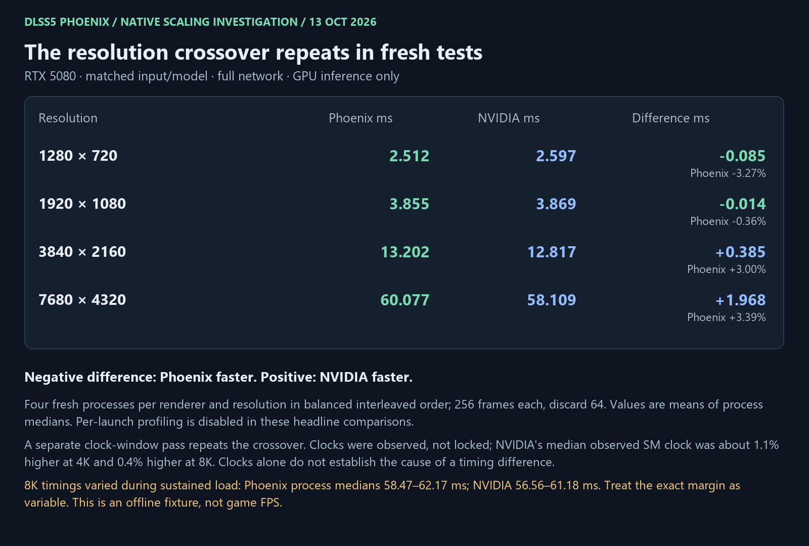
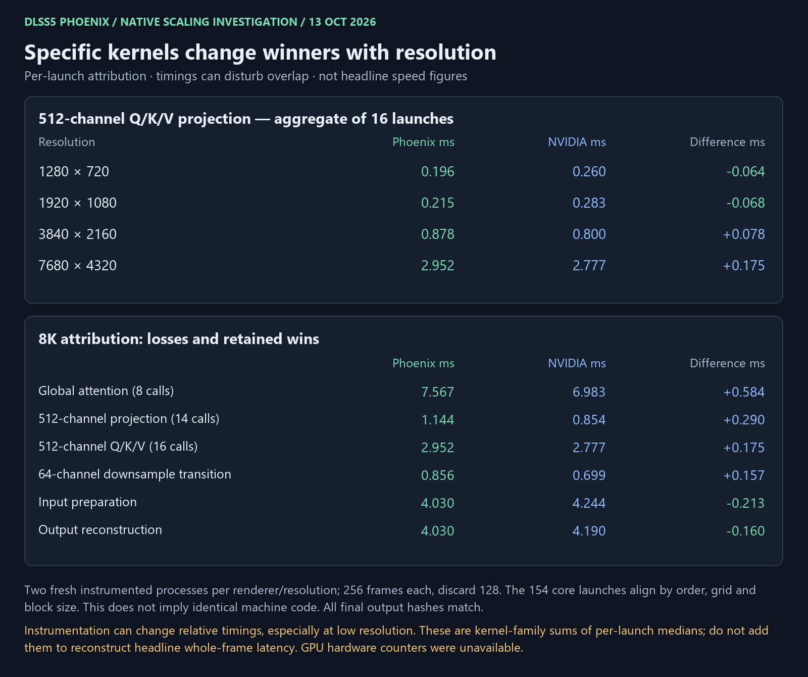

# Native resolution crossover — measured investigation

**The crossover repeats, and specific kernels change winners with resolution.**
The explanation is more specific than a generic launch-overhead hypothesis:
Phoenix wins some small projections and retains several large-image wins, while
other projections, spatial transitions and global attention favor NVIDIA at
larger extents. Observed GPU boost differences also affect the margin.

[Follow-up: controlled memory tests and implemented automatic kernel selection](NATIVE_MEMORY_INVESTIGATION_2026-10-13.md)
recover about 1.5–1.9% in the fresh 6K/8K automatic-path comparison while preserving
the original small-input register choices.



## Whole-frame results

RTX 5080 16 GiB, driver 616.64; Ryzen 9950X3D, 96 GiB RAM. Same external
`nvngx_dlssnr.dll` 310.8.0.0 and synthetic RGBA16F color / RG16F zero-motion
fixture, full eight blocks and one pass. D3D12 debug enabled on both paths.
GPU timestamps exclude uploads and output readback; these are not game FPS.

Four fresh processes per renderer and extent, balanced `P N N P N P P N` order;
256 frames per process, discard 64. Values are means of process medians.
Per-launch timestamps are disabled for these speed comparisons.

| Input | Phoenix GPU ms | NVIDIA GPU ms | Phoenix difference |
| --- | ---: | ---: | ---: |
| 1280×720 | 2.5118 | 2.5968 | −3.27% |
| 1920×1080 | 3.8553 | 3.8691 | −0.36% |
| 3840×2160 | 13.2020 | 12.8169 | +3.00% |
| 7680×4320 | 60.0770 | 58.1089 | +3.39% |

A second, independently built observation pass uses two fresh processes per
renderer and extent, 256 frames, discard 128. UTC frame boundaries restrict
100-ms clock samples to the measured loop, excluding model loading/upload.
The crossover repeats: approximately −3.35%, −0.40%, +2.76% and +3.97%.

Clocks were **observed, not locked**. Mean process-median SM observations:

| Input | Phoenix MHz | NVIDIA MHz |
| --- | ---: | ---: |
| 720p | 2816.0 | 2799.3 |
| 1080p | 2748.5 | 2778.5 |
| 4K | 2643.5 | 2673.5 |
| 8K | 2606.0 | 2617.5 |

These sample the measured loop, including gaps between frames, rather than only
the instants when a kernel executes. Do not normalize timings by MHz as if all
work were compute-bound. Temperatures and power also vary. During the primary
8K series, process medians span 58.47–62.17 ms for Phoenix and 56.56–61.18 ms
for NVIDIA. The crossover is repeatable; its exact percentage is variable.

## Direct launch attribution



An offline, process-local observer times NVIDIA's NVAPI kernel launches without
changing the DLL on disk. NVIDIA submits 156 launches: 154 core launches plus a
counter-clear kernel and an output-copy kernel. All 154 core launches align with
the native plan by **ordinal, grid and block dimensions at all four extents**.
This establishes geometry correspondence, not identical machine code.

Two fresh instrumented processes per renderer/extent, 256 frames, discard 128.
The original NVIDIA calls each contain one kernel; instrumentation preserves
that call structure and inserts timestamps around the calls. Phoenix is timed
the same way. The following numbers aggregate per-launch medians over repeated
instances of a kernel family.

The **512-channel Q/K/V projection** is a concrete crossover:

| Input | Phoenix ms, 16 calls | NVIDIA ms, 16 calls | Difference |
| --- | ---: | ---: | ---: |
| 720p | 0.196 | 0.260 | −0.064 |
| 1080p | 0.215 | 0.283 | −0.068 |
| 4K | 0.878 | 0.800 | +0.078 |
| 8K | 2.952 | 2.777 | +0.175 |

At **4K**, notable losses include 512-channel Q/K/V (+0.078 ms), global
feed-forward contraction (+0.067 ms), expansion (+0.058 ms), and 512-channel
attention projection (+0.055 ms). At **8K**, important losses include:

- Global attention: **7.567 versus 6.983 ms**, +0.584 ms across eight calls.
- 512-channel attention projection: **1.144 versus 0.854 ms**, +0.290 ms.
- 512-channel Q/K/V: **2.952 versus 2.777 ms**, +0.175 ms.
- Three 64-channel transition families together: approximately **+0.419 ms**.

There are retained wins at 8K: input preparation saves about 0.213 ms, output
reconstruction 0.160 ms, and repeated 256-channel spatial attention 0.268 ms.
NVIDIA's extra output-copy kernel takes about 0.335 ms there; Phoenix directly
produces its output through a different path. Its counter-clear and output-copy
helpers are not incorrectly paired with native neural launches.

**Attribution is diagnostic.** Per-launch timestamps can change overlap and
pacing. At 1080p, the instrumented NVIDIA whole interval is about 4.027 ms versus
3.869 ms in the primary uninstrumented pass; Phoenix is about 3.836 versus
3.855 ms. Thus the instrumented 1080p advantage must not replace the headline
near-parity result. Summing kernel medians does not reconstruct a whole-frame
median, and these diagnostic losses are not guaranteed recoverable speedups.

## What the measurements establish

- This is not solely an old benchmark-order artifact: two interleaved passes
  reproduce the crossover, and kernel-level comparisons show specific flips.
- Low-resolution time has a substantial weakly scaling component. Between
  720p and 1080p, the native 512-channel encoder/decoder groups grow only from
  roughly 0.321/0.310 to 0.339/0.325 ms, while input preparation grows from
  0.110 to 0.249 ms. Different stages scale differently.
- Global attention becomes more important at large sizes: its eight attention
  launches grow from about 0.6 ms at 4K to about 7.6 ms at 8K in the matched
  attribution pass. It is a useful large-resolution target.
- The four primary whole-frame differences have a close descriptive fit:
  `Phoenix_ms − NVIDIA_ms ≈ −0.144 + 0.0637 × input_megapixels`.
  This is compatible with a small fixed advantage offset by extra work per
  pixel. It is **not** an isolated measurement of overhead or a causal model.
- Grid/block correspondence rules out different core launch geometry as the
  explanation in these four cases. It does not rule out differences in
  instructions, register allocation, cache behavior or synchronization.

Nsight hardware counters are blocked by the current driver permissions. A
standard Nsight trace yielded command-list workloads but no useful CUDA kernel
records in this setup; the offline API observer supplied the launch timings.
We therefore have no measured cache-miss, memory-bandwidth, spill-traffic or
instruction-throughput diagnosis. Those should not be presented as proven causes.

## Validation, retention and next targets

The three passes execute **18,432 frames in 72 processes**. Every process's final
frame hash matches the same-resolution baseline, including both instrumented
paths. This does not check every intermediate output or certify moving-scene
quality. Native runs report zero D3D12 debug errors and complete resource/module
retirement; NVIDIA creation/evaluation and debug checks pass.

No production kernel, model, precision or addon behavior changed. The offline
native probe gained configurable frame/warmup counts and UTC observation fields.
The driver-API observer and vendor-probe experiments remain in the ignored
local workbench; no vendor binary or model payload is added to the repository.

The next optimization targets are now specific: 512-channel Q/K/V and projection
at 4K+, global attention at 8K, and 64-channel transitions. Resolution-specific
variants should preserve the existing low-resolution and input/output wins,
with fresh uninstrumented comparisons deciding whether a change ships.

[Machine-readable results and receipt hashes](benchmarks/2026-10-13/native-scaling-diagnosis.json)
retain per-process observations, stage timings and all 154 matched core-launch
timings per extent. Raw receipts, clock CSVs, source snapshots, recipes and
experimental probes remain under `build/native_crossover_20261013/`.

Regenerate the images with:

```powershell
python tools/render_native_scaling.py --snapshot docs/benchmarks/2026-10-13
```
