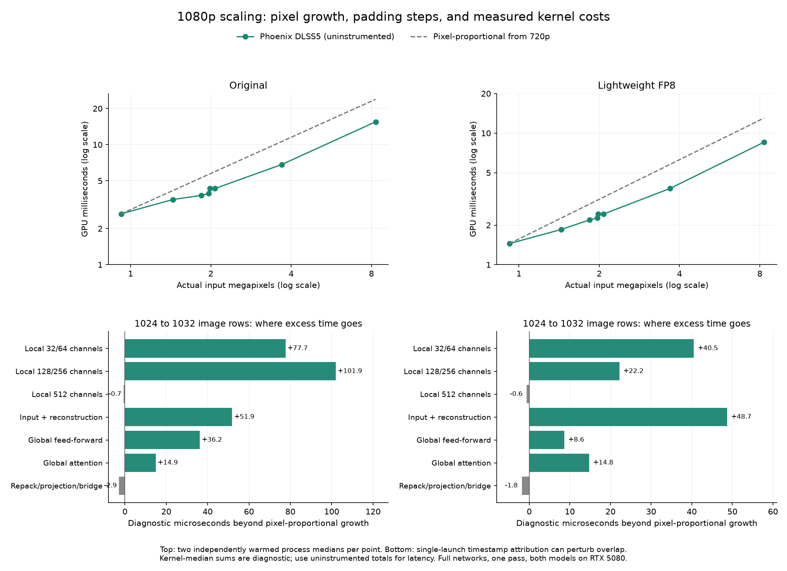

# Native resolution scaling: is there a 1080p cliff?

**There is no general superlinear jump at 1080p. There is a real padding/token boundary just below it.** This investigation separates those two effects using full-model Phoenix DLSS5/NVIDIA DLSS5 comparisons and individual Phoenix kernel timestamps.

## What the original chart hid

Its horizontal axis placed every resolution the same distance apart. The move from 720p to 1080p contains 125% more pixels; it is not the same amount of work as moving between adjacent small resolutions. The native comparison chart now places points by actual pixel count, using a logarithmic horizontal axis.

The original 12-resolution sweep measured Original at 2.475 → 3.841 ms and Lightweight at 1.450 → 2.250 ms from 720p to 1080p: about 55% more GPU time for 125% more pixels. Thus cost per pixel **decreases**. The fresh profiling sweep below is separate; its absolute times should not be pooled with the earlier sweep.

## A genuine boundary: 1920×1024 to 1920×1032

| Input | Padded spatial extent | Global token grid | Tokens | Full-resolution FP8 stem skip |
| --- | --- | --- | ---: | ---: |
| 1920×1024 | 1920×1024 | 32×16 | 512 | 60.0 MiB |
| 1920×1032 | 1920×1152 | 32×20 | 640 | 67.5 MiB |
| 1920×1080 | 1920×1152 | 32×20 | 640 | 67.5 MiB |

Eight extra image rows mean only **0.781%** more displayed pixels, but **12.5%** more padded spatial pixels and **25%** more latent tokens. Global attention can also grow with token-pair count; its launch grid changes from two to three query tiles. There is no renderer/model/transport switch here.

| Engine / model | 1024 rows (ms) | 1032 rows (ms) | Growth | 1080 rows (ms) |
| --- | ---: | ---: | ---: | ---: |
| Phoenix DLSS5 / Original | 3.917 | 4.320 | 10.3% | 4.313 |
| NVIDIA DLSS5 / Original | 3.990 | 4.323 | 8.4% | 4.368 |
| Phoenix DLSS5 / Lightweight FP8 | 2.267 | 2.421 | 6.8% | 2.425 |
| NVIDIA DLSS5 / Lightweight FP8 | 2.267 | 2.415 | 6.5% | 2.417 |

The step also appears in NVIDIA DLSS5. Its internal stages were not instrumented; Phoenix source and launch metadata explain Phoenix’s own geometry change. Both implementations match byte-for-byte in reset/history outputs at all four reference-checked extents, including both sides of this boundary.

## Which parts exceed proportional growth?

For each profiled kernel, the pixel-only expectation is its 1024-row time multiplied by `1032 / 1024`. Positive excess is actual time minus that expectation. Medians are first collected per independently warmed process, then summarized. Single-launch timestamps perturb overlap; their sum is not an exact accounting identity for total GPU time.

| Kernel family | Original excess (µs) | Lightweight excess (µs) |
| --- | ---: | ---: |
| Local 32/64 channels | +77.7 | +40.5 |
| Local 128/256 channels | +101.9 | +22.2 |
| Local 512 channels | -0.7 | -0.6 |
| Input + reconstruction | +51.9 | +48.7 |
| Global feed-forward | +36.2 | +8.6 |
| Global attention | +14.9 | +14.8 |
| Repack/projection/bridge | -2.9 | -1.8 |

Local image processing is the main source of this boundary’s excess. The 128/256-channel stages lead for Original; the 32/64-channel stages and input/reconstruction matter more for Lightweight. Global attention is a contributor, **not the dominant cause** of the measured step. The full per-launch ranking and grids are in the [data](native-scaling-profile.json).

Stage-only timestamps retain the original dispatch batches. They put almost all of the increase inside the neural dispatch region; initial preparation remains below 3 µs, and the matching output copy changes by only a few microseconds. These separate diagnostic runs are not pooled with the plain timing sweep.

| Model / stage | 1024 rows (ms) | 1032 rows (ms) |
| --- | ---: | ---: |
| Original / engine prepare | 0.0027 | 0.0027 |
| Original / dispatch region | 3.9036 | 4.3448 |
| Original / output copy | 0.0188 | 0.0238 |
| Lightweight FP8 / engine prepare | 0.0024 | 0.0025 |
| Lightweight FP8 / dispatch region | 2.2510 | 2.4009 |
| Lightweight FP8 / output copy | 0.0175 | 0.0202 |

## Code and memory review

- `src/native/model/generated_plan.h`: `Geometry` rounds the spatial image to 64/128-pixel boundaries, with a shifted-window margin, then rounds the latent axes to multiples of four. Those are real compute dimensions, not merely spare allocation bytes.
- `src/native/model/native_layout.h` and the model registry: the full schedule stays at 154 launches for Original or 78 for Lightweight, with all eight global blocks and one pass. The Lightweight model removes local blocks, not global attention.
- Production kernel entry selections are identical on both sides of the boundary. The bundle’s separate large-image entry threshold is 18,662,400 pixels, far above 1080p.
- Driver queries show fixed register/local-storage sizes for the same compiled entries. There is no per-thread spill-size switch triggered by 1080p.
- The GPU reports a 64 MiB L2 cache. The full stem skip grows from 60 to 67.5 MiB here, so cache behavior is a reasonable hypothesis, but this study has **no hardware cache-miss/bandwidth counters**. Crossing the nominal capacity is not proof that cache misses caused the step; other live tensors and streaming reuse also matter.
- Measured per-process device-local residency near this boundary is roughly 500–575 MiB. This does not suggest VRAM exhaustion on this 16 GiB card; residency totals alone do not measure paging.

## Focused register experiment: rejected

Input preparation and reconstruction together cost about 0.5 ms around 1080p. Their current 128-register entries have 64/104 bytes of driver-reported local storage per thread. Local storage is not itself a measurement of spill traffic. We rebuilt only these two entries from the same PTX, verified the 128-register control has identical machine instructions, and tried 96, 160 and 192 registers.

| Register limit for both boundary kernels | Original GPU ms | Lightweight GPU ms |
| ---: | ---: | ---: |
| 128 (production) | 4.369 | 2.436 |
| 96 | 5.161 | 3.306 |
| 160 | 4.401 | 2.457 |
| 192 | 4.588 | 2.575 |

At 160 registers the input kernel’s local storage falls to zero and output storage to 24 bytes; at 192 both reach zero. However, active blocks per SM fall from 16 to 12 or 8, and whole-model latency gets worse. All variants preserve reset/history pixels, but **none were promoted**. Eliminating local storage is not automatically a performance improvement.

## What is worth optimizing next

The profile points toward local-window work (128/256 channels for Original; also 32/64 for Lightweight) and input/reconstruction: reduce redundant memory movement or improve tile reuse while preserving arithmetic and padded outputs. Blindly reducing the model’s padding, tokens, blocks or precision would change the computation and needs reference-equivalence evidence first. The current 128-register boundary budget remains the better measured choice.

## Method and limits

RTX 5080, driver 616.64; full Original and Lightweight models; fixed structured FP16 SDR input, zero motion, automatic masks and one pass. Eight extents × two models × two native measurement modes × two fresh processes, plus 16 NVIDIA reference processes: **80 processes**. A further **8** stage-only processes preserve dispatch batching and verify preparation/network/copy attribution; **24** processes test register alternatives. Each profiling process warms for one second and measures at least 40 frames for at least one second; register experiments use two-second warmup/measurement intervals and three process pairs. No games were launched or modified.

This is a static-frame performance investigation, not a game-motion/image-quality study. Instrumented timings are diagnostic; plain timings determine total latency. [Machine-readable results](native-scaling-profile.json) · Runners: `tools/profile_native_scaling.py`, `tools/experiment_boundary_registers.py`, `tools/report_native_scaling.py`.
