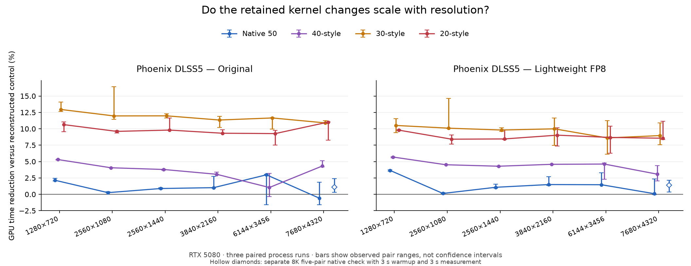

# Phoenix DLSS5: resolution sweep

The retained kernel changes are tested at 720p, 2560×1080 ultrawide, 1440p, 4K, 6144×3456 (6K) and 7680×4320 (8K). Both Original and Lightweight run through Phoenix DLSS5 Native RTX on an RTX 5080. Automatic/native remains the recommended style.

Positive percentages mean less GPU time. Each value is the median of three matched before/after changes; † means the three pairs include both a gain and a regression. Error bars show the observed range, not a confidence interval.

## What held up

- **20-style:** lower median GPU time in 12/12 cells; observed median reductions range from +8.41% to +11.01%.
- **30-style:** lower median GPU time in 12/12 cells; observed median reductions range from +8.60% to +12.95%.
- **40-style:** lower median GPU time in 12/12 cells; observed median reductions range from +1.04% to +5.69%.
- **Native 50:** lower median GPU time in 11/12 cells; observed median reductions range from -0.59% to +3.65%.

The additional 8K native-50 check measured +1.08% for Original and +1.40% for Lightweight. The initial three-pair values remain in the matrix; the longer-warmup results are shown separately below. Small native-50 effects deserve more caution than the larger compatibility-path gains.

## Original

| Resolution | Native 50 | 40-style | 30-style | 20-style |
| --- | ---: | ---: | ---: | ---: |
| 1280×720 | +2.14% | +5.30% | +12.95% | +10.63% |
| 2560×1080 | +0.25% | +4.05% | +11.96% | +9.60% |
| 2560×1440 | +0.88% | +3.79% | +11.97% | +9.80% |
| 3840×2160 | +1.01% | +3.06% | +11.34% | +9.32% |
| 6144×3456 | +2.97% † | +1.04% † | +11.65% | +9.27% |
| 7680×4320 | -0.59% † | +4.31% | +10.90% | +11.01% |

## Lightweight FP8

| Resolution | Native 50 | 40-style | 30-style | 20-style |
| --- | ---: | ---: | ---: | ---: |
| 1280×720 | +3.65% | +5.69% | +10.51% | +9.79% |
| 2560×1080 | +0.13% | +4.51% | +10.09% | +8.41% |
| 2560×1440 | +1.07% | +4.29% | +9.81% | +8.45% |
| 3840×2160 | +1.49% | +4.58% | +9.99% | +9.03% |
| 6144×3456 | +1.46% | +4.62% | +8.60% | +8.68% |
| 7680×4320 | +0.09% † | +3.08% | +8.96% | +8.56% |

## Tuned native 50 processing time

| Resolution | Original GPU ms | Lightweight GPU ms |
| --- | ---: | ---: |
| 1280×720 | 2.460 | 1.445 |
| 2560×1080 | 4.867 | 2.787 |
| 2560×1440 | 5.976 | 3.349 |
| 3840×2160 | 13.132 | 7.416 |
| 6144×3456 | 34.341 | 19.908 |
| 7680×4320 | 57.959 | 34.506 |

## Memory and validation

| Resolution | Original process device-local MiB | Lightweight process device-local MiB |
| --- | ---: | ---: |
| 1280×720 | 401.6 | 368.8 |
| 2560×1080 | 671.0 | 638.6 |
| 2560×1440 | 787.9 | 754.8 |
| 3840×2160 | 1429.9 | 1395.6 |
| 6144×3456 | 3212.2 | 3178.0 |
| 7680×4320 | 4940.4 | 4900.2 |

**48/48 model/style/size cells passed**, across 288 paired-process cases. Successful cells have finite, repeatable outputs and exact reset/history hashes against their matching control in every process. Failed cells retain their reason without a successful timing summary.

Memory figures are medians of process readings for the winning native-50 bundle after measurement and capture checks. They include harness and driver allocations; they are not pure model-buffer sizes, cold startup peaks or vendor-internal accounting. The control uses reconstructed single-target modules, so host-RAM differences against its different containers are not used as optimization claims.

## Method and limits

- Three alternating before/after process pairs per cell; one second of warmup, two seconds of measurement and at least 30 measured frames. The explicit sampling cap is extended to 120 seconds for slow high-resolution paths. GPU clocks use their normal dynamic settings.
- GPU milliseconds are separate medians of process medians. Percentages are medians of matched-round changes, so they need not equal the ratio of those separate time medians.
- Full graph, eight blocks, one pass, default controls, deterministic FP16 detail/gradient input and zero motion. Matching output copies and GPU barriers are timed; loading, producer upload, CPU gaps and readback are excluded. These are processing timings, not gameplay FPS.
- The saved native-50 control images are reused byte for byte. Compatibility controls are reconstructed by removing the winning changes in a temporary source copy. All eight model/style combinations first pass the earlier 1080p reset/history hashes. Recompiled compatibility image hashes are recorded rather than claimed identical to the earlier binaries.
- Older instruction styles are compiled for the physical RTX 5080. This does not predict performance on physical RTX 20/30/40 cards. No game, installed files or published package is changed.

During this sweep, a CPU-only capture-check overhead was removed: successful literal checks no longer allocate an error-message string for every FP16 component. Completed cells were retained; unfinished cells use the corrected probe for all of their pairs. Both probe hashes are recorded per case, and all eight control combinations were checked again. GPU recording and the timed rendering code are unchanged.

The compact public data is [native-tuning-resolutions.json](native-tuning-resolutions.json). Raw local receipts, source/image pins and failure details are under `artifacts/current/kernel-tuning/resolutions.json` (ignored by Git). The maintained runner is `tools/benchmark_tuning_resolutions.py`.

## Native 50 at 8K: longer-warmup confirmation

The initial three pairs straddled zero for both models. A separate five-pair confirmation therefore uses three seconds of warmup and three seconds of measurement per process. The main matrix above keeps its original three-pair values rather than replacing them with a more favorable repeat.

| Model | Control GPU ms | Tuned GPU ms | Median time reduction | Observed pair range |
| --- | ---: | ---: | ---: | ---: |
| Original | 57.883 | 57.353 | +1.08% | +0.30% to +2.39% |
| Lightweight FP8 | 34.545 | 34.059 | +1.40% | +0.33% to +2.14% |

All 20 confirmation processes retain exact outputs against the main sweep. Pair ranges are descriptive, not confidence intervals. The full local receipt is `artifacts/current/kernel-tuning/native-8k-confirmation.json`.
