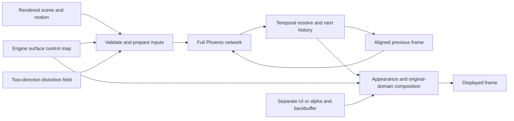

# Phoenix appearance and optional inputs

<!-- current-two-model-evidence -->
Both Phoenix models expose the eight model-specific central transformer controls, 0-4 repetitions and addon/portable 1-10 passes. See [support and integration limits](SUPPORT.md), [portable scheduling](PORTABLE_MODEL_CONTROLS.md) and [current measured control costs](benchmarks/current/README.md#granular-and-appearance-controls). Experimental appearance options are not vendor-parity modes.
<!-- /current-two-model-evidence -->

The shared panel exposes an experimental Phoenix appearance switch, global
intensity (0-2), and Default/Natural/Cinematic styles. Values take effect as
live tuning edits and remain separate from the NVIDIA-only overrides.
Disabling appearance restores host values while retaining the chosen settings.

The encoder, central attention blocks, decoder and temporal recurrence remain
the model pipeline. Block repetitions, whole-network passes and prior-frame
history are separate mechanisms; this adds no diffusion sampling loop.

| Feature | How it is supplied |
| --- | --- |
| Global intensity and style | Shared panel or library controls |
| Per-object/surface strengths | Engine IDs/materials converted to a control map |
| Protected UI | Premultiplied UI, or alpha plus a backbuffer |
| Distortion correction | Explicit normalized forward/inverse field |
| Producer status | Panel reports connected map/UI/field and generation |

Surface selection is an engine-integration feature, not a click-to-select
object tool in the overlay. `examples/engine_control_mask.hlsl` demonstrates an
ID-table producer, and `tools/build_control_mask.py` constructs offline maps.
Final-color capture alone cannot recover reliable object identities or UI
layers. Unsupported advanced controls are hidden on that route.

The map contract is explicitly named `phoenix-experimental-rgb/1`; its alpha is
reserved at 1. It is not a claim about NVIDIA's undocumented channel/alpha
semantics. Library V2/V3 and feeder V2 validate dimensions, ranges, strides,
ownership and freshness. Optional planes traverse local/helper/x86-client
transport, and rejected frames preserve accepted history in the checked cases.

The standalone native advanced adapter currently requires equal source, neural
and output extents and rejects explicit depth/validity planes. HDR transfer,
scaled advanced planes, engine-object edge cases and cross-vendor acceptance
remain integration work. Portable grading, distortion and UI composition still
have substantial CPU cost; feature availability is not a real-time guarantee.

See [the portable library](LIBRARY.md), [native library](NATIVE_LIBRARY.md),
[feeder API](FEEDER_API.md) and [release validation](VALIDATION_0.82.md).
