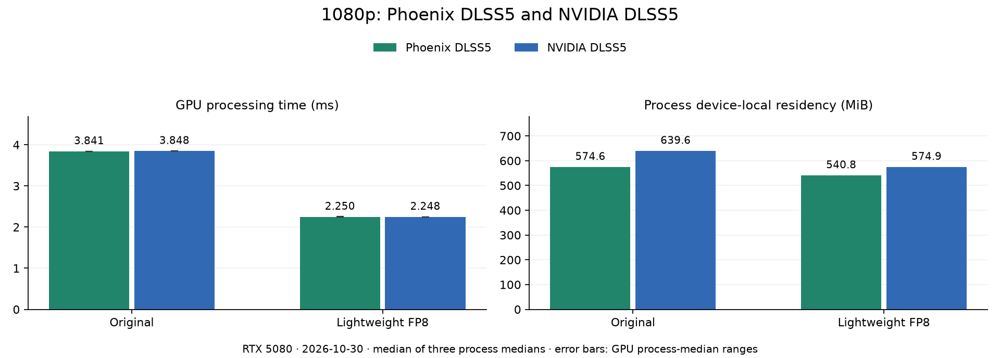
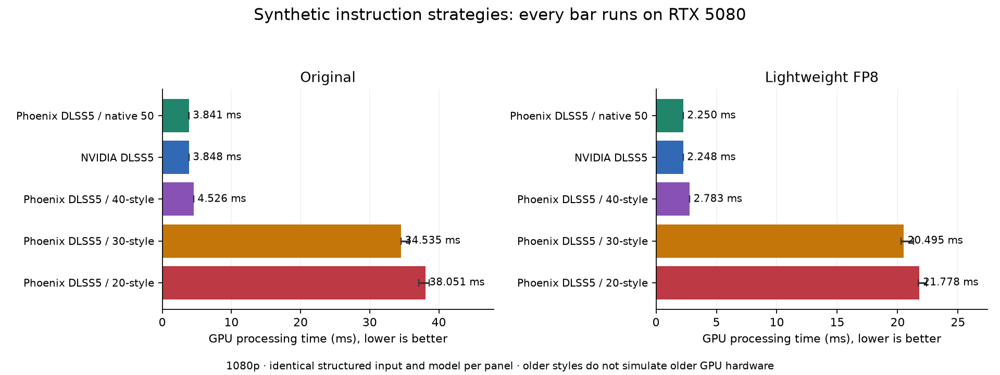
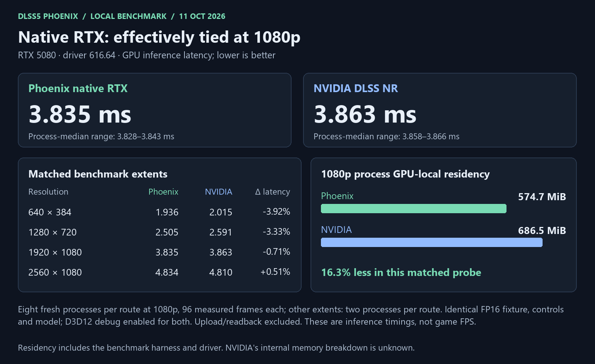
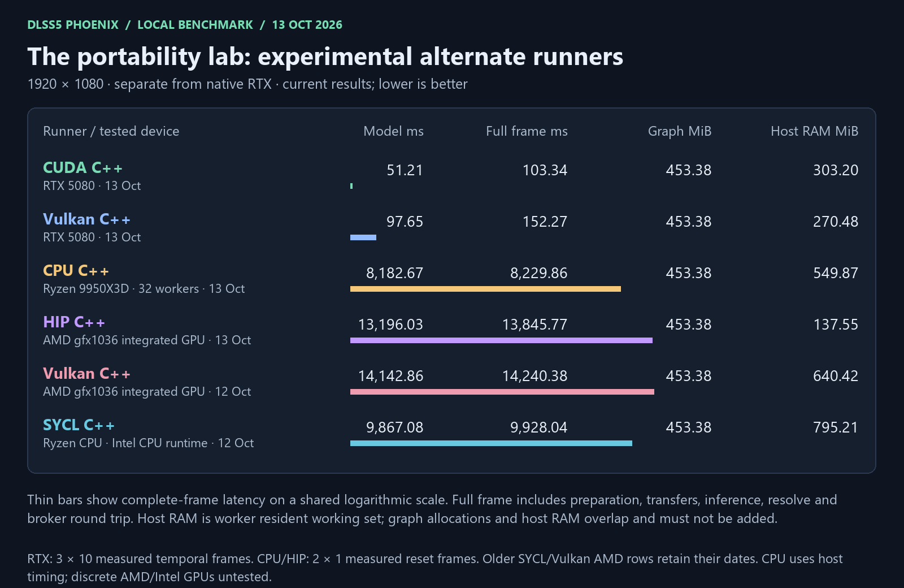
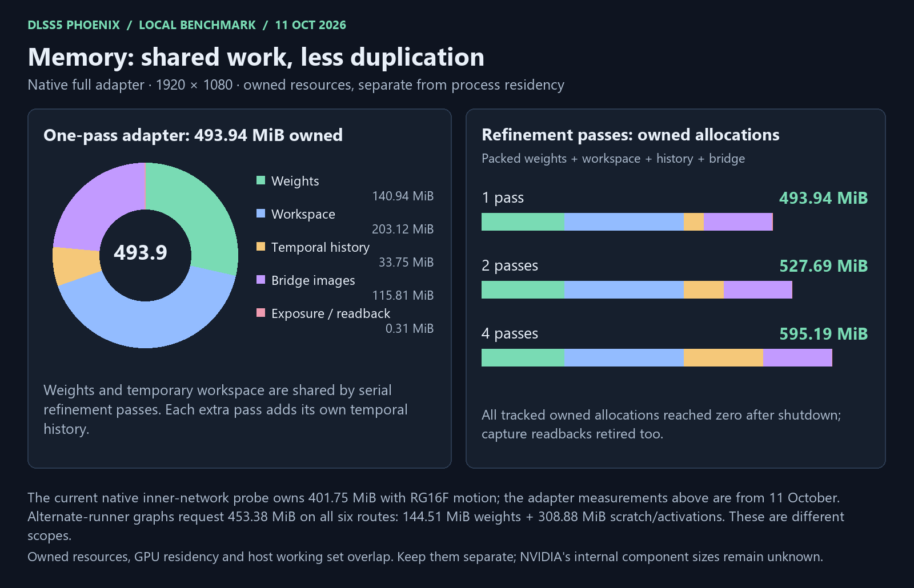

# Performance and benchmarks

[Project overview](../README.md) · [Documentation index](README.md)

Native RTX is the primary performance path. Current results, older studies and experimental routes retain their own hardware, dates and measurement scope.

<!-- current-two-model-benchmark -->
## Native RTX: the main event

**Performance on par with NVIDIA DLSS5 at 1080p on the tested RTX 5080.**
Both Original and Lightweight have comparable isolated processing latency at 1080p; the full report shows where higher-resolution differences remain.

Measured **2026-10-30** using the tuned development kernels, RTX 5080, native x64 and one full pass. These are not game FPS or measurements of every download/route.

| Renderer / model at 1080p | GPU ms | Full call ms |
| --- | ---: | ---: |
| Native RTX Phoenix DLSS5 / Original | 3.841 | 4.321 |
| Native RTX Phoenix DLSS5 / Lightweight FP8 | 2.250 | 2.563 |
| Native RTX NVIDIA DLSS5 / Original | 3.848 | 4.544 |
| Native RTX NVIDIA DLSS5 / Lightweight FP8 | 2.248 | 2.622 |

**A lighter model, not a longer coffee break.** Lightweight uses **41.4% less GPU time** than Original within Phoenix DLSS5 at 1080p. It produces a different image: pick the look you prefer, not just the smallest number.

**Same model, matching pixels.** The native-50/default Phoenix DLSS5 path matches its corresponding NVIDIA DLSS5 preset byte for byte in reset/history fixtures at all **12 extents**, from 320×180 through 8K. The 20/30 instruction strategies can use different floating-point rounding.

**Memory gets a vote too.** At 1080p, Lightweight reduces measured process GPU-local residency by **5.9% within Phoenix DLSS5** and **10.1% within NVIDIA DLSS5**. These include harness and driver allocations. [Current RAM/VRAM readings](benchmarks/current/README.md#memory-at-1080p).

**More knobs, fewer mysteries.** Both models support tone/structure/skin tuning, compatible external weights, block controls, repeats, passes and adaptive budgets where the selected route supports them. [Controls and limits](PORTABLE_MODEL_CONTROLS.md) · [Appearance controls](NEURAL_CONTROLS.md).

**The portability side quest is still alive.** CUDA, Vulkan, CPU, HIP, SYCL and Metal have their own limits. Their retained timings have their own measurement dates. [Backend matrix](SUPPORT.md) · [Dated portable study](benchmarks/current/README.md#portable-host-plane-runtime).

**Less repeated work, same model inputs.** The [portable reuse study](PORTABLE_REUSE_STUDY.md)
tests faster CPU operand loading and shared host input preparation against the previous
code, with exact output checks for both models. It also separates GPU fallback experiments
from the default CUDA/Vulkan paths: a faster loader does not mean every backend gets faster.

**The 1080p bend, investigated.** Pixel count explains the broad curve; a real
padding/token step just below 1080p also appears in NVIDIA DLSS5. The
[profiling report](NATIVE_SCALING_PROFILE.md) identifies the expensive stages
and documents register experiments that were rejected after measurement.

[Full current native report and resolution charts](benchmarks/current/README.md) · [Machine-readable results](benchmarks/current/measurements.json) · [Historical released/current comparison](benchmarks/current/release-ab.md)
<!-- /current-two-model-benchmark -->

## Built for older RTX cards; measured on RTX 5080

**The kernels exist. The older cards aren't on my desk.** I built `sm_75`, `sm_86`
and `sm_89` kernels for RTX 20/30/40, alongside native `sm_120` for RTX 50. All 410
native and selectable-style device images passed the offline checks. Physical
20/30/40 inference and compatibility still need testing on those cards.

The synthetic tests below compile the older instruction strategies for the
**actual RTX 5080**: the same models, full graphs, one pass, matching inputs and
before/after output checks. They measure how the kernel changes behave on my
card. They cannot reproduce an older card's caches, bandwidth or throughput.
This before/after study uses a deterministic gradient/detail fixture.

The 20/30-style changes retain roughly **8–13% lower GPU time** across the tested
sizes. The 40-style medians improve about **1–6%**. Native 50 changes are smaller
and more variable; at 2560×1080 they're essentially unchanged. The chart keeps
mixed pairs visible, and hollow diamonds show the separate longer-warmup 8K
confirmation. All **308 benchmark processes** preserve exact matching-control
outputs. These are synthetic processing measurements, not game FPS.

Here is the absolute 1080p cost beside native Phoenix DLSS5 and NVIDIA DLSS5,
using one matched structured fixture. Automatic/native remains the recommended
choice on the tested RTX 5080. The older strategies are compatibility options.
The two studies use different fixtures; compare values within each chart.

[Full synthetic results, memory and methodology](NATIVE_TUNING_RESOLUTIONS.md) ·
[Kernel architecture and instruction styles](NATIVE_ARCHITECTURES.md)

## Historical native study

Historical Original-only native study: 14 October 2026

- **1080p inference: a small measured edge.** Phoenix DLSS5 **3.829 ms**, NVIDIA DLSS5 NR
  **3.864 ms** on RTX 5080: about **0.9% lower GPU time** in this test.
  Small margins vary with clocks and scheduling; this is not a promised game-FPS gain.
  NVIDIA DLSS5 was about 1.2–2.3% faster at the larger tested extents.
- **Less measured GPU residency at 1080p:** **558.8 MiB** for Phoenix DLSS5 versus **686.5 MiB**
  for NVIDIA DLSS5 in the matched probe—about **18.6% less**. This includes the
  harness and driver; it is not a measurement of NVIDIA's internal buffers.
  Spare VRAM apparently needs a financing plan these days.
- **Correct output from 360p through 8K:** reset and final history frames match NVIDIA DLSS5
  exactly on the synthetic fixture at all nine tested standard extents. Memory is
  essentially tied at 6K; Phoenix DLSS5 uses about 2.7% more at 8K. No universal VRAM
  saving or moving-scene quality claim is implied.
- **The point is a fast, inspectable runner with controls.** Native RTX is the
  primary path. Getting the same architecture running through other APIs is
  extra engineering exploration. Yes, we may have taken the side quest too far.

Measured **14 October 2026**, two fresh processes per renderer at each extent,
128 frames each, discarding the first 32. Figures average process medians.
Same RGBA16F color/RG16F motion fixture, controls and model. GPU inference
excludes upload/readback and is not game frame time. Resolution planning and
padding are corrected. Automatic kernel selection preserves the small-input
register choices and switches two stages at 18.66 million neural input pixels
(5760×3240 area). Wider memory reads improve three 64-channel stages.
The native kernels used for this study target **sm_120**; the tested GPU is an RTX 5080.
At 8K the two Phoenix DLSS5 process medians span 60.94–63.74 ms;
the chart shows their mean, not a fixed performance guarantee.

This resolution and memory study uses a different sampling protocol from the
execution tests below. Its VRAM figures were not remeasured in that transport study.

[Automatic kernel selection and memory tuning: measurements and limits](NATIVE_MEMORY_INVESTIGATION_2026-10-13.md)

Lower input resolutions: 360p, 480p and 540p

[Historical regular performance and regression checks](REGULAR_PERFORMANCE_REGRESSION_2026-10-14.md) ·
[Bridge fixes and transport benchmarks](BRIDGE_FIXES_2026-10-14.md) ·
[Download ReShade addon](https://github.com/RazvanManolache/dlss5-phoenix-addon/releases/tag/1.0-beta) ·
[SDK build and integration guide](LIBRARY.md) ·
[Historical benchmark methodology and data](benchmarks/2026-10-13/README.md) ·
[Output comparisons](benchmarks/2026-10-13/README.md#actual-output-images) ·
[Resolution report (HTML)](benchmarks/2026-10-13/resolutions.html)

What might VR cost? PSVR2 and Steam Frame estimates

**Estimates on RTX 5080, not VR benchmarks or verified headset support.** These
assume two independent views, full network and one pass. A proper stereo batch
could share scheduling and weights; no batching speedup has been measured.

Game rendering, upscaling and compositor/streaming costs are additional. Actual
per-eye render targets can differ from panel resolution. Separate eye histories
are necessary even if execution is batched together.

[Assumptions, calculations and stereo batching explained](benchmarks/2026-10-13/VR_ESTIMATES.md)

## Historical execution benchmarks

Detailed execution benchmarks: in-process versus helper

**Historical execution study, Original model only.** These transport results
were not rerun in the current two-model analysis above; they are not Lightweight
FP8 or current-checkout transport measurements.

**RTX 5080, driver 616.64, 1920 x 1080, 1:1, full network, reset frames.**
Each case used 5 seconds of warmup followed by 20 seconds of measurement.
These are measured per-output times, **not game FPS** or a promise of faster games.

| Execution | Phoenix DLSS5 GPU / wall (ms) | NVIDIA DLSS5 GPU / wall (ms) | Wall-time scope |
| --- | ---: | ---: | --- |
| Native x64 | 4.007 / 4.391 | 4.027 / 4.455 | Resident-input synchronized API call |
| x64 library inside x86 | 4.037 / 4.508 | 4.004 / 4.465 | Resident-input call; worker entered once |
| x86 Phoenix DLSS5 + native driver | 4.009 / 4.464 | Not available | Resident input plus per-frame dispatch handoff |
| External x64 helper | 4.338 / 12.358 | 4.472 / 13.071 | DX12 fixture capture, IPC, processing and return |

The helper row uses a different fixture image and sampled latency. The other
rows use isolated synthetic resident inputs; their timing does **not** measure
the new add-on routes' CPU capture/upload cost. One serial run per case cannot
establish architectural speed differences. The x86 Phoenix DLSS5 graph-host mechanism
has no NVIDIA DLSS5 equivalent. The earlier NVIDIA x86 in-process experiment is
unavailable after wider testing found intermittent allocation failures and crashes;
NVIDIA DLL evaluation in 32-bit games uses the x64 helper. These old probe timings
do not qualify that withdrawn experiment. [Scopes, sample counts and p95 values](benchmarks/0.81/README.md).

Standalone libraries for developers

An [experimental standalone C library](LIBRARY.md) exposes model selection,
block repeats, passes, conditioning, history and timing/memory status without
ReShade. Windows/Linux builds and an Android ARM64 cross-build are available;
Apple silicon Metal compiles in Mac CI and still needs GPU/model validation.
These portable runners do not inherit the native RTX performance shown above.
A separate [Windows native RTX library](NATIVE_LIBRARY.md) reuses the
optimized executor and spatial resizing without ReShade, with D3D12 texture and
host-buffer interfaces.

## The portability lab

CUDA, Vulkan, HIP, CPU, SYCL and Metal are **experimental alternate implementations**. Current two-model measurements and unavailable-device limits are in the [current report](benchmarks/current/README.md); the dated six-route study below is historical.
They let us explore devices, validate operators and learn where execution costs
come from. They are still much slower than native RTX; the CPU and integrated
GPU paths are development/reference tools, not real-time gaming choices.

Historical Original-only alternate-runner study: 14 October 2026

- **RTX 5080:** CUDA **56.31 ms** model / **102.84 ms** full call;
  Vulkan **68.37 ms** / **117.67 ms**.
- **Ryzen 9950X3D, 32 workers:** CPU C++ **9.36 s** full call;
  SYCL CPU **11.37 s**.
- **Integrated Radeon gfx1036:** HIP **14.78 s** full call;
  Vulkan **12.11 s**. These are iGPU results, not discrete Radeon results.
- **Owned model/scratch buffers:** Vulkan RTX requests **465.33 MiB**, including
  its cached noise tensor; the other five routes request **453.38 MiB**. Host RAM, caller
  buffers, driver/JIT caches and GPU residency are separate scopes. CPU worker
  private commitment is about **501 MiB**, SYCL CPU about **954 MiB**; the chart
  shows resident working set instead. Equal tensor demand does not mean equal RAM.

All six alternate runners measured **14 October 2026**. Warm 1920×1080 calls, one pass
and all eight block repetition controls set to one. RTX: three processes × 12
temporal frames, discarding two. CPU/HIP: two processes × two reset frames,
discarding one. SYCL/Vulkan AMD: two × three temporal frames, discarding one.
Native uses a different fixture and timing boundary; do not infer a cross-runner
speedup ratio. The six-route regression checked **92 exact frame hashes** across all
six alternate routes; native reset/final comparisons pass at all nine standard
resolutions. The newly packaged Vulkan path additionally passed **72 exact temporal
frame comparisons** plus edge-size and operator checks. These are offline results,
not game FPS; the new package has not had a new live-game test.

[Vulkan measurements and validation](VULKAN_MATRIX2_2026-10-14.md).
The Vulkan-native kernel-launch prototype remains experimental and is not enabled
in this release.

[Historical optimization details and memory measurements](PORTABLE_OPTIMIZATION_FOLLOWUP_2026-10-13.md)

Native adapter memory: shared workspace across refinement passes

The full native adapter and inner-network probe have different ownership scopes.
See [memory ownership details](../MEMORY_USAGE.md) and the
[historical measurement definitions](benchmarks/2026-10-13/README.md).

**Test machine:** RTX 5080, NVIDIA driver 616.64; Ryzen 9 9950X3D, 16 cores /
32 threads; 96 GiB RAM; AMD Radeon gfx1036 integrated graphics. Discrete AMD
and Intel GPUs remain untested. Contributions and hardware results are welcome.
