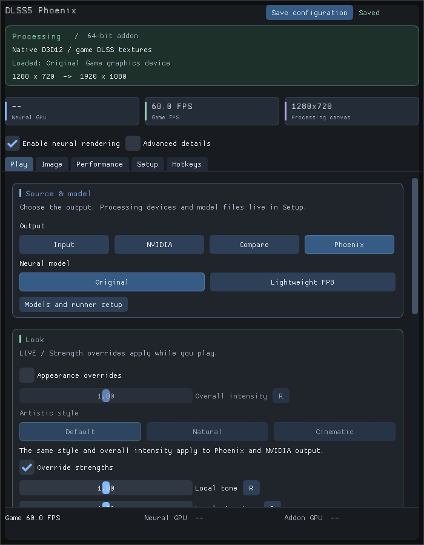
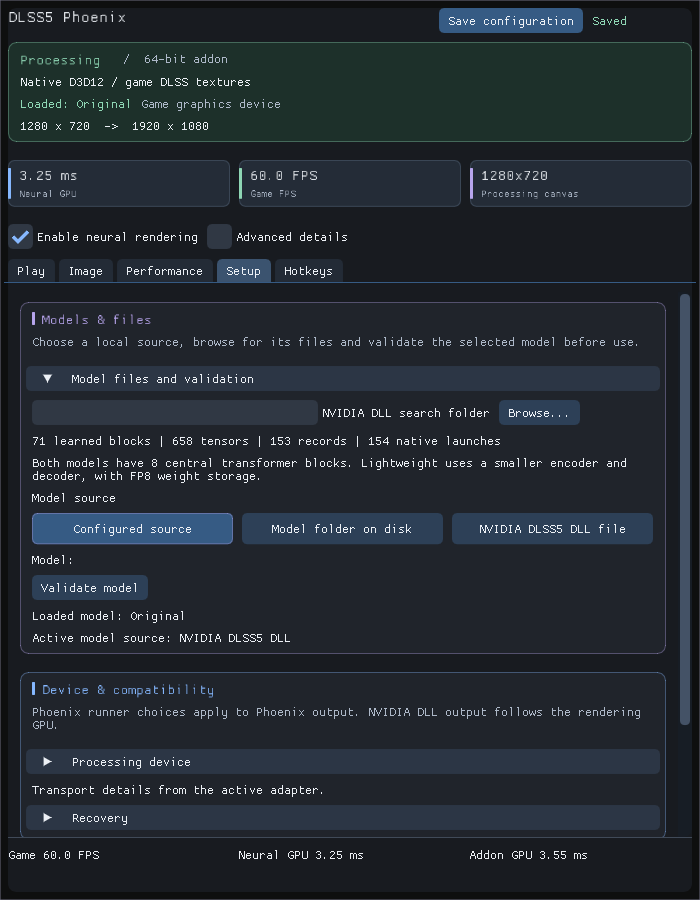
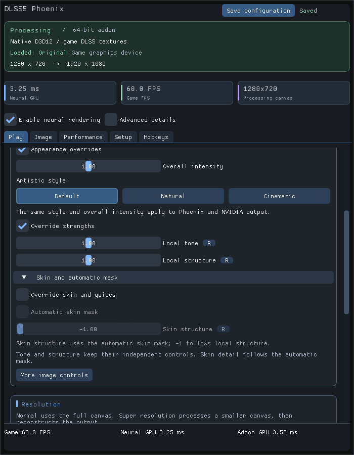
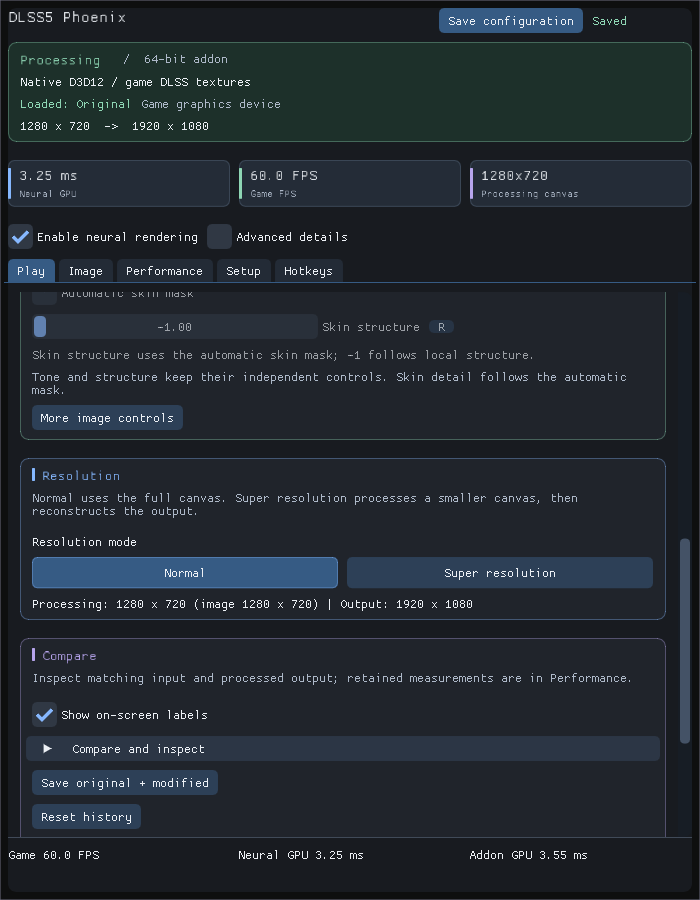
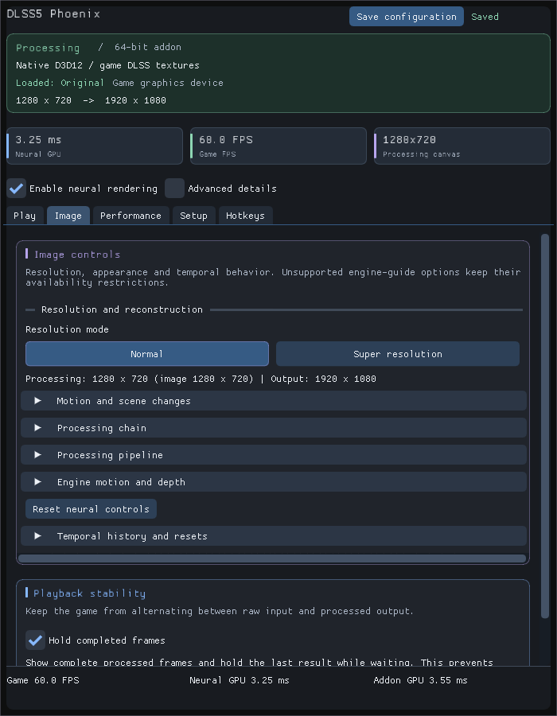
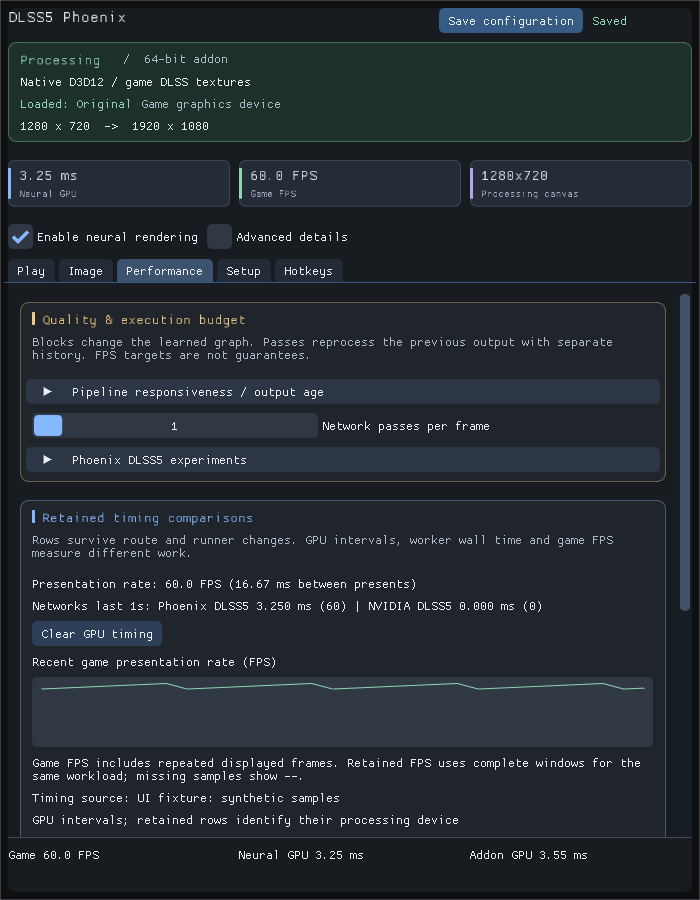
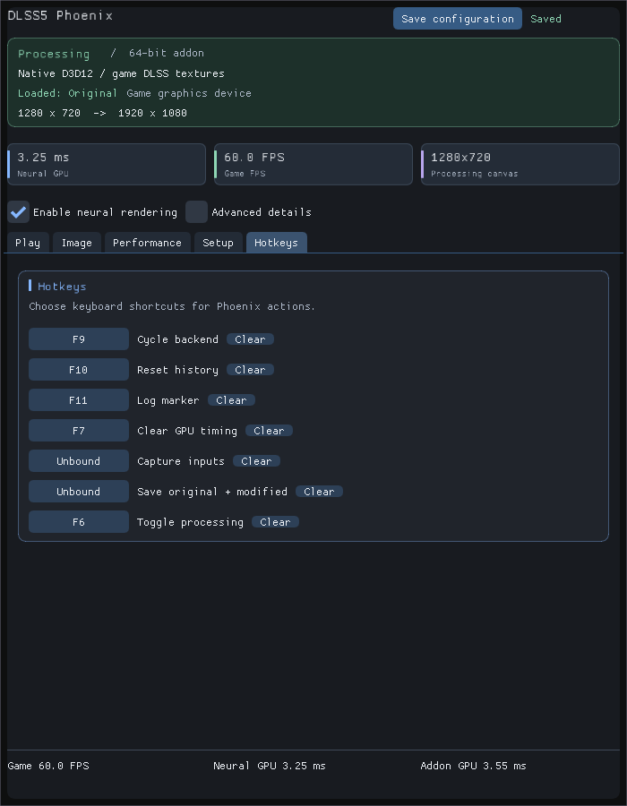
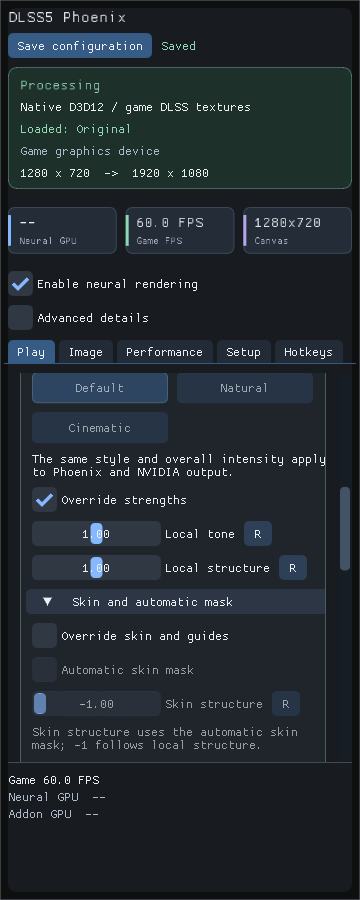
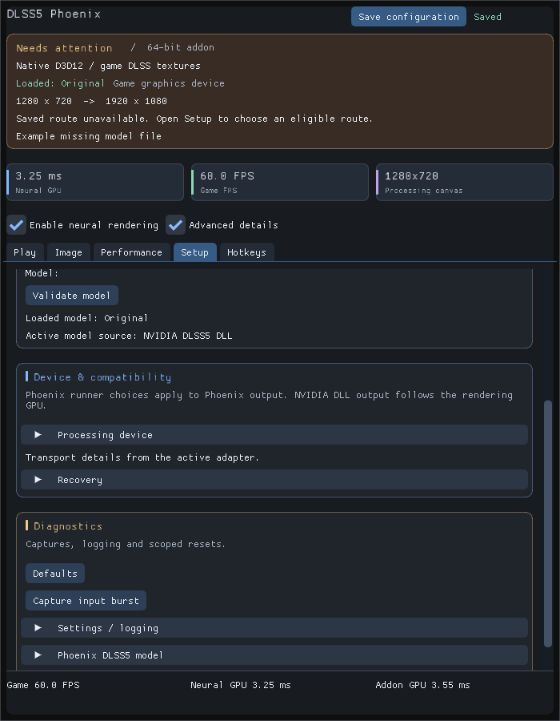

# Using Phoenix DLSS5

[Project overview](../README.md) · [Documentation index](README.md)

Choose a renderer and compatible model, start with Automatic execution, and compare the same frame before tuning the look. [Installation](INSTALLATION.md) · [All features](FEATURES.md)

<table><tr><td></td><td></td></tr></table>

*Native UI fixture renders, with synthetic status and no personal game captures.
Dashes mean no measurement. [All controls and screenshots](USER_GUIDE.md#a-quick-look).*

## Playback stability and leaving comparison

On helper/capture routes, **Image → Playback stability → Hold completed frames**
keeps each original/processed pair together and holds the last completed result
while processing catches up. Before the first result, the loading gate hides raw
input. Leave it on to prevent original/processed alternation; camera movement
includes processing delay. Turning it off enables experimental live-image edits.

For DX11 shared-GPU helpers, a transient ReShade runtime reset can retain the
helper and completed frame when the game device, window, settings and canvas
still match. Releasing the old backbuffer views lets DXGI resize safely without
reloading the model. Device destruction, incompatible settings/layouts and
helper failures still require fresh resources. The operating system's fullscreen
mode transition can itself blink; keeping the model warm avoids the additional
model-loading blackout. Diagnostics expose `runtime_resumes` for this handoff.

**Exit comparison** returns to the processed comparison source in both the full
and compact panels. The saved pair and divider remain available for next time.

### Motion and temporal stability

Open **Image → Motion and scene changes**. Compatible local bridges, the Native
RTX helper and matching x86 in-process library runtimes expose these controls.
With the latter installed, Automatic can keep Phoenix DLSS5 motion processing
inside the x86 game. Older x86 packages and spatial-only driver/portable routes
still need the helper for these controls. They do not turn estimated motion into
engine depth or other game buffers.

- **Motion source:** Automatic prefers explicitly supplied engine vectors and
  otherwise estimates missing motion. Estimation is enabled by default. Engine vectors
  requires a real, history-aligned producer; an allocated zero texture does not
  qualify. NVIDIA Optical Flow forces estimation; Zero motion ignores vectors.
- **Estimate motion when engine vectors are unavailable:** enables NVIDIA Optical
  Flow on supported hardware. An unavailable provider falls back to spatial
  processing with a history reset. Color-only capture routes normally use this
  option because they do not receive engine vectors. An explicitly saved Off
  choice is preserved when updating an installation.
- **Motion analysis height:** 64–2160 pixels, with aspect ratio preserved and no
  enlargement beyond the captured input. At 1920×1080, a height of 180 analyzes
  320×180; 360 analyzes 640×360. This changes flow work, not neural output size.
- **Consistency tolerance** and **cost threshold:** reject unreliable estimated
  vectors before temporal history is reused. Direction/magnitude and confidence
  views visualize estimated flow; they do not fabricate confidence for engine data.
- **Detect scene changes and reset history:** analyzes a small 64×36 thumbnail.
  Ordinary exposure shifts and small pans are discounted. Geometry/source changes,
  long gaps and explicit resets also invalidate history.

The status reports the active source, configured estimation size and whether
history is available. Missing, priming or invalid flow resets history; it does
not intentionally switch to the original game image. **Temporal history and resets → Force
reset every frame** overrides temporal reuse, so leave it off when evaluating
motion stability. Motion settings apply when you release the control, without
restarting the helper or reloading the neural model. Artistic sliders remain live
while dragging. Hold completed frames addresses presentation alternation; motion
and history controls address temporal stability within the processed image.
The **Output** selector also switches directly to Input, Phoenix DLSS5 or NVIDIA
DLSS5. Motion/history controls remain disabled on routes without motion services.
Color-only capture can use a supported estimator; it does not provide engine
guides. This is independent of completed-frame protection.

## Automatic execution and the helper

**Setup → Advanced transport → Automatic** prefers an eligible same-process
route. An x64 DX11 game creates a DX12 compute device on its own adapter and
exchanges textures entirely on the GPU. DX12 uses the game device/queue directly.
Other supported x64 capture APIs (DX9/10, OpenGL and Vulkan) use a native worker
inside the game with fenced CPU pixel capture/return; removing the helper does
not remove that transfer cost.

For x86, Automatic still tries the matching native library/driver bridge and
portable runtime before the helper. Native x86 requires its optional bridge
package and a matching Windows bootstrap profile; the standard download alone
cannot supply that route. The installed NVIDIA driver is discovered automatically
and checked once in an isolated, model-free startup/copy probe. Its result is
cached per driver, Windows image and bridge package. A changed driver is checked
again; a failed check keeps the real error and allows helper fallback. NVIDIA
DLSS5 in an x86 game still needs the x64 helper.
Inspect **Active execution**, process IDs and fallback reasons rather than
inferring where processing runs from the game API. Explicit **External x64
helper** remains available; unsafe, unretired GPU work stops processing.

The added x64 DX11 interop and staging paths have software-only transfer and
synthetic-evaluator regression coverage. That is not a new retail-game or
hardware-inference validation claim.

## Appearance Controls

- Experimental Phoenix intensity and Default/Natural/Cinematic styles.
- Engine-fed surface maps, protected UI and distortion inputs. Per-surface editing
  requires engine-provided IDs/textures; final-color capture cannot invent them.
- Tile-aligned native graphs, stale-layout rejection and graph/package checks.

[Feature guide](NEURAL_CONTROLS.md) · [Installation](RELEASE_0.19.md) · [Native correctness](NATIVE_CORRECTNESS_0.82.md)

## A quick look

- **Run native RTX:** the optimized path and the focus of this project.
- **Choose tuned kernels automatically:** selection follows the actual neural
  input resolution, including odd/portrait/ultrawide inputs; no manual switch.
  [Tests and limits](NATIVE_MEMORY_INVESTIGATION_2026-10-13.md).
- **Explore the portability lab:** experimental CUDA, Vulkan, HIP, CPU and SYCL runners.
- **Bring a compatible model:** browse to a DLL or model folder and validate it.
- **Choose resolution and upscaling:** Normal or Super resolution, aspect controls,
  spatial reconstruction, NVIDIA DLSS SR or Intel XeSS.
- **Let the network adapt:** automatically reduce or restore Phoenix DLSS5 transformer
  blocks to target game FPS or a GPU-time budget (experimental).
- **Make it your own:** tone, structure, skin controls and adjustable neural work.
- **Compare as you go:** split/difference views and timing history across backends.
- **Keep it practical:** CPU thread limits, presets and Save configuration at the top.

Runner and upscaler availability depends on your hardware and installed runtimes.
The [performance guide](PERFORMANCE.md) separates current two-model results from historical Original-only studies. The [full current report](benchmarks/current/README.md)
has the detailed timings, memory measurements and limits.

**Less hunting. More playing.** Source and Look controls get their own cards;
model files, device choices and transport details live in Setup. Save and timing
summaries stay visible while the body scrolls. All 136 saved settings are retained.

See the new cards, detailed controls and narrow-panel layout

**Look, skin and masks**

**Resolution, comparison and presets**

**Image and pipeline details**

**Performance and retained comparisons**

**Hotkeys and quick bypass**

**Narrow panels and useful errors**

<table><tr><td></td><td></td></tr></table>

These are the actual C++/ImGui widgets rendered in a CPU UI fixture, with
synthetic status metadata. They are not gameplay screenshots, hardware
qualification or benchmark measurements. Available controls depend on the route,
hardware and installed runtimes. [UI guide](overlay-ui.md).

[Appearance and timing controls](FEATURES.md#what-you-can-play-with) ·
[Native RTX results](PERFORMANCE.md#native-rtx-the-main-event) ·
[Experimental runners](PERFORMANCE.md#the-portability-lab) ·
[Build instructions](DEVELOPMENT.md#build-from-source)

## Release notice

When a newer published Phoenix version is found, a small link appears at the top of the panel in both x86 and x64 addons. Click it to open GitHub releases. Checks run in the background, include beta releases, and retry quietly if GitHub is unavailable. No models, game names or local paths are sent.
