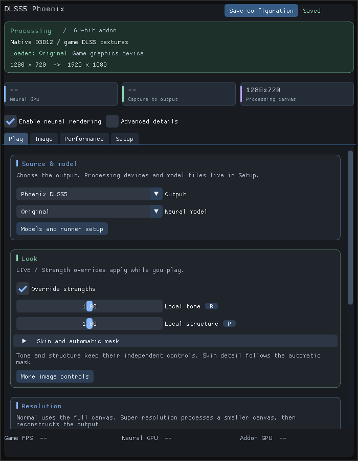
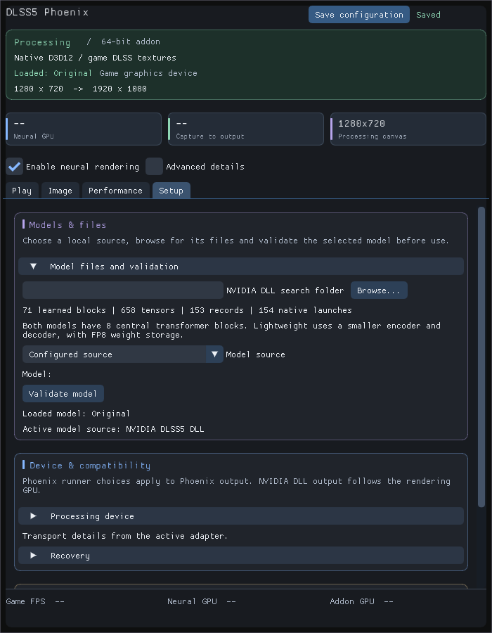
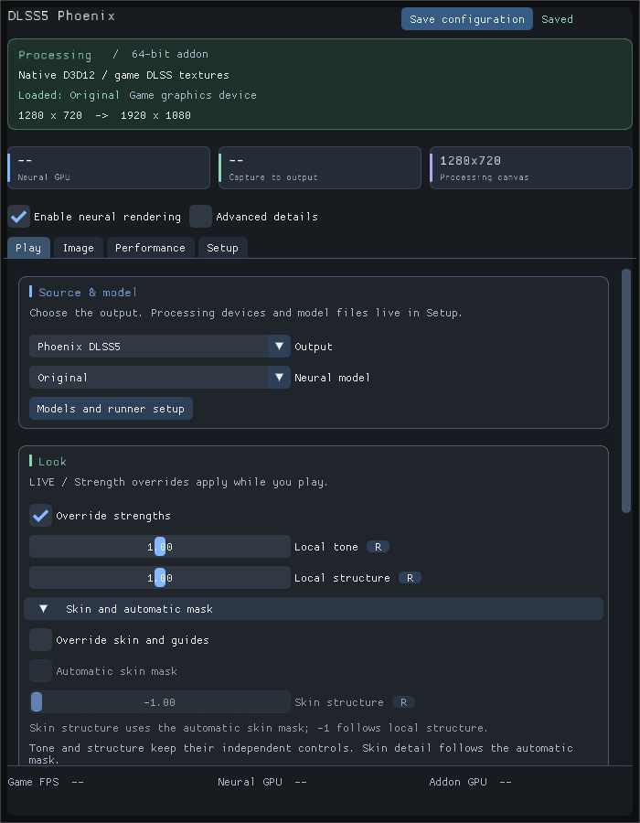
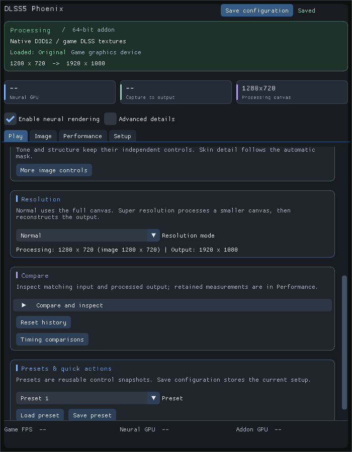
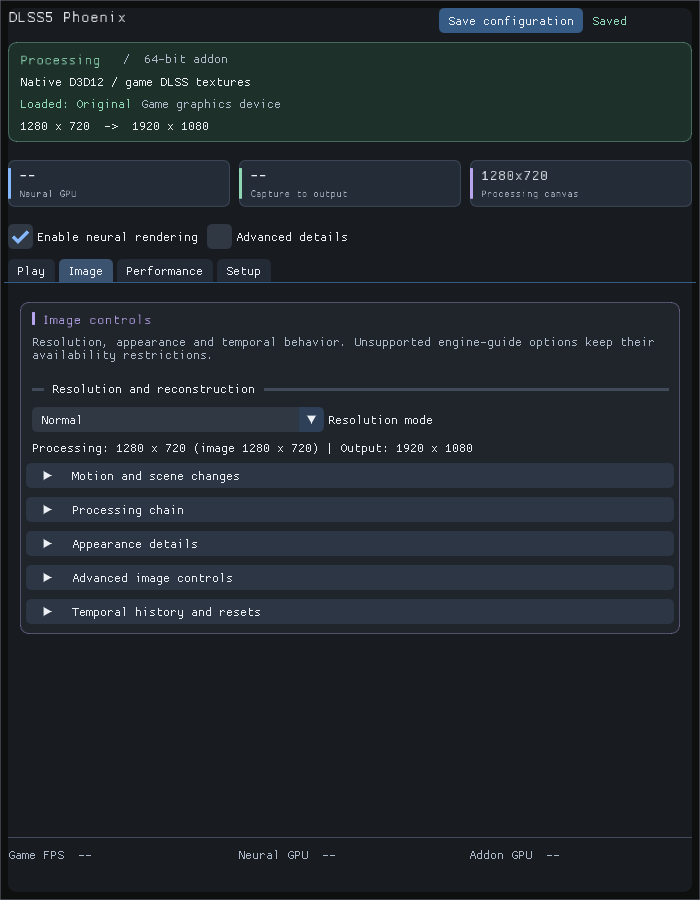
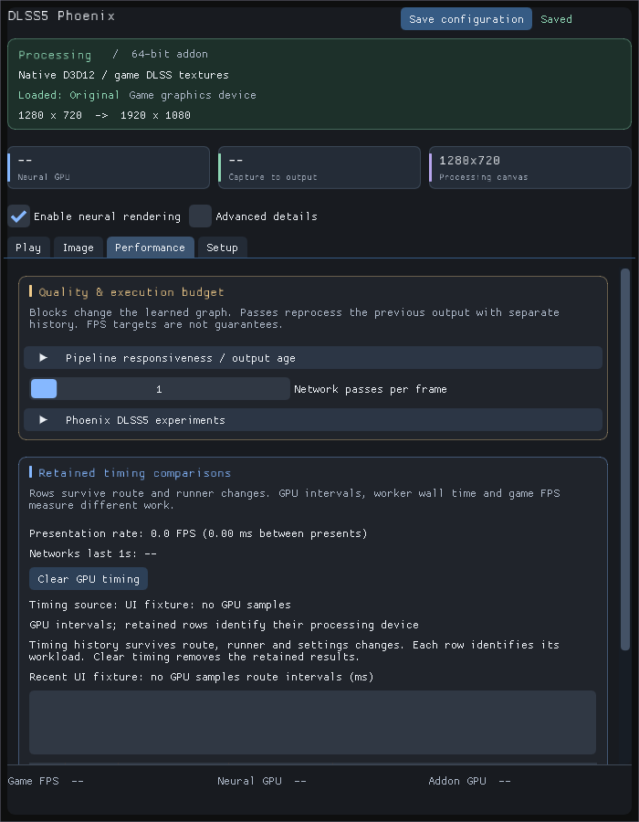
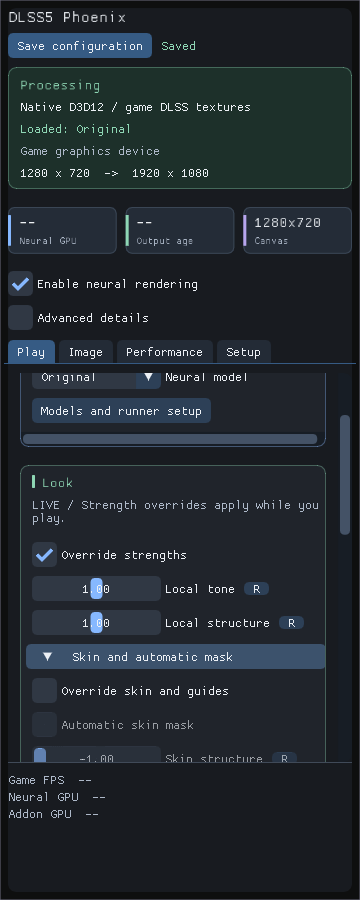
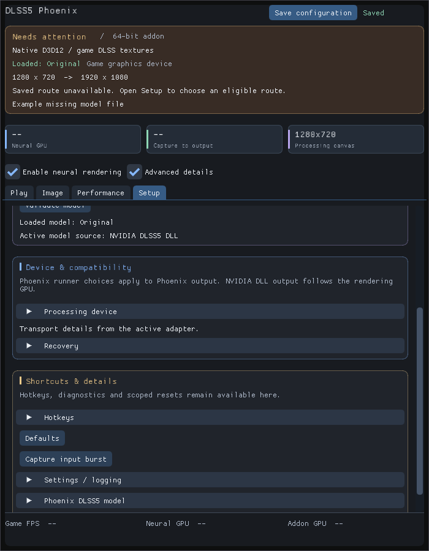

# Using Phoenix DLSS5

[Project overview](../README.md) · [Documentation index](README.md)

Choose a renderer and compatible model, start with Automatic execution, and compare the same frame before tuning the look. [Installation](INSTALLATION.md) · [All features](FEATURES.md)

<table><tr><td></td><td></td></tr></table>

*Native UI fixture renders, with synthetic status and no personal game captures.
Dashes mean no measurement. [All controls and screenshots](USER_GUIDE.md#a-quick-look).*

## Appearance Controls

- Experimental Phoenix intensity and Default/Natural/Cinematic styles.
- Engine-fed surface maps, protected UI and distortion inputs. Per-surface editing
  requires engine-provided IDs/textures; final-color capture cannot invent them.
- Tile-aligned native graphs, stale-layout rejection and graph/package checks.

[Feature guide](NEURAL_CONTROLS.md) · [Installation](RELEASE_0.19.md) · [Native correctness](NATIVE_CORRECTNESS_0.82.md)

## A quick look

- **Run native RTX:** the optimized path and the focus of this project.
- **Choose tuned kernels automatically:** selection follows the actual neural
  input resolution, including odd/portrait/ultrawide inputs; no manual switch.
  [Tests and limits](NATIVE_MEMORY_INVESTIGATION_2026-10-13.md).
- **Explore the portability lab:** experimental CUDA, Vulkan, HIP, CPU and SYCL runners.
- **Bring a compatible model:** browse to a DLL or model folder and validate it.
- **Choose resolution and upscaling:** Normal or Super resolution, aspect controls,
  spatial reconstruction, NVIDIA DLSS SR or Intel XeSS.
- **Let the network adapt:** automatically reduce or restore Phoenix DLSS5 transformer
  blocks to target game FPS or a GPU-time budget (experimental).
- **Make it your own:** tone, structure, skin controls and adjustable neural work.
- **Compare as you go:** split/difference views and timing history across backends.
- **Keep it practical:** CPU thread limits, presets and Save configuration at the top.

Runner and upscaler availability depends on your hardware and installed runtimes.
The [performance guide](PERFORMANCE.md) separates current two-model results from historical Original-only studies. The [full current report](benchmarks/current/README.md)
has the detailed timings, memory measurements and limits.

**Less hunting. More playing.** Source and Look controls get their own cards;
model files, device choices and transport details live in Setup. Save and timing
summaries stay visible while the body scrolls. All 136 saved settings are retained.

See the new cards, detailed controls and narrow-panel layout

**Look, skin and masks**

**Resolution, comparison and presets**

**Image and pipeline details**

**Performance and retained comparisons**

**Narrow panels and useful errors**

<table><tr><td></td><td></td></tr></table>

These are the actual C++/ImGui widgets rendered in a CPU UI fixture, with
synthetic status metadata. They are not gameplay screenshots, hardware
qualification or benchmark measurements. Available controls depend on the route,
hardware and installed runtimes. [UI guide](overlay-ui.md).

[Appearance and timing controls](FEATURES.md#what-you-can-play-with) ·
[Native RTX results](PERFORMANCE.md#native-rtx-the-main-event) ·
[Experimental runners](PERFORMANCE.md#the-portability-lab) ·
[Build instructions](DEVELOPMENT.md#build-from-source)

## Release notice

When a newer published Phoenix version is found, a small link appears at the top of the panel in both x86 and x64 addons. Click it to open GitHub releases. Checks run in the background, include beta releases, and retry quietly if GitHub is unavailable. No models, game names or local paths are sent.
