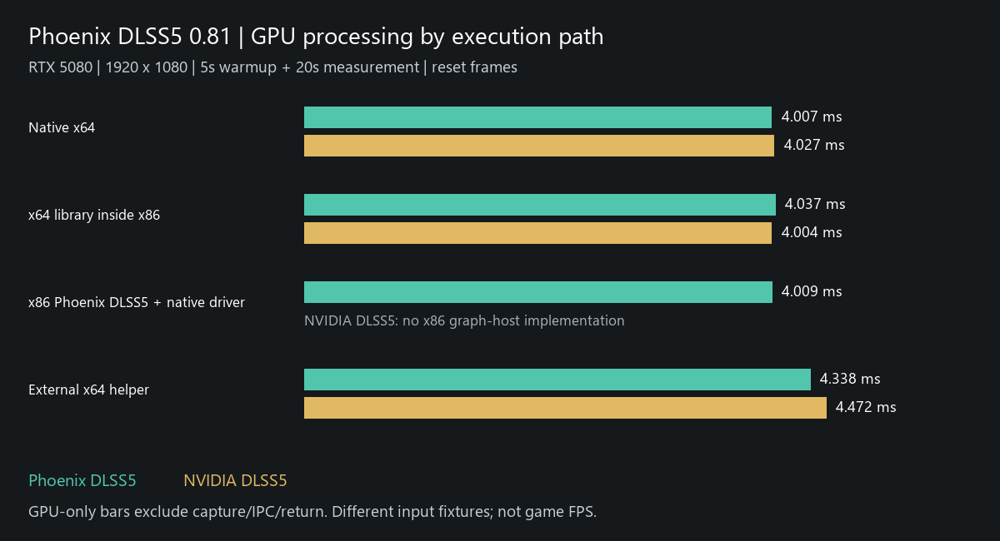

# 0.81 Execution Measurements

RTX 5080, driver 616.64; 1920 x 1080; 1:1; full network; reset frames.
Each case: 5 seconds warmup, then 20 seconds measurement. These retained
pre-release measurements were not rerun on the release binaries.

**Not game FPS. GPU time excludes CPU capture/readback/IPC. Wall-time scopes differ.**

| Renderer | Execution | GPU mean / p95 (ms) | Wall mean / p95 (ms) | Timing samples | Completed outputs/s |
| --- | --- | ---: | ---: | ---: | ---: |
| Phoenix DLSS5 | Native x64 | 4.007 / 4.445 | 4.391 / 4.835 | 4240 | 211.95 |
| Phoenix DLSS5 | x64 library inside x86 | 4.037 / 4.494 | 4.508 / 4.973 | 4096 | 204.78 |
| Phoenix DLSS5 | x86 Phoenix DLSS5 + native driver | 4.009 / 4.468 | 4.464 / 4.916 | 4480 | 223.99 |
| Phoenix DLSS5 | External x64 helper | 4.338 / 5.037 | 12.358 / 13.661 | 41 | 63.65 |
| NVIDIA DLSS5 | Native x64 | 4.027 / 4.529 | 4.455 / 4.959 | 4487 | 224.34 |
| NVIDIA DLSS5 | x64 library inside x86 | 4.004 / 4.474 | 4.465 / 4.931 | 4435 | 221.70 |
| NVIDIA DLSS5 | x86 Phoenix DLSS5 + native driver | Not available | Not available | - | - |
| NVIDIA DLSS5 | External x64 helper | 4.472 / 4.858 | 13.071 / 13.857 | 41 | 60.80 |

## Read the Scopes

- **Native x64 / x64 library inside x86:** GPU-resident synchronized API calls.
  The x86 experiment enters its x64 worker once, not once per frame.
- **x86 Phoenix DLSS5 + native driver:** resident images with a real per-frame
  x86 dispatch-packet handoff; no host-image transfer.
- **External x64 helper:** actual x86 DX12 fixture capture/readback, IPC,
  model processing and return. Latencies are status-poll sampled; output
  throughput is counted separately, not the inverse of sampled latency.

- Wall-time scopes differ; do not treat the helper/resident ratio as architectural overhead.
- Resident tests use synthetic pixels; the helper uses a different DX12 fixture image.
- Resident calls are collected individually; helper latency uses 41 status-poll samples.
- Single serial run per case; no confidence interval or statistical overhead claim.
- Completed output throughput is not game FPS.
- New add-on native x86 paths also stage CPU pixels; their end-to-end latency is not measured here.

The GPU column includes route-specific model/output work; Phoenix DLSS5 native
probes include output copy. Do not combine the historical October 14 VRAM
study with these timings as if they were one matched measurement.

[Machine-readable measurements and receipt hashes](measurements.json).
Raw receipts remain local because they include host paths and diagnostics.
Regenerate this export with `python tools/export_release_benchmarks.py`
when the three validated local receipts are available. No GPU is used.
