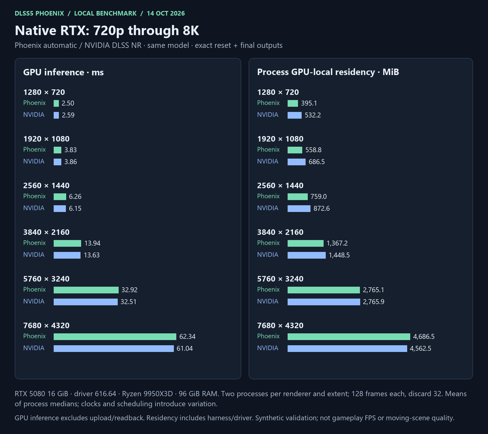
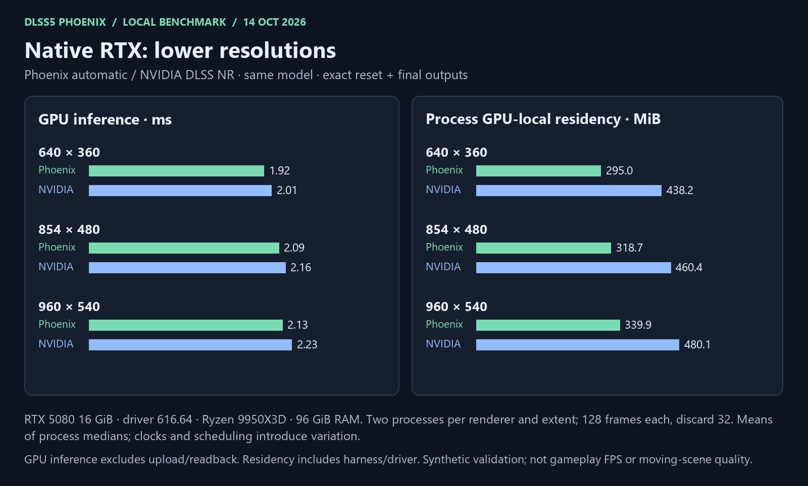
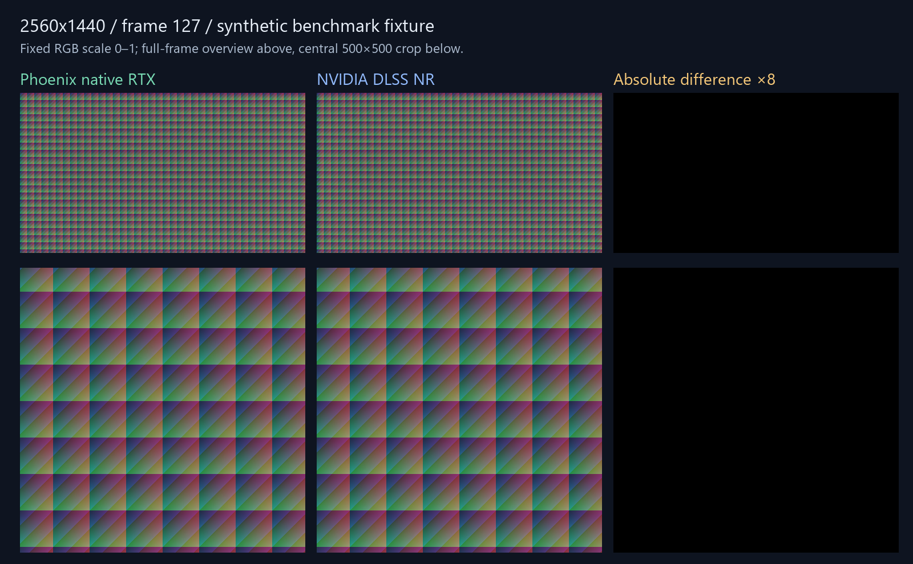
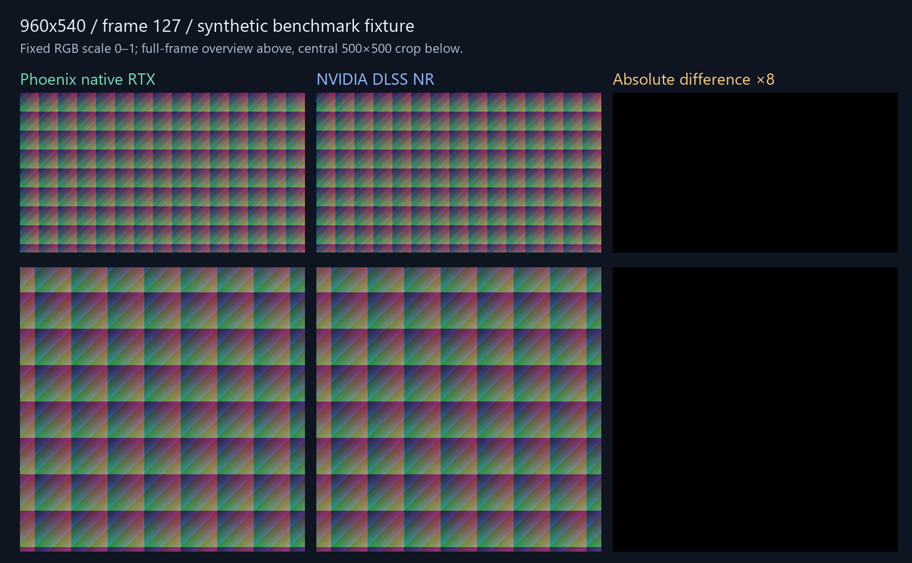

# Current benchmark snapshot — 14 October 2026

Native RTX is the primary execution path. Experimental alternate runners have a
different fixture and timing boundary and are reported separately. Current
measurements only; inference latency is not game FPS. [Regular regression checks and retained 8K control stalls](../../REGULAR_PERFORMANCE_REGRESSION_2026-10-14.md).

[Interactive resolution report and output comparisons](resolutions.html) ·
[Measurements](measurements.json) · [Exact-output receipts](native-resolution-validation.json)

## Native RTX and NVIDIA DLSS NR — measured 14 October

RTX 5080 16 GiB, NVIDIA driver 616.64; Ryzen 9 9950X3D, 16 cores / 32 threads;
96 GiB RAM. Same synthetic RGBA16F color / RG16F motion textures, model DLL
310.8.0.0, controls, full eight blocks and one pass. D3D12 debug enabled on both.
GPU timestamps cover runner/Evaluate, excluding uploads and readbacks. Each
renderer uses two fresh processes per extent, 128 frames each, discarding 32.
Phoenix uses automatic input-resolution kernel selection and aligned 64-channel
memory access. Both routes were freshly rerun; input pixel hashes are unchanged.
Headline values are arithmetic means of the two process medians; ranges are
preserved in the JSON. Clocks and scheduling introduce variation.

| Resolution | Phoenix GPU ms | NVIDIA GPU ms | Phoenix GPU MiB | NVIDIA GPU MiB |
| --- | ---: | ---: | ---: | ---: |
| 640 × 360 | 1.9222 | 2.0074 | 295.01 | 438.21 |
| 854 × 480 | 2.0883 | 2.1586 | 318.70 | 460.40 |
| 960 × 540 | 2.1257 | 2.2282 | 339.88 | 480.15 |
| 1280 × 720 | 2.4971 | 2.5889 | 395.13 | 532.21 |
| 1920 × 1080 | 3.8288 | 3.8636 | 558.82 | 686.52 |
| 2560 × 1440 | 6.2617 | 6.1518 | 759.01 | 872.65 |
| 3840 × 2160 | 13.9424 | 13.6280 | 1367.20 | 1448.46 |
| 5760 × 3240 | 32.9226 | 32.5125 | 2765.13 | 2765.90 |
| 7680 × 4320 | 62.3358 | 61.0393 | 4686.51 | 4562.52 |

GPU memory is measured whole-process local residency, including harness and
driver allocations. It is not the model size or NVIDIA internal buffer usage.
The same texture formats are used on both routes. No universal VRAM saving is
claimed: compare the measured rows, especially 6K and 8K.





<details>
<summary>Host memory observations, MiB</summary>

These are averages of process-median observations, not startup peaks. Private
commit, working set, owned allocations and GPU residency overlap; do not sum them.
The Phoenix probe retains weight/fixture host caches through the run; NVIDIA
uses transient host upload planes. These columns describe the probes, not a
matched comparison of runner-only system RAM.

| Resolution | Phoenix private commit | Phoenix working set | NVIDIA private commit | NVIDIA working set |
| --- | ---: | ---: | ---: | ---: |
| 640 × 360 | 601.6 | 292.7 | 663.5 | 350.8 |
| 854 × 480 | 630.9 | 296.3 | 692.0 | 350.7 |
| 960 × 540 | 656.2 | 298.1 | 713.8 | 350.9 |
| 1280 × 720 | 719.7 | 305.9 | 760.1 | 350.1 |
| 1920 × 1080 | 899.0 | 327.9 | 914.8 | 351.0 |
| 2560 × 1440 | 1130.9 | 358.6 | 1100.5 | 351.5 |
| 3840 × 2160 | 1828.5 | 446.7 | 1677.8 | 350.2 |
| 5760 × 3240 | 3426.0 | 644.4 | 2998.0 | 350.3 |
| 7680 × 4320 | 5629.2 | 1111.8 | 4796.2 | 603.2 |

</details>

## Further analysis

[Native scaling investigation](../../NATIVE_SCALING_DIAGNOSIS_2026-10-13.md):
the retained baseline before tuning, with clock observations and direct
Phoenix/NVIDIA launch attribution at 720p, 1080p, 4K and 8K.
[Controlled memory tests and automatic selection](../../NATIVE_MEMORY_INVESTIGATION_2026-10-13.md)
explain the implemented changes. These investigations retain their separate
sample counts; the current release snapshot above uses the freshly rerun
nine-resolution method documented here.

### Hypothetical VR costs

[PSVR2 and Steam Frame charts, calculations and stereo-batching explanation](VR_ESTIMATES.md).
These are estimates from the desktop measurements, not VR benchmarks, and are
kept separate from the measured rows above.

## Output validation and resolution fixes

- All nine standard extents match NVIDIA exactly at reset and frame 127.
  Both fresh Phoenix processes produce identical endpoint hashes. NVIDIA
  final-frame comparisons are repeated in two fresh processes per extent.
- Earlier planner validation, before the automatic-kernel tuning, checked
  **29 awkward extents** at reset and frame 15, with two fresh
  processes per renderer: small, odd, portrait and ultrawide
  inputs. Examples include 63×65, 960×540, 1025×769, 1921×1081,
  3841×2161, 721×1281 and 3441×1439.
- Earlier native-only planner checks at seven additional sizes (1×1, 17×31, 1×1024, 4096×7, 7×4096,
  16384×17 and 17×16384) pass finite-output, zero-debug-error, retirement
  and two-process hash-repeatability checks. NVIDIA probes at 1×1 and 17×31
  hung the GPU device; the other thin cases were not compared to NVIDIA.
- [Edge-case receipts](resolution-edge-validation.json) retain numerical
  comparisons and hashes. [Planner checks](planner-validation.json) cover
  41 allocation extents, tensor lifetimes and token-tail capacity.
- Frame padding follows the rounded grid after three reductions. Four tiled
  dispatch grids use their actual tile count. Transformer allocations include
  the complete 32-token write tail. Unwritten downsample border cells retain
  zero initialization across frames and passes through a small reserved tensor.
- The earlier resolution failures reproduced with the pre-release kernels and
  were fixed in planning/allocation. The current release additionally changes
  three 64-channel memory-access stages and automatically selects two large-input
  entries at 18,662,400 pixels. No per-frame full-workspace clear was added.
- Current saved-regression validation checks **eight extents**, including
  5760×3239 below the tuning threshold and 5761×3241 above it. Both compiled
  branches are exercised; current NVIDIA comparisons cover all nine standard
  extents. Earlier edge-case receipts retain their original source/version scope.

These are numerical checks of one synthetic input and fixed controls. They do
not certify moving-scene quality, every possible resolution, optional guides,
all control combinations or live-game frame time. Debug errors were zero and
tracked owned allocations retired to zero in the probes.

### Actual output images

Final frame 127, fixed RGB range 0–1, no auto exposure or contrast. Left: Phoenix;
middle: NVIDIA; right: absolute difference amplified ×8. These are synthetic
fixtures, not gameplay screenshots.





Other comparisons: [640×360](output-640x360.png) · [854×480](output-854x480.png) · [960×540](output-960x540.png) · [1280×720](output-1280x720.png) · [1920×1080](output-1920x1080.png) · [2560×1440](output-2560x1440.png) · [3840×2160](output-3840x2160.png) · [5760×3240](output-5760x3240.png) · [7680×4320](output-7680x4320.png)


## Experimental alternate runners — measured 14 October

Saved RGB32F broker fixtures and controls were replayed with exact hashes on every frame. CUDA and Vulkan RTX use three processes with 12 fractional-motion frames each, discarding two. CPU/HIP use two processes with one warmed reset frame each. Vulkan AMD and SYCL CPU use two processes with two measured fractional-motion frames each. The table uses the median of process medians. Full call includes preparation, transfers, execution, resolve and broker overhead; startup, file I/O and output hashing are excluded.

| Runner / hardware | Model ms | Full call ms | Owned graph MiB | Worker working set MiB |
|---|---:|---:|---:|---:|
| CUDA · RTX 5080 | 56.31 | 102.84 | 453.38 | 303.34 |
| Vulkan · RTX 5080 | 104.91 | 158.07 | 453.38 | 313.52 |
| CPU · Ryzen 9950X3D | 9311.58 | 9363.97 | 453.38 | 548.77 |
| HIP · AMD integrated gfx1036 | 14104.37 | 14784.61 | 453.38 | 137.71 |
| Vulkan · AMD integrated gfx1036 | 11999.67 | 12105.86 | 453.38 | 685.91 |
| SYCL · Ryzen CPU / Intel CPU runtime | 11291.05 | 11370.68 | 453.38 | 794.62 |

CPU used all 32 workers. CPU/SYCL operator time uses host timing; GPU operator time uses GPU timestamps. Owned graph memory is requested weight/scratch storage, not whole-process GPU residency. Worker working set, private commitment and graph allocations overlap and must not be added. Owned graph memory is unchanged for every route. These alternate fixtures and timing boundaries differ from native; these timings are not game FPS.

## Alternate RTX resolution limits — measured 14 October

These are measurements from the earlier portable build, before the latest
1080p optimization pass; they have not been rerun with candidate 124. They use
the alternate-runner RGB32F/fractional-motion broker fixture above.
Two fresh processes × six frames, discard two; averages of process medians.
Repeatability hashes match between processes. They are not native/NVIDIA parity
checks, and the short runs are exploratory. Vulkan failures are reported as
failures rather than assigning a time or hiding the row.

| Resolution | CUDA model / full ms | Vulkan model / full ms | Requested buffers MiB |
| --- | ---: | ---: | ---: |
| 2560 × 1440 | 118.24 / 188.41 | 191.91 / 268.10 | 684.01 |
| 3840 × 2160 | 282.61 / 443.46 | 481.83 / 649.86 | 1,805.33 |
| 5760 × 3240 | 765.49 / 1,118.13 | Operand-offset failure | 6,152.52 |
| 7680 × 4320 | 13,526.16 / 14,309.75 | Resident-allocation failure | 16,422.05 |

The alternate CUDA 8K graph requests about 16 GiB before other GPU allocations;
its very large slowdown is consistent with memory pressure, but residency/paging
was not directly measured here. Vulkan 6K/8K support remains unresolved. CPU
and iGPU runners were not extrapolated to these large sizes. See
[alternate resolution receipts](portable-resolution-validation.json).

## Native adapter memory — measured 11 October

The unchanged full game-adapter measurements are **493.94 MiB** owned at one
pass, **527.69 MiB** at two and **595.19 MiB** at four. Serial passes share
weights and workspace; each adds 33.75 MiB history. Returning to one restores
493.94 MiB. These are earlier adapter measurements, not fresh game residency.
The current RG16F inner-network probe owns 401.75 MiB at 1080p.
The adapter includes extra bridge/exposure resources; these scopes differ.

## Build and validation

The current 14 October replay checks 92 exact alternate frames and all nine native extents;
[regular regression checks](../../REGULAR_PERFORMANCE_REGRESSION_2026-10-14.md) and
[bridge checks](../../BRIDGE_FIXES_2026-10-14.md) retain the complete scopes and limitations.

- Current automatic-selection addon: **15 CPU suites, two software D3D12 suites, 127 embedded
  payload files verified**. No model or NVIDIA DLL embedded.
- Rebuilt portable runtime: **42 exact regression frames / 18 jobs / six routes**.
  Earlier 13 October CUDA/Vulkan paired trials checked **144 exact temporal frames**; CPU/HIP
  trials check 16 exact reset frames. Operator contracts pass on CPU, HIP, CUDA
  and both Vulkan devices. CUDA compact-window memory/race checks report zero
  errors/hazards. See [the optimization details](../../PORTABLE_OPTIMIZATION_FOLLOWUP_2026-10-13.md).
- This exact addon has not had a new live-game test. No game FPS, discrete
  AMD/Intel GPU, dual-GPU speedup or portable/native bit-equivalence is implied.
- Addon source checkpoint: `f86c2f2`.
  Documentation may have later commits. Addon SHA256:
  `25576abc62674293d0f28e87ec5ad385bbc9e5a27c17d6c2f73ba6ec26a04316`.

## Regenerate the charts and HTML

```powershell
python -m pip install pillow
python tools/render_readme_benchmarks.py --snapshot docs/benchmarks/2026-10-13
```

Pillow is documentation-only. This redraws the checked-in measurements without
a model or GPU. Segoe UI is used on Windows, with DejaVu Sans as a Linux fallback.
Source inference probes and fixture generation are described in [BUILDING.md](../../../BUILDING.md).
