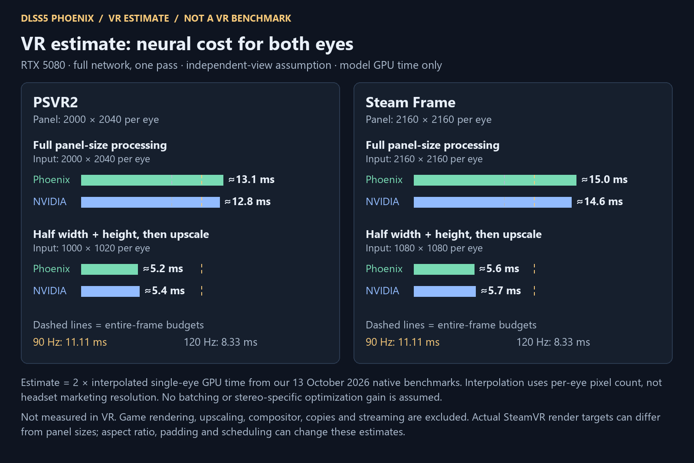
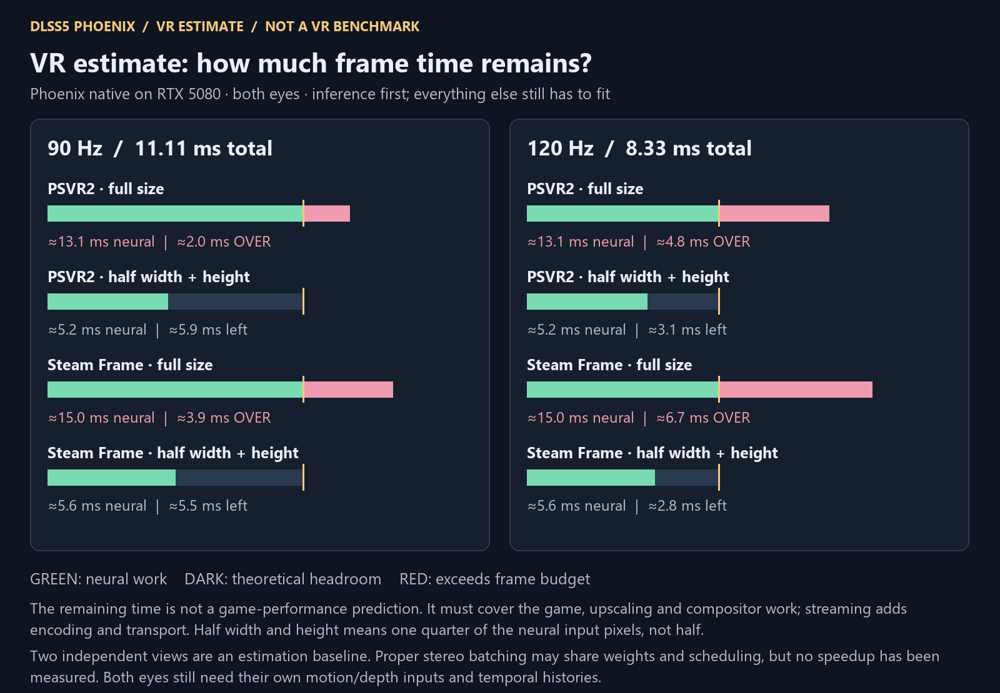

# VR cost estimates — PSVR2 and Steam Frame

**These are hypothetical calculations from measured desktop inference, not VR
benchmarks, verified headset support or game-FPS predictions.** All estimates
assume native Phoenix or NVIDIA NR on the RTX 5080 host PC, the full network and
one pass. They do not estimate standalone Steam Frame performance.





## Inputs and arithmetic

- [PSVR2 specifications](https://www.playstation.com/en-us/ps-vr2/ps-vr2-tech-specs/):
  2000×2040 per eye; 90/120 Hz.
- [Steam Frame specifications](https://store.steampowered.com/hardware/steamframe):
  2160×2160 per eye; 72–144 Hz, with 144 Hz experimental.
- [Measured source data](measurements.json): 13 October 2026 native GPU timings,
  RTX 5080, driver 616.64. Two processes per renderer and extent, 96 measured
  frames per process, means of process medians. Native fixture and controls;
  these are different from portable-runner full-call measurements.
- Interpolate in **single-eye pixel count** between the two neighboring measured
  extents, then double the result for two independently processed views:
  `stereo_ms = 2 × interpolate(width_per_eye × height_per_eye)`.
- Full-panel estimates interpolate between 2560×1440 and 3840×2160. Half-width,
  half-height estimates interpolate between 1280×720 and 1920×1080. No extrapolation.
- Frame budget is `1000 / refresh_hz`; theoretical remaining time is that budget
  minus the estimated Phoenix stereo inference time. Half width and height
  means **one quarter** of the input pixels per eye.

| Headset | Neural input per eye | Phoenix stereo ms | NVIDIA stereo ms |
| --- | --- | ---: | ---: |
| PSVR2, panel size | 2000×2040 | ≈13.1 | ≈12.8 |
| PSVR2, half width/height | 1000×1020 | ≈5.2 | ≈5.4 |
| Steam Frame, panel size | 2160×2160 | ≈15.0 | ≈14.6 |
| Steam Frame, half width/height | 1080×1080 | ≈5.6 | ≈5.7 |

Game rendering, upscaling, compositor work, copies and streaming are excluded.
The reduced-input scenario assumes a separate upscale step whose cost and
stereo quality have not been measured. Shape, padding, attention token counts,
GPU scheduling and contention can change actual timing. Interpolation is an
engineering estimate, not a timing bound or confidence interval.

The headset panel sizes are reference points. A runtime's actual per-eye render
target can differ because of distortion compensation and supersampling; use
the actual target for a deployment estimate. See
[Valve's recommended render target documentation](https://github.com/ValveSoftware/openvr/wiki/IVRSystem%3A%3AGetRecommendedRenderTargetSize).

## Separate views do not require separate execution calls

The current native `Network` has one image geometry, one input/motion pair and
one temporal history pair. The portable graph uses `[height, width, channels]`
tensors; its current batches describe attention heads and spatial windows, not
an eye axis. No stereo inference batch has been implemented or timed here.

Three different arrangements must be distinguished:

1. **Two independent views, submitted serially:** each eye keeps its own history
   and guides. This is the calculation baseline. It does not require two CPU
   waits; both views could be recorded on the same GPU command list.
2. **A proper two-eye batch:** one orchestration can share immutable weights and
   reduce scheduling overhead while isolating the eyes' histories, spatial
   operations and attention. This is feasible engineering work, not an existing
   measured speedup. Native serial refinement already demonstrates shared
   model/workspace ownership with separate histories; stereo would need its
   own integration and correctness checks. Concurrent eyes cannot blindly reuse
   the same scratch memory.
3. **Joining the images into one wide picture:** this is not equivalent to a
   stereo batch. Spatial neighborhoods may cross the eye seam; global attention
   can mix the two eyes even with padding at the seam. Global attention currently
   flattens all spatial tokens into one sequence. Correct isolation requires
   an eye batch axis or appropriate indexing/masks throughout the network.

OpenXR can represent views in shared texture arrays or image rectangles; that
storage layout does not automatically add stereo batching to a neural runner.
See [the OpenXR projection-view interface](https://registry.khronos.org/OpenXR/specs/1.1/man/html/XrCompositionLayerProjection.html).

Relevant source: [native view state](../../../src/native/network/production_network.h),
[portable tensor/attention layout](../../../native_runtime/graph.h), and
[native geometry](../../../src/native/model/generated_plan.h).

The NVIDIA DLL timings also use the independent-view assumption. These tests
establish no claim about an NVIDIA NR stereo-batch interface or its performance.

## Regeneration

```powershell
python -m pip install pillow
python tools/render_vr_estimates.py --snapshot docs/benchmarks/2026-10-13
```

[Machine-readable estimates](vr-estimates.json) retain the input-data digest,
interpolation endpoints, full-precision calculations, sources and exclusions.
They are kept separate from measured benchmark records.
