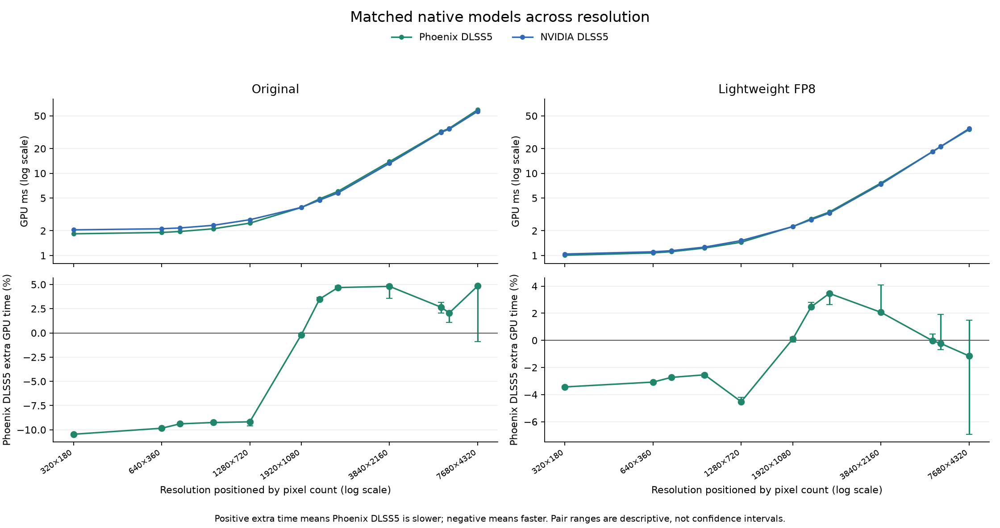
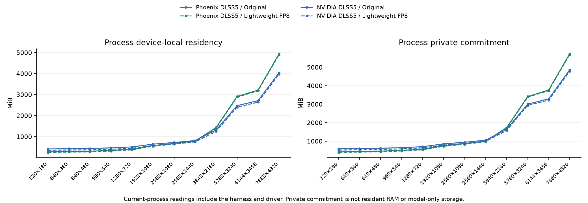
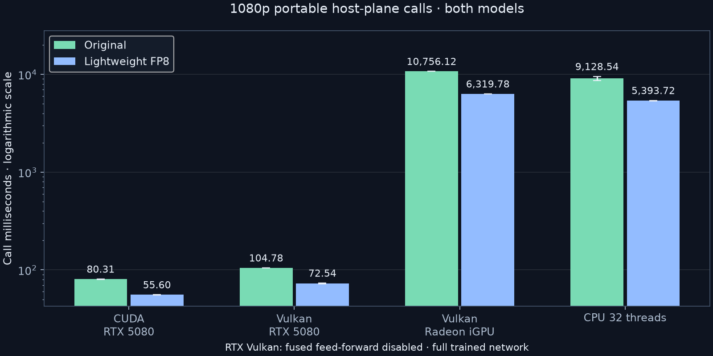
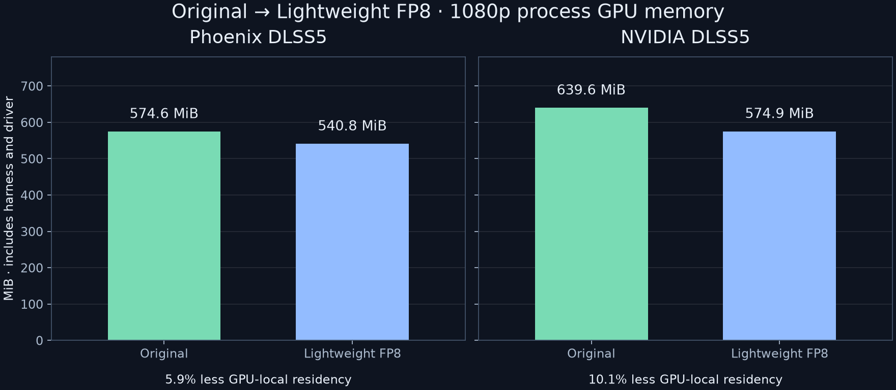
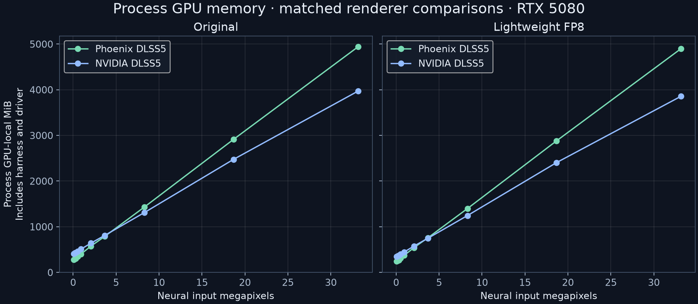

# Current native two-model benchmark

Native measurements refreshed **2026-10-30** from the tuned development bundle. The portable/feature study retained below is dated **2026-10-20** and was not rerun. One RTX 5080, native x64, full trained graphs, one pass, fixed structured FP16 input and zero motion. Both engines use the same authenticated 310.9.16 model DLL. No games or installed addons were changed.

[Measurements JSON](measurements.json) · [Synthetic architecture study](../../NATIVE_TUNING_RESOLUTIONS.md)

## Native RTX and NVIDIA DLSS5

**Performance on par with NVIDIA DLSS5 at 1080p on the tested RTX 5080.** Both Original and Lightweight have comparable isolated inference latency; this is not end-to-end game FPS or portable-backend performance.


| Input | Phoenix DLSS5 Original GPU ms | Phoenix DLSS5 Lightweight GPU ms | NVIDIA DLSS5 Original GPU ms | NVIDIA DLSS5 Lightweight GPU ms |
| --- | ---: | ---: | ---: | ---: |
| 320×180 | 1.838 | 1.007 | 2.052 | 1.042 |
| 640×360 | 1.907 | 1.075 | 2.116 | 1.109 |
| 640×480 | 1.960 | 1.113 | 2.163 | 1.144 |
| 960×540 | 2.114 | 1.233 | 2.329 | 1.265 |
| 1280×720 | 2.475 | 1.450 | 2.725 | 1.519 |
| 1920×1080 | 3.841 | 2.250 | 3.848 | 2.248 |
| 2560×1080 | 4.893 | 2.797 | 4.727 | 2.726 |
| 2560×1440 | 6.035 | 3.384 | 5.772 | 3.287 |
| 3840×2160 | 13.881 | 7.614 | 13.247 | 7.383 |
| 5760×3240 | 32.112 | 18.356 | 31.462 | 18.353 |
| 6144×3456 | 35.346 | 21.137 | 34.553 | 21.221 |
| 7680×4320 | 59.470 | 34.154 | 56.750 | 35.005 |



Points are positioned by actual pixel count on a logarithmic horizontal axis.
The [resolution profiling investigation](../../NATIVE_SCALING_PROFILE.md) separates
pixel growth from the padding/token step just below 1080p and attributes the extra
GPU work to specific kernel families.

## Performance conclusions

Compare the same model and size. Positive extra GPU time below means Phoenix DLSS5 is slower; negative means faster. Percentages are medians of matched-pair changes, not ratios of the separate renderer medians. All three process medians, per-process sample counts and timing summaries remain in the local receipt. Per-frame sample arrays are not retained by this compact refresh.

| Model | Input | Phoenix DLSS5 extra GPU time | Observed pair range |
| --- | --- | ---: | ---: |
| Original | 320x180 | -10.46% | -10.48% to -10.45% |
| Lightweight FP8 | 320x180 | -3.43% | -3.45% to -3.37% |
| Original | 640x360 | -9.84% | -9.95% to -9.79% |
| Lightweight FP8 | 640x360 | -3.08% | -3.11% to -3.04% |
| Original | 640x480 | -9.39% | -9.40% to -9.37% |
| Lightweight FP8 | 640x480 | -2.73% | -2.76% to -2.68% |
| Original | 960x540 | -9.25% | -9.28% to -9.18% |
| Lightweight FP8 | 960x540 | -2.54% | -2.69% to -2.45% |
| Original | 1280x720 | -9.18% | -9.58% to -9.08% |
| Lightweight FP8 | 1280x720 | -4.52% | -4.60% to -4.19% |
| Original | 1920x1080 | -0.18% | -0.40% to -0.08% |
| Lightweight FP8 | 1920x1080 | +0.11% | -0.11% to +0.24% |
| Original | 2560x1080 | +3.50% | +3.35% to +3.67% |
| Lightweight FP8 | 2560x1080 | +2.47% | +2.45% to +2.80% |
| Original | 2560x1440 | +4.68% | +4.50% to +4.86% |
| Lightweight FP8 | 2560x1440 | +3.46% | +2.62% to +3.53% |
| Original | 3840x2160 | +4.80% | +3.59% to +4.94% |
| Lightweight FP8 | 3840x2160 | +2.07% | +2.00% to +4.08% |
| Original | 5760x3240 | +2.66% | +2.06% to +3.14% |
| Lightweight FP8 | 5760x3240 | -0.02% | -0.10% to +0.46% |
| Original | 6144x3456 | +2.06% | +1.08% to +2.30% |
| Lightweight FP8 | 6144x3456 | -0.22% | -0.69% to +1.92% |
| Original | 7680x4320 | +4.84% | -0.91% to +4.91% |
| Lightweight FP8 | 7680x4320 | -1.15% | -6.94% to +1.48% |

Both models match their corresponding NVIDIA DLSS5 preset byte for byte in reset A, history and reset B at all 12 extents, across 144 fresh processes. This applies to the native-50/default path. The two trained models produce different images; this is implementation parity, not a moving-scene quality ranking.

## Instruction styles: synthetic context

**I don't own RTX 20/30/40 hardware.** Their native kernels are built, but physical-card inference is pending. Every bar below is measured on RTX 5080 with the same structured 1080p fixture and sampling settings. Older strategies still compile for the real target GPU. They do not emulate older-card throughput, caches or bandwidth.


The 20/30 paths use FP16 decomposition and can round differently from native FP8. Exact NVIDIA parity above is for the default native path. The separate [before/after study](../../NATIVE_TUNING_RESOLUTIONS.md) checks each style against its own control over 720p–8K.

## Memory at 1080p

| Engine / model | Device-local MiB | Nonlocal MiB | Private commitment MiB | Working set MiB |
| --- | ---: | ---: | ---: | ---: |
| Phoenix DLSS5 / Original | 574.6 | 49.6 | 756.1 | 171.3 |
| Phoenix DLSS5 / Lightweight FP8 | 540.8 | 49.6 | 721.7 | 170.2 |
| NVIDIA DLSS5 / Original | 639.6 | 50.1 | 848.6 | 333.6 |
| NVIDIA DLSS5 / Lightweight FP8 | 574.9 | 50.1 | 783.0 | 300.9 |

DXGI residency includes the process, harness and driver. Private commitment is not resident RAM; working set is shown separately. These are snapshots after measurement and output validation, not cold-start peaks or vendor-internal buffer accounting.

## Memory scaling and host RAM



## Sampling and reproduction

- Three fresh-process pairs per model/size, with renderer order reversed on alternate rounds. Three seconds of warmup and three seconds of measurement, at least 30 measured frames. GPU clocks remain dynamic.
- Headline times are medians of process medians. Observed ranges are descriptive, not confidence intervals. GPU time includes recorded engine work, barriers and matching output copy. Call time includes recording/submission/fence wait; neither includes producer upload or output readback. Do not add GPU time to call time.
- The current native bundle is used unchanged. Model, NGX core, probe and module hashes are retained in the JSON. Successful finite, reset-repeatable outputs and exact matching-renderer captures are required before publication.
- Reproduce with `tools/benchmark_native_vendor.py`, then `tools/benchmark_style_vendor_context.py`, then `tools/report_native_vendor.py`. These scripts perform GPU work except the final report step, and use disposable build/input folders. Proprietary model DLLs and SDKs remain external.

## Earlier portable and feature study (2026-10-20)

Everything below retains that study’s measurements and build identities. Its native reference rows are historical feature baselines, separate from the freshly updated default native results above. The JSON keeps that complete snapshot under `historical_broad_refresh`; it does not label older portable or feature timings as newly measured.

<!-- historical-broad-refresh -->


## Portable host-plane runtime

**Vulkan safe default:** these fresh measurements omit a caller override and exercise the current default: ordered feed-forward pairs, with the complete trained network. The experimental fused optimization is disabled by default. It previously failed 4K reset repeatability in both models (maximum normalized RGB difference 1.0, roughly 0.094 mean absolute difference). Its shader/driver defect remains unresolved; this is not an unresolved default-path failure. [Historical numerical failure receipts](vulkan-ffn-issue.json) remain available, separate from the valid new default-path timings.

The synchronous RGB32F C API includes host preparation, transfers, execution and resolve, plus the thin Python request marshalling around the call; status parsing is outside the timer. Backend GPU-event time is narrower. GPU timestamps/events measure elapsed device intervals, not SM-active cycles or a hardware-stall breakdown; contention and enqueue gaps can affect them. CPU has operator wall time instead of GPU time. These call times use a different boundary from native RTX and cannot be used as matched native-versus-portable inference speedups.



| Route | Input | Original GPU / call ms | Lightweight GPU / call ms | Lightweight call time reduction |
| --- | --- | ---: | ---: | ---: |
| CUDA RTX 5080 | 320×180 | 11.091 / 13.338 | 5.135 / 7.178 | 46.2% |
| CUDA RTX 5080 | 1280×720 | 28.553 / 42.661 | 15.246 / 28.194 | 33.9% |
| CUDA RTX 5080 | 1920×1080 | 52.850 / 80.309 | 29.679 / 55.600 | 30.8% |
| CUDA RTX 5080 | 2560×1440 | 94.209 / 141.282 | 55.849 / 105.167 | 25.6% |
| CUDA RTX 5080 | 3840×2160 | 233.029 / 346.260 | 150.852 / 247.105 | 28.6% |
| Vulkan RTX 5080 | 320×180 | 13.133 / 15.312 | 5.855 / 7.944 | 48.1% |
| Vulkan RTX 5080 | 1280×720 | 40.509 / 54.652 | 22.394 / 36.040 | 34.1% |
| Vulkan RTX 5080 | 1920×1080 | 75.540 / 104.776 | 43.618 / 72.539 | 30.8% |
| Vulkan RTX 5080 | 2560×1440 | 129.994 / 179.142 | 77.878 / 126.201 | 29.6% |
| Vulkan RTX 5080 | 3840×2160 | 309.538 / 419.605 | 195.463 / 301.729 | 28.1% |
| Vulkan Radeon iGPU | 320×180 | 629.899 / 634.948 | 366.381 / 370.123 | 41.7% |
| Vulkan Radeon iGPU | 1920×1080 | 10682.036 / 10756.118 | 6259.902 / 6319.784 | 41.2% |
| CPU 32 threads | 320×180 | — / 722.287 | — / 354.622 | 50.9% |
| CPU 32 threads | 1920×1080 | — / 9128.540 | — / 5393.716 | 40.9% |
| CPU 1 thread | 320×180 | — / 8461.518 | — / 4874.125 | 42.4% |

**Variation warning:** CPU 32 threads / Lightweight FP8 has wall process medians of 328.44-380.80 ms at 320x180 (14.8% spread relative to their mean). The mean is descriptive, not a stable quantified speedup or confidence bound; no causal explanation is established by these two processes.

**Variation warning:** CUDA RTX 5080 / Lightweight FP8 has wall process medians of 99.54-110.79 ms at 2560x1440 (10.7% spread relative to their mean). The mean is descriptive, not a stable quantified speedup or confidence bound; no causal explanation is established by these two processes.

At 320×180, CPU, CUDA, NVIDIA Vulkan and AMD Vulkan reset/history RGB32F outputs are compared directly with the CPU reference. Larger portable inputs are checked for finite output and repeatable resets; NVIDIA parity above applies to the separate native harness. See JSON for exact comparisons and cross-process hashes.

Metal, HIP and SYCL share both model graphs and scheduling controls in source. They have **no fresh timings here**: no Mac or HIP/SYCL SDK/runtime is available. Older Original-only HIP/SYCL results remain historical.

## Memory at 1080p

Snapshots are taken while resources remain alive. DXGI local/nonlocal residency includes each process, harness and driver caches. Native and Python portable harnesses differ. Requested graph buffers, native owned allocation-info sizes and process RAM are separate metrics; do not add them or treat them as NVIDIA internal-buffer sizes. AMD is an integrated GPU using shared system memory.

| Route / model | DXGI local MiB | DXGI nonlocal MiB | Process private MiB | Working set MiB | Requested graph / native owned MiB |
| --- | ---: | ---: | ---: | ---: | ---: |
| Native RTX Phoenix DLSS5 / Original | 574.6 | 49.6 | 756.3 | 166.7 | 377.8 |
| Native RTX Phoenix DLSS5 / Lightweight FP8 | 540.8 | 49.6 | 721.6 | 165.6 | 344.0 |
| Native RTX NVIDIA DLSS5 / Original | 639.6 | 50.1 | 850.4 | 333.7 | — |
| Native RTX NVIDIA DLSS5 / Lightweight FP8 | 574.9 | 50.1 | 783.1 | 301.1 | — |
| CUDA RTX 5080 / Original | 696.0 | 74.0 | 1811.2 | 393.6 | 453.4 |
| CUDA RTX 5080 / Lightweight FP8 | 658.0 | 74.0 | 1758.1 | 379.6 | 418.5 |
| Vulkan RTX 5080 / Original | 546.2 | 52.8 | 1632.7 | 348.7 | 465.3 |
| Vulkan RTX 5080 / Lightweight FP8 | 498.0 | 50.8 | 1567.7 | 343.6 | 430.5 |
| Vulkan Radeon iGPU / Original | 464.0 | 0.0 | 1447.6 | 731.7 | 453.4 |
| Vulkan Radeon iGPU / Lightweight FP8 | 428.1 | 0.0 | 1410.0 | 693.8 | 418.5 |
| CPU 32 threads / Original | — | — | 1403.2 | 675.3 | 453.4 |
| CPU 32 threads / Lightweight FP8 | — | — | 1366.5 | 639.5 | 418.5 |

In this matched 1080p probe, Phoenix process GPU-local residency is 10.2% below NVIDIA for Original and 5.9% below NVIDIA for Lightweight. These savings are specific to this process/extent and are not universal VRAM guarantees.

Native Network-owned allocation-info sizes at 1080p: Original weights 140.94 MiB, workspace 203.12 MiB, history 33.75 MiB; Lightweight FP8 weights 108.69 MiB, workspace 201.56 MiB, history 33.75 MiB. Sharing weights/workspace across serial passes leaves separate history storage per pass; this inner-network ledger excludes the addon bridge and driver/module storage.



## Memory scaling and host RAM

The authenticated source DLL is 254.08 MiB on disk and contains both model resources. Both selections use the same source file. Disk size, mapped file pages, decoded packed weights and live GPU allocations are distinct; the file size is not a per-model RAM or VRAM requirement.

These are alive snapshots after steady execution and output checks, not peak VRAM. Private commit measures committed virtual storage; working set measures resident pages and can include mapped DLL/model pages. Peak working set includes initialization and the complete process lifetime, not just the model. GPU local/nonlocal comes from DXGI process accounting; the integrated Radeon shares system RAM. Do not add these columns or equate lower working set with lower committed memory.

| Renderer / model | Extent | GPU local MiB | Private commit MiB | Working set MiB | Peak working set MiB | Network owned MiB |
| --- | --- | ---: | ---: | ---: | ---: | ---: |
| Native RTX Phoenix DLSS5 / Original | 1920x1080 | 574.6 | 756.3 | 166.7 | 390.9 | 377.8 |
| Native RTX Phoenix DLSS5 / Lightweight FP8 | 1920x1080 | 540.8 | 721.6 | 165.6 | 363.0 | 344.0 |
| Native RTX NVIDIA DLSS5 / Original | 1920x1080 | 639.6 | 850.4 | 333.7 | 555.3 | unknown |
| Native RTX NVIDIA DLSS5 / Lightweight FP8 | 1920x1080 | 574.9 | 783.1 | 301.1 | 459.2 | unknown |
| Native RTX Phoenix DLSS5 / Original | 3840x2160 | 1429.9 | 1731.7 | 284.8 | 509.5 | 995.3 |
| Native RTX Phoenix DLSS5 / Lightweight FP8 | 3840x2160 | 1395.6 | 1696.5 | 284.4 | 481.8 | 961.9 |
| Native RTX NVIDIA DLSS5 / Original | 3840x2160 | 1309.0 | 1638.7 | 452.6 | 674.0 | unknown |
| Native RTX NVIDIA DLSS5 / Lightweight FP8 | 3840x2160 | 1242.5 | 1571.6 | 419.6 | 577.6 | unknown |
| Native RTX Phoenix DLSS5 / Original | 7680x4320 | 4940.4 | 5725.5 | 760.4 | 1013.5 | 3551.0 |
| Native RTX Phoenix DLSS5 / Lightweight FP8 | 7680x4320 | 4900.2 | 5683.5 | 758.8 | 1012.0 | 3511.2 |
| Native RTX NVIDIA DLSS5 / Original | 7680x4320 | 3969.8 | 4779.6 | 926.6 | 1179.7 | unknown |
| Native RTX NVIDIA DLSS5 / Lightweight FP8 | 7680x4320 | 3857.1 | 4665.7 | 894.6 | 1147.7 | unknown |

**Peak-RAM harness caveat:** the offline native probe still validates the DLL through a whole-file byte vector, including the digest callback supplied to its bundle. Production hashing now uses a read-only mapping. The common preflight buffer can contribute the complete source-file size to process-lifetime peaks for either renderer; these peaks are not production-addon startup requirements. It is outside the native inference timer.

The closed NVIDIA runtime does not expose an equivalent model-owned ledger here; `unknown` is not zero. Phoenix network ownership excludes the addon bridge, appearance textures, model DLL mappings, driver caches and transport. The separate addon appearance allocation probe below is not part of the native timing harness.

| Model | Extent | Weights MiB | Workspace MiB | History MiB |
| --- | --- | ---: | ---: | ---: |
| Original | 1920x1080 | 140.94 | 203.12 | 33.75 |
| Lightweight FP8 | 1920x1080 | 108.69 | 201.56 | 33.75 |
| Original | 3840x2160 | 140.94 | 726.88 | 127.50 |
| Lightweight FP8 | 3840x2160 | 108.69 | 725.69 | 127.50 |
| Original | 7680x4320 | 140.94 | 2900.06 | 510.00 |
| Lightweight FP8 | 7680x4320 | 108.69 | 2892.56 | 510.00 |

Model weights are only part of memory demand. Workspace/history grow with padded frame dimensions, so the smaller graph does not imply a proportional reduction in RAM or VRAM. Serial refinement passes share immutable weights and temporary workspace, but each retains independent temporal history. These fresh baseline tables use one pass, not a new multi-pass leak test.



**Original versus NVIDIA DLSS5:** Phoenix DLSS5 process GPU-local differences are -65.0 MiB at 1920x1080, +120.9 MiB at 3840x2160, +970.6 MiB at 7680x4320. Negative means less in this harness; no universal memory winner is inferred.

**Lightweight FP8 versus NVIDIA DLSS5:** Phoenix DLSS5 process GPU-local differences are -34.1 MiB at 1920x1080, +153.2 MiB at 3840x2160, +1043.1 MiB at 7680x4320. Negative means less in this harness; no universal memory winner is inferred.

### Portable host buffers

| Route / model at 1080p | Graph requested MiB | Noise capacity MiB | Retained history MiB | Sampled temporary high-water MiB |
| --- | ---: | ---: | ---: | ---: |
| CUDA RTX 5080 / Original | 453.38 | 11.95 | 23.73 | 130.76 |
| CUDA RTX 5080 / Lightweight FP8 | 418.52 | 11.95 | 23.73 | 130.75 |
| Vulkan RTX 5080 / Original | 465.33 | 0.00 | 23.73 | 130.75 |
| Vulkan RTX 5080 / Lightweight FP8 | 430.47 | 0.00 | 23.73 | 130.75 |
| Vulkan Radeon iGPU / Original | 453.38 | 11.95 | 23.73 | 130.75 |
| Vulkan Radeon iGPU / Lightweight FP8 | 418.52 | 11.95 | 23.73 | 130.75 |
| CPU 32 threads / Original | 453.38 | 11.95 | 23.73 | 130.94 |
| CPU 32 threads / Lightweight FP8 | 418.52 | 11.95 | 23.73 | 130.88 |

Vector capacities are sampled at explicit stage boundaries, not an allocator-wide peak. Backend-requested buffers exclude these host vectors, caller planes and driver storage. The CUDA/Vulkan network API still stages host RGB32F input/output, so transfer and CPU costs can dominate even when GPU inference is faster. Cached weights now survive schedule rebuilds; the separate [controlled review-fix study](review-fixes.md) measures switching and its remaining private-commit caveat.

### Addon-only lazy appearance allocations

The fresh allocation-only helper records D3D12 command lists but does not submit them. It checks unused/style/lazy-mask allocation and zero-live-texture teardown; it does not benchmark effect execution, distortion or visual correctness. Source-confirmed native addon CPU packed-weight release is approximately 141 MiB for Original / 109 MiB for Lightweight; this standalone probe already frees its packed copy, so these tables are not a measured whole-game saving. See [ownership history and current limitations](../../../MEMORY_USAGE.md).

| Extent | Unused MiB | Style-only MiB | Style + mask MiB |
| --- | ---: | ---: | ---: |
| 1920x1080 | 0.00 | 67.50 | 101.25 |
| 3840x2160 | 0.00 | 255.00 | 382.50 |

### Refinement storage at 320x180

Short profile probes, not a long-session leak test. Serial passes share weights/workspace, while history is retained separately per pass. These owned allocation-info sizes exclude the harness, bridge and driver.

| Model | Passes | Weights MiB | Workspace MiB | History MiB | Network owned MiB |
| --- | ---: | ---: | ---: | ---: | ---: |
| Original | 1 | 140.94 | 15.06 | 1.00 | 157.00 |
| Original | 2 | 140.94 | 15.06 | 2.00 | 158.00 |
| Original | 4 | 140.94 | 15.06 | 4.00 | 160.00 |
| Original | 10 | 140.94 | 15.06 | 10.00 | 166.00 |
| Lightweight FP8 | 1 | 108.69 | 15.00 | 1.00 | 124.69 |
| Lightweight FP8 | 2 | 108.69 | 15.00 | 2.00 | 125.69 |
| Lightweight FP8 | 4 | 108.69 | 15.00 | 4.00 | 127.69 |
| Lightweight FP8 | 10 | 108.69 | 15.00 | 10.00 | 133.69 |

### Registers and local-memory spills

The separate [two-model register study](register-limits.md) found 16 spilling compiled entries among 43 entries. Production Original executes 15 below the large-input threshold and 16 above; Lightweight executes 12 / 13. Relaxing caps reduced static spills but did not establish an end-to-end gain; tightening caps substantially slowed inference. No speculative cap change was promoted. A `cuobjdump LOCAL:0` line is not proof of no spills: PTXAS spill/stack and CUDA driver local-memory accounting must be read separately. These static per-thread resources are not process VRAM totals. The [register guide](../../REGISTER_PRESSURE.md) explains the measurements and threshold.


## Granular and appearance controls

One fresh process per profile at 320×180 for each model and route below. Depth 4 keeps the first four central transformers; skip 4 sets transformer 4 to zero repetitions; repeat 4×2 runs it twice. Passes 2/4/10 are whole-network passes with independent temporal histories. Other settings retain the full trained schedule. These approximations change output and are not NVIDIA parity modes.

| Route / model | Profile | GPU ms | Call ms | Observed transformer depth |
| --- | --- | ---: | ---: | --- |
| CUDA RTX 5080 / Original | adaptive_gpu | 9.335 | 11.645 | 2 |
| CUDA RTX 5080 / Original | cinematic | 11.240 | 15.795 | 8 |
| CUDA RTX 5080 / Original | combined | 10.904 | 22.647 | 8 |
| CUDA RTX 5080 / Original | control_map | 11.402 | 15.767 | 8 |
| CUDA RTX 5080 / Original | depth4 | 10.010 | 12.122 | 4 |
| CUDA RTX 5080 / Original | distortion | 11.122 | 18.094 | 8 |
| CUDA RTX 5080 / Original | natural | 11.375 | 16.742 | 8 |
| CUDA RTX 5080 / Original | passes10 | 114.212 | 127.985 | 8 |
| CUDA RTX 5080 / Original | passes2 | 22.252 | 25.580 | 8 |
| CUDA RTX 5080 / Original | passes4 | 46.243 | 53.068 | 8 |
| CUDA RTX 5080 / Original | repeat4x2 | 11.426 | 13.558 | 8 |
| CUDA RTX 5080 / Original | skip4 | 10.737 | 12.995 | 8 |
| CUDA RTX 5080 / Original | ui_overlay | 11.276 | 15.204 | 8 |
| CUDA RTX 5080 / Original | v3_default | 11.245 | 14.137 | 8 |
| CUDA RTX 5080 / Lightweight FP8 | adaptive_gpu | 3.464 | 5.039 | 2 |
| CUDA RTX 5080 / Lightweight FP8 | cinematic | 5.232 | 9.506 | 8 |
| CUDA RTX 5080 / Lightweight FP8 | combined | 5.258 | 16.711 | 8 |
| CUDA RTX 5080 / Lightweight FP8 | control_map | 5.205 | 9.163 | 8 |
| CUDA RTX 5080 / Lightweight FP8 | depth4 | 4.123 | 5.962 | 4 |
| CUDA RTX 5080 / Lightweight FP8 | distortion | 5.226 | 11.946 | 8 |
| CUDA RTX 5080 / Lightweight FP8 | natural | 5.214 | 9.964 | 8 |
| CUDA RTX 5080 / Lightweight FP8 | passes10 | 52.842 | 64.294 | 8 |
| CUDA RTX 5080 / Lightweight FP8 | passes2 | 10.482 | 13.273 | 8 |
| CUDA RTX 5080 / Lightweight FP8 | passes4 | 21.028 | 27.118 | 8 |
| CUDA RTX 5080 / Lightweight FP8 | repeat4x2 | 5.412 | 7.236 | 8 |
| CUDA RTX 5080 / Lightweight FP8 | skip4 | 4.936 | 6.732 | 8 |
| CUDA RTX 5080 / Lightweight FP8 | ui_overlay | 5.254 | 9.320 | 8 |
| CUDA RTX 5080 / Lightweight FP8 | v3_default | 5.228 | 7.733 | 8 |
| Native RTX Phoenix DLSS5 / Original | adaptive_gpu | 1.440 | 1.768 | 2 |
| Native RTX Phoenix DLSS5 / Original | depth4 | 1.569 | 2.010 | 4 |
| Native RTX Phoenix DLSS5 / Original | passes10 | 19.412 | 22.109 | 8 |
| Native RTX Phoenix DLSS5 / Original | passes2 | 3.710 | 4.285 | 8 |
| Native RTX Phoenix DLSS5 / Original | passes4 | 7.429 | 8.739 | 8 |
| Native RTX Phoenix DLSS5 / Original | repeat4x2 | 1.918 | 2.334 | 8 |
| Native RTX Phoenix DLSS5 / Original | skip4 | 1.793 | 2.267 | 8 |
| Native RTX Phoenix DLSS5 / Lightweight FP8 | adaptive_gpu | 0.503 | 0.701 | 2 |
| Native RTX Phoenix DLSS5 / Lightweight FP8 | depth4 | 0.740 | 0.959 | 4 |
| Native RTX Phoenix DLSS5 / Lightweight FP8 | passes10 | 10.673 | 12.504 | 8 |
| Native RTX Phoenix DLSS5 / Lightweight FP8 | passes2 | 2.077 | 2.460 | 8 |
| Native RTX Phoenix DLSS5 / Lightweight FP8 | passes4 | 4.157 | 4.872 | 8 |
| Native RTX Phoenix DLSS5 / Lightweight FP8 | repeat4x2 | 1.085 | 1.332 | 8 |
| Native RTX Phoenix DLSS5 / Lightweight FP8 | skip4 | 0.964 | 1.202 | 8 |
| Vulkan RTX 5080 / Original | adaptive_gpu | 11.582 | 14.424 | 2 |
| Vulkan RTX 5080 / Original | cinematic | 13.035 | 18.064 | 8 |
| Vulkan RTX 5080 / Original | combined | 13.450 | 26.615 | 8 |
| Vulkan RTX 5080 / Original | control_map | 12.995 | 17.064 | 8 |
| Vulkan RTX 5080 / Original | depth4 | 11.844 | 14.102 | 4 |
| Vulkan RTX 5080 / Original | distortion | 13.260 | 20.899 | 8 |
| Vulkan RTX 5080 / Original | natural | 13.412 | 19.129 | 8 |
| Vulkan RTX 5080 / Original | passes10 | 131.657 | 149.182 | 8 |
| Vulkan RTX 5080 / Original | passes2 | 26.644 | 30.699 | 8 |
| Vulkan RTX 5080 / Original | passes4 | 54.525 | 63.465 | 8 |
| Vulkan RTX 5080 / Original | repeat4x2 | 13.956 | 16.733 | 8 |
| Vulkan RTX 5080 / Original | skip4 | 12.880 | 15.270 | 8 |
| Vulkan RTX 5080 / Original | ui_overlay | 13.121 | 17.248 | 8 |
| Vulkan RTX 5080 / Original | v3_default | 13.067 | 16.533 | 8 |
| Vulkan RTX 5080 / Lightweight FP8 | adaptive_gpu | 4.417 | 6.614 | 2 |
| Vulkan RTX 5080 / Lightweight FP8 | cinematic | 5.952 | 11.017 | 8 |
| Vulkan RTX 5080 / Lightweight FP8 | combined | 5.959 | 20.191 | 8 |
| Vulkan RTX 5080 / Lightweight FP8 | control_map | 6.119 | 11.268 | 8 |
| Vulkan RTX 5080 / Lightweight FP8 | depth4 | 5.212 | 7.521 | 4 |
| Vulkan RTX 5080 / Lightweight FP8 | distortion | 5.955 | 14.339 | 8 |
| Vulkan RTX 5080 / Lightweight FP8 | natural | 5.967 | 12.241 | 8 |
| Vulkan RTX 5080 / Lightweight FP8 | passes10 | 60.597 | 77.840 | 8 |
| Vulkan RTX 5080 / Lightweight FP8 | passes2 | 11.923 | 16.337 | 8 |
| Vulkan RTX 5080 / Lightweight FP8 | passes4 | 24.177 | 31.107 | 8 |
| Vulkan RTX 5080 / Lightweight FP8 | repeat4x2 | 6.158 | 8.703 | 8 |
| Vulkan RTX 5080 / Lightweight FP8 | skip4 | 5.734 | 8.233 | 8 |
| Vulkan RTX 5080 / Lightweight FP8 | ui_overlay | 5.957 | 10.238 | 8 |
| Vulkan RTX 5080 / Lightweight FP8 | v3_default | 5.961 | 9.467 | 8 |

The adaptive profile requests a deliberately unreachable 0.1 ms GPU target with minimum depth 2. It demonstrates feedback and fixed-work limits, not a guaranteed deadline. Presentation-FPS adaptation requires real application presentation timestamps and is covered by contract tests, not offscreen loop rates.

Natural/Cinematic, RGB control maps, premultiplied UI overlays, bidirectional distortion and their combined V3 request run on CUDA and NVIDIA Vulkan. Use `v3_default` as their matching API baseline; the ordinary portable baseline uses V1. Subtracting a V3 profile from V1 would mix effect cost with API overhead. Timing/finite/reset checks do not establish semantic correctness or vendor equivalence for these experimental effects. Native addon color conversion, resizing, filters, guides and composition are outside this standalone native neural probe.

## DLL weights versus shared model exports

Original and Lightweight are each tested from the authenticated NVIDIA DLL and from the canonical native export in the shared library. These are two storage formats for the same two networks, not additional trained models. Every listed shared export matches its DLL baseline exactly for reset/history captures in both fresh processes.

The table reports export minus DLL steady-call time and whole-process private commit. Small timing changes include run-to-run drift; these are not randomized cold-cache trials. Create time excludes the native probe's initial whole-DLL digest allocation, so it does not measure the full launch-time benefit of avoiding that scan. Native DLL peak resident RAM includes this probe-only temporary digest buffer; production uses mapped hashing. Requested network buffer sizes remain separate in JSON.

| Route / model | Input | Export call ms | Delta vs DLL ms | Export create range ms | Private commit delta MiB | Peak resident delta MiB |
| --- | --- | ---: | ---: | ---: | ---: | ---: |
| CPU 1 thread / Original | 320x180 | 8630.628 | +169.110 | 355.28-366.27 | -0.7 | +0.1 |
| CPU 1 thread / Lightweight FP8 | 320x180 | 4772.836 | -101.289 | 271.01-272.04 | -0.5 | +0.3 |
| CPU 32 threads / Original | 320x180 | 658.655 | -63.632 | 356.59-360.19 | -0.3 | +0.0 |
| CPU 32 threads / Lightweight FP8 | 320x180 | 311.052 | -43.569 | 263.52-274.37 | -0.5 | +0.3 |
| CPU 32 threads / Original | 1920x1080 | 9044.862 | -83.678 | 371.65-377.32 | -0.0 | +0.4 |
| CPU 32 threads / Lightweight FP8 | 1920x1080 | 5267.101 | -126.615 | 261.94-276.55 | -0.3 | +0.3 |
| CUDA RTX 5080 / Original | 320x180 | 13.299 | -0.038 | 444.31-466.66 | +0.5 | +0.1 |
| CUDA RTX 5080 / Lightweight FP8 | 320x180 | 6.774 | -0.404 | 359.88-378.37 | +2.1 | -37.0 |
| CUDA RTX 5080 / Original | 1920x1080 | 78.881 | -1.428 | 427.11-443.57 | -0.7 | +0.0 |
| CUDA RTX 5080 / Lightweight FP8 | 1920x1080 | 53.396 | -2.204 | 335.86-347.91 | +1.6 | -0.2 |
| Native RTX Phoenix DLSS5 / Original | 320x180 | 2.219 | -0.070 | 475.65-495.65 | -0.6 | -0.0 |
| Native RTX Phoenix DLSS5 / Lightweight FP8 | 320x180 | 1.236 | -0.086 | 378.76-394.08 | -0.7 | -36.4 |
| Native RTX Phoenix DLSS5 / Original | 1920x1080 | 4.389 | +0.066 | 486.36-486.84 | +0.8 | +0.0 |
| Native RTX Phoenix DLSS5 / Lightweight FP8 | 1920x1080 | 2.519 | -0.057 | 373.67-382.57 | +1.8 | -36.5 |
| Native RTX Phoenix DLSS5 / Original | 3840x2160 | 14.198 | -0.084 | 492.17-506.04 | +0.5 | -0.0 |
| Native RTX Phoenix DLSS5 / Lightweight FP8 | 3840x2160 | 7.944 | -0.153 | 394.00-394.20 | -0.3 | -36.8 |
| Vulkan Radeon iGPU / Original | 320x180 | 647.624 | +12.677 | 637.26-638.36 | +0.1 | -0.1 |
| Vulkan Radeon iGPU / Lightweight FP8 | 320x180 | 368.023 | -2.100 | 525.13-526.22 | +0.0 | +0.0 |
| Vulkan Radeon iGPU / Original | 1920x1080 | 10792.906 | +36.788 | 601.74-667.21 | -0.5 | -0.7 |
| Vulkan Radeon iGPU / Lightweight FP8 | 1920x1080 | 6131.702 | -188.082 | 514.91-544.23 | -0.4 | -0.5 |
| Vulkan RTX 5080 / Original | 320x180 | 15.397 | +0.085 | 645.71-659.74 | -0.7 | -0.3 |
| Vulkan RTX 5080 / Lightweight FP8 | 320x180 | 7.577 | -0.367 | 560.28-571.30 | -2.2 | -36.7 |
| Vulkan RTX 5080 / Original | 1920x1080 | 105.904 | +1.128 | 656.02-685.46 | -10.6 | -0.1 |
| Vulkan RTX 5080 / Lightweight FP8 | 1920x1080 | 70.486 | -2.053 | 535.52-566.40 | -3.4 | -0.4 |

## Process variation and initialization at 1080p

Ranges span the two process medians, not a confidence interval. P95 pools all measured call samples. Session creation includes model/provider setup; the cold call is separate and excluded from steady-state measurements. Native creation excludes the initial DLL digest, D3D12 device/texture setup and input upload. Portable creation has a different setup boundary. Neither is process-launch-to-first-image or the time to enable the addon in a game. Fresh processes can reuse OS/driver caches; these are not guaranteed cold-cache startup costs. CPU/iGPU use only three steady samples per process, so their p95 and run-to-run variation should be read cautiously.

| Route / model | Call process-median range ms | Pooled call p95 ms | Create range ms | Cold-call range ms |
| --- | ---: | ---: | ---: | ---: |
| Native RTX Phoenix DLSS5 / Original | 4.25–4.39 | 4.93 | 695.20–699.57 | 14.48–14.65 |
| Native RTX Phoenix DLSS5 / Lightweight FP8 | 2.55–2.60 | 3.11 | 619.04–641.31 | 11.54–12.80 |
| Native RTX NVIDIA DLSS5 / Original | 4.36–4.60 | 5.10 | 1076.15–1283.31 | 7.87–9.45 |
| Native RTX NVIDIA DLSS5 / Lightweight FP8 | 2.53–2.64 | 3.11 | 1136.60–1177.57 | 6.22–6.24 |
| CUDA RTX 5080 / Original | 79.89–80.73 | 84.53 | 606.86–611.91 | 222.92–223.33 |
| CUDA RTX 5080 / Lightweight FP8 | 55.44–55.76 | 58.49 | 535.68–540.99 | 143.69–158.86 |
| Vulkan RTX 5080 / Original | 104.54–105.02 | 107.17 | 815.13–827.85 | 497.85–499.43 |
| Vulkan RTX 5080 / Lightweight FP8 | 71.67–73.41 | 75.28 | 744.41–789.24 | 282.05–292.51 |
| Vulkan Radeon iGPU / Original | 10738.75–10773.48 | 10863.46 | 750.28–788.12 | 10892.18–10936.80 |
| Vulkan Radeon iGPU / Lightweight FP8 | 6301.73–6337.84 | 6370.77 | 695.36–712.34 | 6424.43–6481.12 |
| CPU 32 threads / Original | 8706.64–9550.44 | 10380.00 | 514.45–542.58 | 8384.09–9762.04 |
| CPU 32 threads / Lightweight FP8 | 5359.84–5427.59 | 5642.54 | 467.00–470.06 | 5400.00–6004.53 |

## Sampling and reproduction

Baseline cells average two isolated-process medians, preserving process medians/range, pooled p95 and sample counts in JSON. Native cells reverse renderer/model order in the second process block. Native: at least 0.75 s warmup, at least 30 measured frames and 2 s measurement. Fast portable: at least four warmup calls / 0.75 s, at least 12 samples / 2 s, stopping after 30 s once the minimum is met. CPU/iGPU: one extra warmup after the cold call and three measured calls per process. Adaptive portable profiles warm 240 calls. Initialization and cold calls are excluded and retained separately in JSON. Background OS scheduling and clocks are uncontrolled; small differences are not guarantees. Routes and resolutions are reported separately, never pooled into a misleading universal average.

Each case runs sequentially; no benchmark GPU workloads overlap. Inputs are structured SDR gradients/checkers with a skin-colored central patch, quantized through FP16, zero motion, fixed seed, no depth, automatic mask and default tone/structure. Native reset/history hashes use RGBA16F; portable CPU comparisons use RGB32F. Raw timing samples, telemetry, input hashes, case hashes and module/source build identities remain under the ignored local result folder.

```powershell
python tools/refresh_benchmarks.py --vulkan-deps <external-vulkan-sdk-folder> --model-library <external-model-library> --output artifacts/current/feature-refresh
python tools/report_readme_benchmarks.py --source artifacts/current/feature-refresh
```

Use a fresh result folder for a new run; mixing build identities is rejected. Preparation needs the external authenticated DLL, SDKs and model library. Native kernels, portable runtime, CPU/CUDA providers, low-level Vulkan provider and SPIR-V, Vulkan adapter, memory probe and native probe are rebuilt from current source. The orchestrator removes its own temporary build trees after execution and retains compact receipts. Proprietary weights and SDKs are not distributed. Native kernels target sm_120 / RTX 5080. Current development binaries are not a newly published release.

## Related controlled studies

The broad refresh uses the current refactored kernels and runtime fixes. These separate studies isolate earlier changes against explicit checkpoints; their dates, fixtures and build identities remain intact. The new endpoint comparison with NVIDIA DLSS5 is not a cumulative controlled before/after refactor benchmark.

- [Kernel structure refactor](kernel-structure.md): 41 rebuilt modules, exact reset/history checks and paired timings.
- [Scheduling follow-up](kernel-scheduling.md): shared work assignment and copy setup in seven modules.
- [Boundary iteration](kernel-boundary.md): 15 loop-count replacements and full-range unsigned-division checks.
- [Coordinate/padding clears](kernel-coordinates.md): vector layout, address order and paired timings.
- [Register/spill variations](register-limits.md): both models, 8K and the large-input selection boundary; no speculative budget promoted.
- [Runtime and memory fixes](review-fixes.md): cached schedule changes, lazy appearance resources and private-commit limitations.
- [Source maintenance guide](../../BOUNDARY_KERNELS.md) and [register measurement guide](../../REGISTER_PRESSURE.md).

## Fresh correctness contracts

Before inference timing, the refresh passed the x86/x64 integer-geometry, word-arithmetic and FP8-oracle contracts, plus isolated CUDA boundary/division, FP8 and attention-tail differential probes. CPU-only checks also cover cached schedule weight residency and implicit-versus-explicit history validity masks on both architectures. Exact counts and receipt hashes are retained in `contract_validation` in the measurements JSON. These contracts do not turn the x64 timings above into x86 transport or game-performance measurements.
