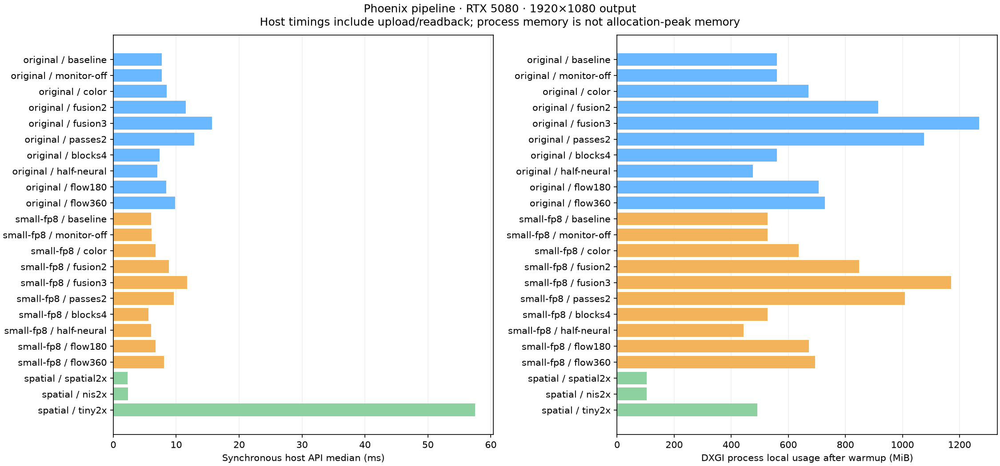
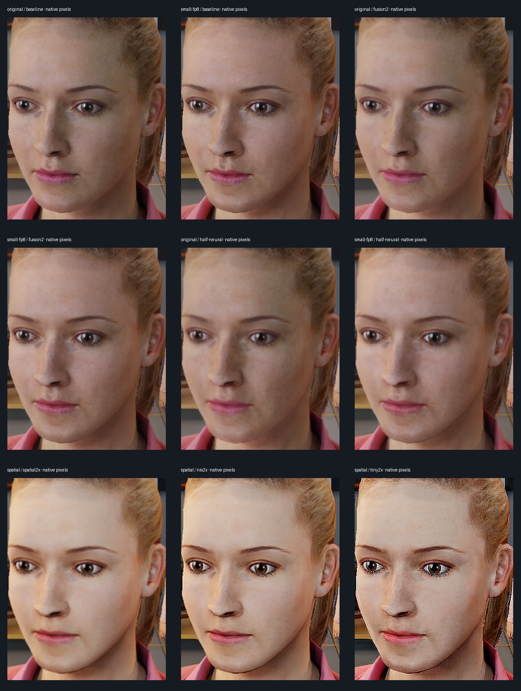

# Native pipeline measurements

RTX 5080, 1920×1080 output. Two fresh processes per recipe, at least six warmup calls and 24 measured calls per process. Fixed quality and full eight blocks unless the recipe explicitly changes them.

Times include host upload, synchronization and readback; they are not GPU-resident game FPS. GPU samples, when present, cover neural processing only and omit custom shader/flow/transfer costs. DXGI memory is process usage sampled after warmup, not an allocation peak. Static SDR character fixture, zero engine vectors except optical-flow cases. No game or desktop control.

| Model | Recipe | Host median ms | Host p95 ms | Process local MiB |
| --- | --- | ---: | ---: | ---: |
| original | baseline | 7.72 | 8.14 | 561 |
| original | monitor-off | 7.68 | 8.06 | 561 |
| original | color | 8.46 | 8.93 | 670 |
| original | fusion2 | 11.51 | 12.44 | 915 |
| original | fusion3 | 15.66 | 16.17 | 1269 |
| original | passes2 | 12.85 | 13.47 | 1076 |
| original | blocks4 | 7.38 | 7.71 | 561 |
| original | half-neural | 6.98 | 7.54 | 476 |
| original | flow180 | 8.42 | 8.93 | 706 |
| original | flow360 | 9.84 | 10.24 | 728 |
| small-fp8 | baseline | 6.01 | 6.49 | 527 |
| small-fp8 | monitor-off | 6.11 | 6.54 | 527 |
| small-fp8 | color | 6.72 | 7.29 | 637 |
| small-fp8 | fusion2 | 8.85 | 9.70 | 849 |
| small-fp8 | fusion3 | 11.70 | 12.62 | 1170 |
| small-fp8 | passes2 | 9.59 | 10.32 | 1008 |
| small-fp8 | blocks4 | 5.61 | 5.93 | 527 |
| small-fp8 | half-neural | 6.02 | 6.69 | 443 |
| small-fp8 | flow180 | 6.68 | 7.07 | 672 |
| small-fp8 | flow360 | 8.08 | 8.47 | 695 |
| spatial | spatial2x | 2.30 | 2.72 | 103 |
| spatial | nis2x | 2.31 | 2.81 | 103 |
| spatial | tiny2x | 57.54 | 57.91 | 491 |

Original/Lightweight, fusion and reduced neural resolution use the original 1920×1080 input. Spatial/NIS/Tiny explicitly receive a Lanczos 960×540 input and reconstruct to 1920×1080. The small checkpoint is not a replacement for the Phoenix neural renderer. Crops preserve native pixels; these subjective examples have no ground-truth target and do not establish improved accuracy.

In this example, fusion and half-size neural processing soften fine facial detail. The current Tiny port produces conspicuous texture/edge artifacts and is substantially slower than spatial/NIS scaling; its checkpoint and implementation remain experimental. Numerical agreement with its independent network oracle does not establish good image quality.

Source/model/runtime/checkpoint identities, repeatability and summary statistics are in [measurements.json](measurements.json). Complete local recipes and raw samples are kept in the player’s `artifacts/current/pipeline-measurements/measurements.json`; its hash is pinned in this public summary. The character source is reused from the existing rendered woman fixture, with source skin diffusion disabled.

The four-block recipe now stays on the established executor when initialized. Resubmitting identical tuning preserves that executor and its histories. Compared with the preceding general-chain build on the same fixture:

- original: 8.17 → 7.38 ms (9.6% lower host time), identical reset pixels.
- small-fp8: 6.38 → 5.61 ms (12.1% lower host time), identical reset pixels.

These are sequential microbenchmark runs with normal scheduling variation. Later structural live tuning changes can still rebuild through the general chain.
